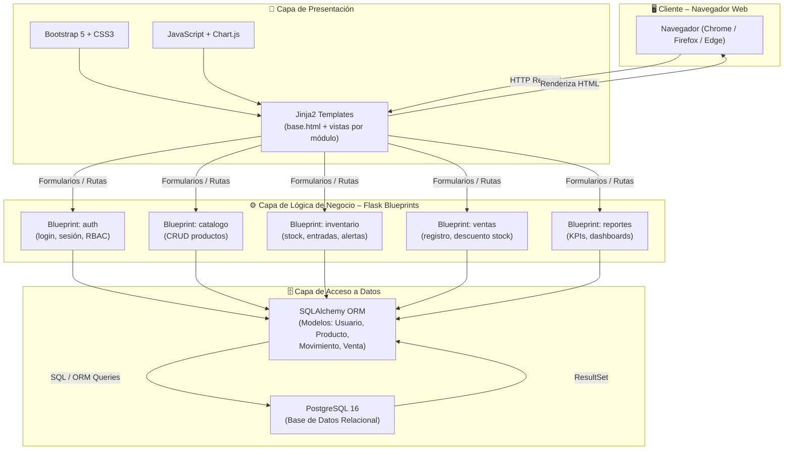
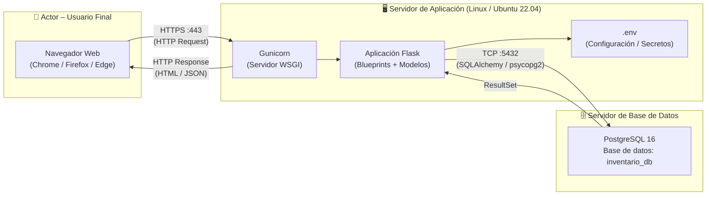

# Documento de Arquitectura del Sistema  
## Sistema de Gestión de Inventarios para Tienda Minorista

---

| Campo              | Detalle                                              |
|--------------------|------------------------------------------------------|
| **Proyecto**       | Sistema de Gestión de Inventarios – Tienda Minorista |
| **Metodología**    | Cascada (Waterfall)                                  |
| **Documento**      | Documento de Arquitectura del Sistema (DAS)          |
| **Versión**        | 1.0                                                  |
| **Fecha**          | 14/10/2026                                           |
| **Autor**          | Daniel Wilston Chura Monroy – Arquitecto / Diseñador de Sistemas |
| **Revisor**        | Angelo Jair Vega Figueroa – Jefe de Proyecto         |
| **Estado**         | Aprobado                                             |

---

## Historial de Versiones

| Versión | Fecha      | Autor                       | Descripción                     |
|---------|------------|-----------------------------|---------------------------------|
| 1.0     | 14/10/2026 | Daniel Wilston Chura Monroy | Versión inicial del documento   |

---

## Tabla de Contenidos

1. [Introducción](#1-introducción)
2. [Estilo y Patrones Arquitectónicos](#2-estilo-y-patrones-arquitectónicos)
3. [Descripción de Componentes por Capa](#3-descripción-de-componentes-por-capa)
4. [Diagrama de Arquitectura](#4-diagrama-de-arquitectura)
5. [Descripción Detallada de Módulos / Blueprints](#5-descripción-detallada-de-módulos--blueprints)
6. [Tecnologías y Dependencias](#6-tecnologías-y-dependencias)
7. [Diagrama de Despliegue](#7-diagrama-de-despliegue)
8. [Decisiones Arquitectónicas y Justificación](#8-decisiones-arquitectónicas-y-justificación)
9. [Restricciones y Supuestos](#9-restricciones-y-supuestos)
10. [Trazabilidad con Requisitos Funcionales del SRS](#10-trazabilidad-con-requisitos-funcionales-del-srs)

---

## 1. Introducción

### 1.1 Propósito del Documento

El presente Documento de Arquitectura del Sistema (DAS) describe la estructura técnica y las decisiones de diseño del **Sistema de Gestión de Inventarios para Tienda Minorista**, desarrollado bajo la metodología Cascada. Su objetivo es proporcionar una vista completa, coherente y formal de la arquitectura elegida, sirviendo de guía de referencia para el equipo de desarrollo, el equipo de pruebas y los revisores técnicos durante todas las fases del ciclo de vida del proyecto.

### 1.2 Alcance

El sistema cubre la gestión integral del inventario de una tienda minorista, incluyendo:

- Control de acceso y seguridad basado en roles (RBAC).
- Administración del catálogo de productos.
- Gestión de inventario y almacén (entradas, salidas, ajustes y alertas).
- Registro y procesamiento de ventas.
- Generación de reportes e indicadores de desempeño (KPIs).

El sistema está orientado a cuatro tipos de actores: **Administrador**, **Almacenero**, **Vendedor** y **Dueño**.

### 1.3 Definiciones y Acrónimos

| Término        | Definición                                                                 |
|----------------|----------------------------------------------------------------------------|
| DAS            | Documento de Arquitectura del Sistema                                      |
| SRS            | Especificación de Requisitos de Software                                   |
| RF             | Requisito Funcional                                                        |
| MVC            | Model-View-Controller (Modelo-Vista-Controlador)                           |
| RBAC           | Role-Based Access Control (Control de Acceso Basado en Roles)              |
| ORM            | Object-Relational Mapping (Mapeo Objeto-Relacional)                        |
| KPI            | Key Performance Indicator (Indicador Clave de Rendimiento)                 |
| Blueprint      | Módulo de organización de rutas y lógica en Flask                          |
| API            | Application Programming Interface                                          |

### 1.4 Referencias

| Documento                                    | Versión | Fecha      |
|----------------------------------------------|---------|------------|
| Especificación de Requisitos de Software (SRS) | 1.0   | 2026-10-07 |
| Plan de Proyecto – GSTI Lab03 Cascada        | 1.0     | 2026-10-01 |
| Flask Documentation                          | 3.x     | Oficial    |
| SQLAlchemy Documentation                     | 2.x     | Oficial    |
| PostgreSQL 16 Documentation                  | 16      | Oficial    |

---

## 2. Estilo y Patrones Arquitectónicos

### 2.1 Estilo General: Arquitectura en Capas (Layered Architecture)

El sistema adopta una **arquitectura en capas** de tres niveles claramente diferenciados, lo que permite separar responsabilidades, facilitar el mantenimiento y habilitar pruebas independientes por capa. Las capas son:

```
┌────────────────────────────────────────┐
│         CAPA DE PRESENTACIÓN           │
│   (Templates Jinja2 + HTML/Bootstrap)  │
├────────────────────────────────────────┤
│       CAPA DE LÓGICA DE NEGOCIO        │
│     (Flask Blueprints + Servicios)     │
├────────────────────────────────────────┤
│       CAPA DE ACCESO A DATOS           │
│      (SQLAlchemy ORM + PostgreSQL)     │
└────────────────────────────────────────┘
```

### 2.2 Patrón de Diseño: MVC (Model-View-Controller)

Dentro de la capa de lógica de negocio se aplica el patrón **MVC**, mapeado de la siguiente manera en el ecosistema Flask:

| Componente MVC | Equivalente en el Proyecto                               |
|----------------|----------------------------------------------------------|
| **Model**      | Clases SQLAlchemy (entidades: Producto, Venta, Usuario…) |
| **View**       | Templates Jinja2 (`.html` renderizados por Flask)        |
| **Controller** | Funciones de vista (routes) dentro de cada Blueprint     |

### 2.3 Patrón Complementario: Blueprints por Módulo

Flask Blueprints permiten organizar el código en módulos funcionales independientes (`auth`, `catalogo`, `inventario`, `ventas`, `reportes`), favoreciendo la **cohesión alta** y el **acoplamiento bajo** entre los subsistemas del proyecto.

### 2.4 Patrón de Seguridad: RBAC

El control de acceso se implementa mediante el patrón **Role-Based Access Control**, donde cada rol (Administrador, Almacenero, Vendedor, Dueño) tiene permisos definidos sobre las rutas y operaciones del sistema. Flask-Login gestiona las sesiones y decoradores personalizados restringen el acceso según el rol activo.

---

## 3. Descripción de Componentes por Capa

### 3.1 Capa de Presentación

La capa de presentación es la interfaz entre el usuario final y el sistema. Recibe las peticiones HTTP del navegador, renderiza las respuestas visuales y envía los datos de formularios al controlador correspondiente.

| Componente             | Descripción                                                                                     |
|------------------------|-------------------------------------------------------------------------------------------------|
| **Flask Jinja2 Templates** | Motor de plantillas integrado en Flask. Permite herencia de plantillas (`base.html`) y renderizado dinámico de datos del servidor. |
| **HTML5**              | Estructura semántica de todas las vistas del sistema.                                           |
| **CSS3 + Bootstrap 5** | Framework de estilos responsivo. Provee componentes UI (tablas, formularios, modales, alertas). |
| **JavaScript (básico)**| Validación de formularios en el cliente, interacciones dinámicas simples (modales, confirmaciones). |
| **Chart.js**           | Librería JavaScript para renderizar gráficos de barras, líneas y torta en el dashboard de KPIs. |

**Estructura de directorios de la capa de presentación:**

```
app/
├── templates/
│   ├── base.html              ← Plantilla base (navbar, footer, CSS/JS globales)
│   ├── auth/
│   │   └── login.html
│   ├── catalogo/
│   │   ├── lista.html
│   │   └── formulario.html
│   ├── inventario/
│   │   ├── stock.html
│   │   └── movimientos.html
│   ├── ventas/
│   │   ├── nueva_venta.html
│   │   └── historial.html
│   └── reportes/
│       └── dashboard.html
└── static/
    ├── css/
    ├── js/
    └── img/
```

### 3.2 Capa de Lógica de Negocio

Es el núcleo del sistema. Contiene las reglas de negocio, la orquestación de flujos y el enrutamiento HTTP. Se estructura en cinco **Flask Blueprints**, cada uno encapsulando un módulo funcional del sistema.

| Blueprint       | Prefijo de Ruta | Responsabilidad Principal                                       |
|-----------------|-----------------|------------------------------------------------------------------|
| `auth`          | `/auth`         | Autenticación, sesiones, control de acceso por rol (RBAC)       |
| `catalogo`      | `/catalogo`     | CRUD completo de productos y categorías                          |
| `inventario`    | `/inventario`   | Entradas, ajustes, alertas de stock mínimo, consulta en tiempo real |
| `ventas`        | `/ventas`       | Registro de ventas, descuento automático de stock, historial     |
| `reportes`      | `/reportes`     | Reportes de movimientos, ventas, dashboard de KPIs               |

**Estructura de directorios de la capa de lógica de negocio:**

```
app/
├── auth/
│   ├── __init__.py
│   ├── routes.py
│   ├── forms.py
│   └── services.py
├── catalogo/
│   ├── __init__.py
│   ├── routes.py
│   ├── forms.py
│   └── services.py
├── inventario/
│   ├── __init__.py
│   ├── routes.py
│   ├── forms.py
│   └── services.py
├── ventas/
│   ├── __init__.py
│   ├── routes.py
│   ├── forms.py
│   └── services.py
└── reportes/
    ├── __init__.py
    ├── routes.py
    └── services.py
```

### 3.3 Capa de Acceso a Datos

Gestiona toda la interacción con la base de datos relacional. Se apoya en **SQLAlchemy ORM** para abstraer las operaciones SQL y en **PostgreSQL 16** como motor de base de datos.

| Componente          | Descripción                                                                                  |
|---------------------|----------------------------------------------------------------------------------------------|
| **SQLAlchemy ORM**  | Mapeo objeto-relacional. Define los modelos (clases Python) que representan tablas en la BD. |
| **Flask-SQLAlchemy**| Integración oficial de SQLAlchemy con Flask. Gestiona el ciclo de vida de la sesión de BD.   |
| **PostgreSQL 16**   | Motor de base de datos relacional robusto. Almacena todos los datos del sistema.             |
| **Alembic / Flask-Migrate** | Gestión de migraciones de esquema de base de datos.                               |

**Modelos principales del sistema:**

```
app/
└── models/
    ├── usuario.py       ← Usuario, Rol
    ├── producto.py      ← Producto, Categoria
    ├── inventario.py    ← MovimientoInventario, Stock
    ├── venta.py         ← Venta, DetalleVenta
    └── reporte.py       ← (vistas/consultas auxiliares)
```

---

## 4. Diagrama de Arquitectura

El siguiente diagrama representa la arquitectura en capas del sistema y las relaciones entre sus componentes principales.



---

## 5. Descripción Detallada de Módulos / Blueprints

### 5.1 Blueprint `auth` – Seguridad y Acceso

**Prefijo de ruta:** `/auth`  
**Actores que lo usan:** Todos (Administrador, Almacenero, Vendedor, Dueño)

**Responsabilidades:**

| Funcionalidad         | Descripción                                                                                     |
|-----------------------|-------------------------------------------------------------------------------------------------|
| **Login**             | Autenticación de usuarios mediante credenciales (nombre de usuario + contraseña). Contraseñas almacenadas con hash `bcrypt`. |
| **Logout**            | Cierre seguro de sesión con invalidación del token de Flask-Login.                              |
| **Gestión de sesión** | Mantenimiento del estado de sesión activa con `Flask-Login` y `session` de Flask.               |
| **Control RBAC**      | Decoradores personalizados (`@requiere_rol`) que verifican el rol del usuario autenticado antes de permitir el acceso a rutas protegidas. |
| **Gestión de usuarios** | CRUD de cuentas de usuario (alta, baja, modificación de rol) — acceso exclusivo del Administrador. |

**Rutas principales:**

| Método | Ruta                | Descripción                  |
|--------|---------------------|------------------------------|
| GET/POST | `/auth/login`     | Formulario e inicio de sesión |
| GET    | `/auth/logout`      | Cierre de sesión              |
| GET/POST | `/auth/usuarios` | Listado y gestión de usuarios (solo Administrador) |

---

### 5.2 Blueprint `catalogo` – Catálogo de Productos

**Prefijo de ruta:** `/catalogo`  
**Actores que lo usan:** Administrador (gestión de catálogo), Almacenero y Vendedor (consulta/búsqueda)

**Responsabilidades:**

| Funcionalidad             | Descripción                                                                                  |
|---------------------------|----------------------------------------------------------------------------------------------|
| **Listado de productos**  | Visualización paginada de todos los productos con filtros por categoría y búsqueda por nombre/código. |
| **Alta de producto**      | Registro de nuevos productos con nombre, SKU, categoría, precio de costo, precio de venta y stock mínimo. |
| **Edición de producto**   | Modificación de atributos del producto existente.                                            |
| **Baja de producto**      | Desactivación lógica (soft delete) de productos sin historial de ventas o con historial.      |
| **Gestión de categorías** | CRUD de categorías para la clasificación de productos.                                       |

**Rutas principales:**

| Método   | Ruta                        | Descripción                 |
|----------|-----------------------------|-----------------------------|
| GET      | `/catalogo/`                | Listado de productos (con búsqueda) |
| GET/POST | `/catalogo/nuevo`           | Crear nuevo producto        |
| GET/POST | `/catalogo/<id>/editar`     | Editar producto existente   |
| POST     | `/catalogo/<id>/eliminar`   | Dar de baja producto        |
| GET      | `/catalogo/buscar`          | Búsqueda AJAX por código o nombre (JSON) |

---

### 5.3 Blueprint `inventario` – Inventario y Almacén

**Prefijo de ruta:** `/inventario`  
**Actores que lo usan:** Administrador, Almacenero

**Responsabilidades:**

| Funcionalidad                  | Descripción                                                                                        |
|--------------------------------|----------------------------------------------------------------------------------------------------|
| **Entradas de inventario**     | Registro de entradas de mercancía (compras, devoluciones de clientes). Actualiza el stock actual.   |
| **Ajustes de inventario**      | Corrección de stock por conteos físicos o mermas. Registra motivo y diferencia ajustada.            |
| **Consulta de stock en tiempo real** | Visualización del nivel actual de stock por producto, con indicadores visuales (normal / bajo / crítico). |
| **Alertas de stock mínimo**    | Generación automática de alertas cuando el stock de un producto cae por debajo del umbral configurado. |
| **Historial de movimientos**   | Registro completo y auditable de todas las entradas, salidas y ajustes por producto y fecha.        |

**Rutas principales:**

| Método   | Ruta                           | Descripción                      |
|----------|--------------------------------|----------------------------------|
| GET      | `/inventario/`                 | Dashboard de stock actual        |
| GET/POST | `/inventario/entrada/nueva`    | Registrar entrada de mercancía   |
| GET/POST | `/inventario/ajuste/nuevo`     | Registrar ajuste de inventario   |
| GET      | `/inventario/movimientos`      | Historial de movimientos         |
| GET      | `/inventario/alertas`          | Listado de alertas de stock bajo |
| GET      | `/inventario/stock/tiempo-real`| Stock actual en JSON (AJAX)      |

---

### 5.4 Blueprint `ventas` – Ventas

**Prefijo de ruta:** `/ventas`  
**Actores que lo usan:** Vendedor, Administrador

**Responsabilidades:**

| Funcionalidad               | Descripción                                                                                        |
|-----------------------------|----------------------------------------------------------------------------------------------------|
| **Registro de venta**       | Creación de una nueva venta seleccionando productos, cantidades y aplicando descuentos si corresponde. |
| **Descuento automático de stock** | Al confirmar una venta, el sistema descuenta automáticamente las unidades vendidas del stock en almacén. |
| **Historial de ventas**     | Consulta de ventas realizadas con filtros por fecha, vendedor y producto. Detalle por línea de venta. |

**Rutas principales:**

| Método   | Ruta                      | Descripción                    |
|----------|---------------------------|--------------------------------|
| GET      | `/ventas/`                | Historial de ventas            |
| GET/POST | `/ventas/nueva`           | Registrar nueva venta          |
| GET      | `/ventas/<id>`            | Detalle de una venta           |

---

### 5.5 Blueprint `reportes` – Reportes e Indicadores

**Prefijo de ruta:** `/reportes`  
**Actores que lo usan:** Administrador, Dueño

**Responsabilidades:**

| Funcionalidad                     | Descripción                                                                                       |
|-----------------------------------|---------------------------------------------------------------------------------------------------|
| **Reporte de movimientos**        | Informe de entradas, salidas y ajustes de inventario en un período seleccionado.                  |
| **Reporte de ventas**             | Informe de ventas por período, vendedor, producto o categoría con totales y promedios.             |
| **Dashboard de KPIs**             | Panel visual con gráficos (Chart.js): ventas por día/semana, productos más vendidos, nivel de stock, alertas activas. |
| **Exportación de reportes**       | Descarga de reportes en formato CSV.                                                              |

**Rutas principales:**

| Método | Ruta                          | Descripción                        |
|--------|-------------------------------|------------------------------------|
| GET    | `/reportes/dashboard`              | Dashboard principal de KPIs        |
| GET    | `/reportes/movimientos`            | Reporte de movimientos de inventario |
| GET    | `/reportes/ventas`                 | Reporte de ventas por período      |
| GET    | `/reportes/inventario-valorizado`  | Valorización del inventario actual |
| GET    | `/reportes/productos-bajo-minimo`  | Productos que cruzaron el umbral   |
| GET    | `/reportes/exportar/ventas`        | Exportar reporte de ventas (CSV)   |
| GET    | `/reportes/exportar/movimientos`   | Exportar reporte de movimientos (CSV) |

---

## 6. Tecnologías y Dependencias

La siguiente tabla consolida el stack tecnológico del sistema con las versiones recomendadas para el entorno de producción.

| Componente              | Tecnología           | Versión Recomendada | Rol en el Sistema                                           |
|-------------------------|----------------------|---------------------|-------------------------------------------------------------|
| **Framework Web**       | Flask                | 3.x (≥ 3.0)         | Núcleo del servidor web, enrutamiento y gestión de solicitudes HTTP |
| **ORM**                 | SQLAlchemy           | 2.x (≥ 2.0)         | Abstracción de la base de datos, definición de modelos y consultas |
| **Integración ORM-Flask** | Flask-SQLAlchemy   | 3.x                 | Integración de SQLAlchemy con el contexto de aplicación de Flask |
| **Migraciones de BD**   | Flask-Migrate / Alembic | 4.x             | Gestión de cambios en el esquema de la base de datos         |
| **Autenticación**       | Flask-Login          | 0.6.x               | Gestión de sesiones de usuario y decoradores de acceso       |
| **Formularios**         | Flask-WTF / WTForms  | 1.2.x               | Validación de formularios en servidor y protección CSRF      |
| **Hash de contraseñas** | Flask-Bcrypt         | 1.0.x               | Almacenamiento seguro de contraseñas con bcrypt              |
| **Motor de plantillas** | Jinja2               | 3.x (incluido con Flask) | Renderizado dinámico de vistas HTML                     |
| **Base de datos**       | PostgreSQL           | 16                  | Almacenamiento relacional persistente de todos los datos      |
| **Driver de BD**        | psycopg2-binary      | 2.9.x               | Conector Python ↔ PostgreSQL                                 |
| **Framework CSS**       | Bootstrap            | 5.3.x               | Estilos responsivos, componentes UI predefinidos             |
| **Gráficos (Dashboard)**| Chart.js             | 4.x                 | Visualización de KPIs y estadísticas en el navegador         |
| **Servidor WSGI**       | Gunicorn             | 21.x                | Servidor de producción WSGI para servir la aplicación Flask  |
| **Entorno virtual**     | Python venv / pip    | Python ≥ 3.11       | Gestión de dependencias del proyecto                         |
| **Variables de entorno**| python-dotenv        | 1.x                 | Carga de configuraciones sensibles desde archivo `.env`      |

---

## 7. Diagrama de Despliegue

El siguiente diagrama muestra la topología de despliegue del sistema en un entorno de producción.



> [!NOTE]
> Para el entorno de desarrollo local, Gunicorn puede ser reemplazado por el servidor integrado de Flask (`flask run`). En producción se recomienda además colocar un proxy inverso **Nginx** frente a Gunicorn para gestión de SSL y archivos estáticos.

---

## 8. Decisiones Arquitectónicas y Justificación

### 8.1 ¿Por qué Flask y no Django?

| Criterio               | Flask                                              | Django                                          |
|------------------------|----------------------------------------------------|-------------------------------------------------|
| **Curva de aprendizaje** | Baja. Ideal para equipos con experiencia intermedia en Python. | Media-alta. Requiere conocer el ecosistema ORM, admin, etc. |
| **Flexibilidad**       | Alta. Solo incluye lo necesario; el desarrollador elige las librerías. | Baja. Framework "batteries included", estructura rígida. |
| **Escala del proyecto** | Adecuado para sistemas medianos con módulos bien definidos. | Más apropiado para proyectos de gran escala y equipo amplio. |
| **Control**            | Total sobre el flujo de la aplicación.             | Parcialmente abstraído por convenciones del framework. |
| **Decisión**           | ✅ **Flask** elegido por su simplicidad, flexibilidad y adecuación al tamaño del proyecto. | ❌ Descartado por overhead innecesario. |

### 8.2 ¿Por qué PostgreSQL y no MySQL / SQLite?

| Criterio               | PostgreSQL 16                                      | MySQL 8                        | SQLite              |
|------------------------|----------------------------------------------------|--------------------------------|---------------------|
| **Integridad referencial** | Alta. Soporte completo de FK, constraints, transacciones ACID. | Alta, pero con limitaciones históricas. | Básica.         |
| **Consultas complejas** | Excelente. Soporte de window functions, CTEs, JSON. | Bueno.                         | Limitado.           |
| **Concurrencia**       | Alta. MVCC nativo.                                 | Buena.                         | Muy limitada.       |
| **Escalabilidad**      | Alta. Apto para crecimiento futuro del negocio.    | Media.                         | No apto para prod.  |
| **Licencia**           | Open source (PostgreSQL License).                  | GPL / Comercial.               | Open source.        |
| **Decisión**           | ✅ **PostgreSQL** elegido por su robustez, cumplimiento ACID y capacidades avanzadas. | ❌ Descartado. | ❌ Solo para dev local. |

### 8.3 ¿Por qué Arquitectura en Capas (MVC)?

La arquitectura en capas con el patrón MVC fue elegida por las siguientes razones:

1. **Separación de responsabilidades:** Cada capa tiene una única responsabilidad, lo que facilita la localización y corrección de errores.
2. **Mantenibilidad:** Los cambios en la interfaz de usuario no afectan la lógica de negocio ni la base de datos.
3. **Testeabilidad:** Cada capa puede probarse de forma independiente (tests unitarios para modelos, tests de integración para rutas).
4. **Familiaridad del equipo:** El patrón MVC es ampliamente conocido y documentado, reduciendo la curva de aprendizaje del equipo.
5. **Alineación con Flask Blueprints:** La arquitectura en módulos de Flask se alinea naturalmente con la organización por capas y el patrón MVC.

### 8.4 ¿Por qué Flask Blueprints?

Los Blueprints permiten modularizar la aplicación Flask de forma que cada módulo funcional del sistema (auth, catálogo, inventario, ventas, reportes) sea un componente independiente con sus propias rutas, formularios y lógica. Esto favorece:

- **Desarrollo paralelo:** Distintos miembros del equipo pueden trabajar en módulos diferentes sin conflictos.
- **Reutilización:** Un Blueprint puede reutilizarse o desactivarse sin afectar al resto del sistema.
- **Escalabilidad del código:** Facilita el crecimiento ordenado del sistema ante nuevos requisitos.

---

## 9. Restricciones y Supuestos

### 9.1 Restricciones Técnicas

| # | Restricción                                                                                     |
|---|--------------------------------------------------------------------------------------------------|
| R1 | El sistema es una **aplicación web** accesible exclusivamente mediante navegador. No se contempla API REST ni aplicación móvil en esta versión. |
| R2 | El sistema operará en un **único servidor** (no distribuido). La escalabilidad horizontal no es un requisito actual. |
| R3 | Todas las interfaces deben ser **responsivas** y funcionar en resoluciones de pantalla ≥ 1024px. |
| R4 | El lenguaje de implementación del backend es **Python 3.11 o superior**. |
| R5 | La base de datos debe ser **PostgreSQL 16**. No se admite cambio de motor de BD sin revisión arquitectónica. |
| R6 | El sistema debe cumplir con el **RBAC** definido en el SRS. Ningún usuario puede acceder a funcionalidades fuera de su rol. |

### 9.2 Supuestos

| # | Supuesto                                                                                         |
|---|--------------------------------------------------------------------------------------------------|
| S1 | La tienda minorista opera con **un único almacén**. La gestión multi-almacén no está contemplada en esta versión. |
| S2 | Los usuarios del sistema tienen **conocimientos básicos de informática** (uso de navegador web, formularios). |
| S3 | El servidor de despliegue tiene acceso a Internet para la instalación inicial de dependencias.   |
| S4 | Las contraseñas se almacenarán **hasheadas** (bcrypt). No se manejarán contraseñas en texto plano bajo ninguna circunstancia. |
| S5 | El sistema se desarrolla para uso **interno de la tienda**. No se contempla acceso público desde Internet sin VPN o firewall. |
| S6 | Los reportes de exportación se generarán en **CSV**. No se contempla integración con herramientas de BI externas en esta versión. |

---

## 10. Trazabilidad con Requisitos Funcionales del SRS

La siguiente tabla mapea cada módulo del sistema con los Requisitos Funcionales (RF) del SRS que implementa.

| Módulo / Blueprint | RF que Implementa                  | Descripción del RF                                                         |
|--------------------|------------------------------------|----------------------------------------------------------------------------|
| **auth**           | RF-01                              | El sistema debe permitir el inicio de sesión con credenciales (usuario y contraseña). |
| **auth**           | RF-02                              | El sistema debe controlar el acceso a funcionalidades según el rol del usuario (RBAC). |
| **catalogo**       | RF-03                              | El sistema debe permitir al Administrador registrar y editar productos (código, nombre, categoría, precio, stock inicial y mínimo). |
| **catalogo**       | RF-04                              | El sistema debe permitir a vendedores y almaceneros buscar productos por código o nombre en tiempo real. |
| **inventario**     | RF-05                              | El sistema debe permitir registrar entradas de mercadería, incrementando el stock disponible. |
| **inventario**     | RF-06                              | El sistema debe mostrar las existencias en tiempo real con su estado (disponible, bajo mínimo, agotado). |
| **inventario**     | RF-07                              | El sistema debe emitir alertas automáticas cuando el stock sea menor o igual al umbral mínimo. |
| **inventario**     | RF-08                              | El sistema debe permitir ajustes manuales de stock registrando obligatoriamente el motivo. |
| **ventas**         | RF-09                              | El sistema debe registrar ventas descontando de forma inmediata las unidades del stock disponible. |
| **ventas**         | RF-10                              | El sistema debe almacenar cada venta con fecha, hora, productos, cantidades, total y vendedor. |
| **reportes**       | RF-11                              | El sistema debe generar reportes de entradas, salidas y ajustes por rango de fechas. |
| **reportes**       | RF-12                              | El sistema debe generar reportes consolidados de ventas diarias, semanales y por producto. |
| **reportes**       | RF-13                              | El sistema debe mostrar un panel con tres indicadores: valor del inventario, productos bajo mínimo y ventas del día. |

> [!IMPORTANT]
> Todos los RF aprobados en el SRS (RF-01 a RF-13) tienen cobertura arquitectónica completa en al menos un módulo del sistema. Ningún RF queda sin módulo asignado.

> [!NOTE]
> La **gestión de cuentas de usuario** (alta, baja lógica y asignación de rol) descrita en el módulo `auth` es una función de soporte del Administrador que da servicio a RF-01 (autenticación) y RF-02 (control de roles); el SRS no define un RF independiente para ella.

---

*Fin del Documento de Arquitectura del Sistema — Versión 1.0*  
*Sistema de Gestión de Inventarios para Tienda Minorista — Equipo Cascada — GSTI 2026-B*
