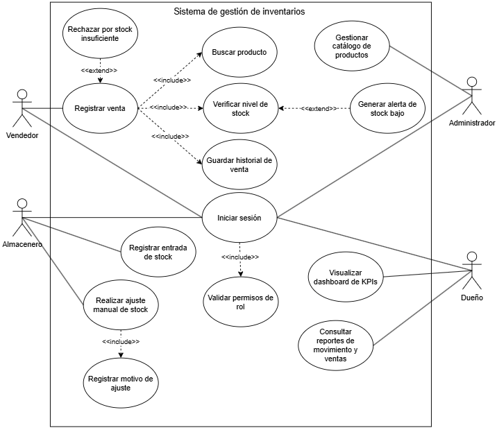

Especificación de Requisitos de Software (SRS) — Sistema de Gestión de Inventarios

**Proyecto:** Sistema de Gestión de Inventarios para Tienda Minorista 

**Metodología:** Cascada (Waterfall) — Fase 1: Requisitos 

**Autor / Analista de Requisitos:** Angelo Jair Vega Figueroa

**Revisor / Arquitecto de Sistemas:** Daniel Wilston Chura Monroy

**Estado:** En Progreso (Día 2)

---

## 1. Introducción y Alcance del Proyecto

### 1.1 Propósito y Objetivos del Sistema
El presente documento define la Especificación de Requisitos de Software (SRS) para el reemplazo del control manual de inventario por un sistema informático centralizado. 
El sistema buscar lo siguiente: 
- Automatizar el control de stock.
- Registrar ventas con descuento automático en tiempo real.
- Emitir alertas de reabastecimiento.
- Generar reportes para la toma de decisiones}.

### 1.2 Alcance del Proyecto (Límite de 12 días)
* **Dentro del Alcance:**
  - Autenticación y roles de usuario
  - Catálogo de productos
  - Entradas y ajustes de stock
  - Alertas de stock bajo
  - Registro de ventas con descuento automático
  - Reportes de movimiento y ventas
  - Dashboard básico con KPIs
  
* **Fuera del Alcance:**
  - Aplicación móvil nativa
  - Integración contable/financiera externa
  - Comercio electrónico
  - Gestión de clientes
  - Flujo complejo de solicitudes y aprobaciones
  - Notificaciones por SMS/email externos

---

## 2. Roles y Actores del Sistema

| Rol / Actor | Responsabilidad en el Sistema |
| :--- | :--- |
| **Administrador del Sistema** | Gestiona usuarios, asigna roles y mantiene el catálogo maestro de productos. |
| **Encargado de Almacén (Almacenero)** | Registra recepciones de mercadería, ajustes de stock por merma o conteo físico y atiende alertas. |
| **Vendedor** | Consulta productos disponibles y procesa ventas con descuento automático de stock. |
| **Dueño de la Tienda / Gerente** | Consulta reportes consolidados y monitorea el dashboard de indicadores (KPIs). |

---

---

## 3. Especificación de requisitos funcionales y no funcionales

*Nota: La especificación de requisitos y su mapeo con las historias de usuario se encuentra respaldada en este documento: https://docs.google.com/document/d/15p-paiSe8IJd8Q8R2E23NbWCgZG-GgkMTj_ijZ_tqwQ/edit?tab=t.0*

### 3.1 Requisitos funcionales (RF)

| ID | Nombre del requisito | Descripción detallada | Origen (HU) | Prioridad |
| :--- | :--- | :--- | :--- | :--- |
| **RF-01** | Autenticación de usuarios | El sistema debe permitir a los usuarios registrados iniciar sesión mediante nombre de usuario y contraseña cifrada. | HU-01 | Alta |
| **RF-02** | Control de acceso por roles | El sistema debe restringir el acceso a módulos y funciones según el rol asignado (administrador, almacenero, vendedor). | HU-02 | Alta |
| **RF-03** | Gestión de catálogo de productos | El sistema debe permitir al administrador registrar y editar productos con los datos: código, nombre, categoría, precio, stock inicial y stock mínimo. | HU-03 | Alta |
| **RF-04** | Búsqueda de productos | El sistema debe permitir a vendedores y almaceneros buscar productos por código o nombre en tiempo real. | HU-04 | Alta |
| **RF-05** | Registro de entradas de stock | El sistema debe permitir al almacenero registrar ingresos de mercadería, incrementando el stock disponible. | HU-05 | Alta |
| **RF-06** | Niveles de stock en tiempo real | El sistema debe mostrar las existencias en tiempo real indicando su estado: disponible, bajo mínimo o agotado. | HU-06 | Alta |
| **RF-07** | Alertas de stock bajo | El sistema debe emitir alertas automáticas en pantalla cuando el stock de un producto sea menor o igual al umbral mínimo. | HU-07 | Alta |
| **RF-08** | Ajuste manual de inventario | El sistema debe permitir realizar ajustes manuales de stock registrando obligatoriamente el motivo (merma, rotura, conteo físico). | HU-08 | Alta |
| **RF-09** | Registro de ventas con descuento directo | El sistema debe registrar ventas descontando de forma inmediata las unidades del stock disponible. | HU-09 | Alta |
| **RF-10** | Historial de transacciones de venta | El sistema debe almacenar el registro de cada venta con fecha, hora, productos, cantidades, total y vendedor. | HU-10 | Alta |
| **RF-11** | Reporte de movimientos de inventario | El sistema debe generar reportes de entradas, salidas y ajustes por rango de fechas. | HU-11 | Alta |
| **RF-12** | Reporte de ventas por período | El sistema debe generar reportes consolidados de ventas diarias, semanales y por producto. | HU-12 | Alta |
| **RF-13** | Panel de control con indicadores clave (KPIs) | El sistema debe mostrar una pantalla con tres indicadores: valor del inventario, productos bajo mínimo y ventas del día. | HU-13 | Media |

### 3.2 Requisitos no funcionales (RNF)

| ID | Categoría | Especificación del requisito | Criterio de verificación |
| :--- | :--- | :--- | :--- |
| **RNF-01** | Rendimiento | El tiempo de respuesta para búsquedas de catálogo y consultas de stock no debe exceder los 2 segundos. | Tiempo de respuesta < 2,0 segundos. |
| **RNF-02** | Seguridad e integridad | Las contraseñas deben almacenarse cifradas y las transacciones de ventas/stock deben ser atómicas. | Ninguna inconsistencia en inventario. |
| **RNF-03** | Usabilidad | La interfaz debe ser clara, requiriendo un máximo de 15 minutos de capacitación para el operador. | Capacitación efectiva ≤ 15 minutos. |

---

## 4. Dependencias de requisitos

Se establece la relación de precedencia técnica entre los requisitos funcionales para garantizar un desarrollo secuencial coherente en la fase de diseño e implementación:

| Requisito | Requisitos de los que depende | Justificación de la dependencia |
| :--- | :--- | :--- |
| **RF-02** (Control de acceso) | **RF-01** (Autenticación) | Se requiere identificar al usuario antes de validar sus permisos y rol. |
| **RF-04, RF-05, RF-08** (Operaciones de stock) | **RF-03** (Catálogo de productos) | No se pueden buscar, ingresar ni ajustar productos que no existan registrados en el catálogo. |
| **RF-06, RF-07** (Visualización y alertas) | **RF-03, RF-05, RF-08** | Las existencias y alertas dependen de las existencias iniciales e ingresos registrados. |
| **RF-09** (Registro de ventas) | **RF-03, RF-04, RF-06** | Para vender se debe buscar el producto en el catálogo y verificar la disponibilidad de existencias. |
| **RF-10** (Historial de ventas) | **RF-09** (Registro de ventas) | El historial se alimenta directamente de las transacciones de venta procesadas. |
| **RF-11, RF-12** (Reportes) | **RF-05, RF-08, RF-09, RF-10** | Los reportes consolidan la información generada por los movimientos de stock y ventas realizadas. |
| **RF-13** (Panel de control - KPIs) | **RF-06, RF-07, RF-09, RF-12** | Los indicadores calculan métricas basadas en las existencias, alertas activas y ventas del día. |

---

## 5. Especificación de casos de uso

### 5.0. Diagrama general de casos de uso (UML)

*Figura 5.1: Diagrama de casos de uso del sistema de gestión de inventarios, representando las interacciones de los cuatro actores principales (Vendedor, Almacenero, Administrador y Dueño) junto con sus relaciones de inclusión (`<<include>>`) y extensión (`<<extend>>`).*

---

### 5.1. CU-01: Registrar venta de productos

| Campo | Detalle |
| :--- | :--- |
| **Identificador** | CU-01 |
| **Nombre** | Registrar venta de productos |
| **Actores** | Vendedor |
| **Requisitos asociados** | RF-04, RF-06, RF-09, RF-10 |
| **Precondiciones** | 1. El vendedor ha iniciado sesión correctamente en el sistema (RF-01). 2. Existen productos registrados en el catálogo con existencias disponibles. |
| **Postcondiciones** | 1. La transacción de venta queda registrada con fecha, hora, productos, cantidades y vendedor. 2. El stock disponible de los productos vendidos se descuenta automáticamente de forma inmediata. |
| **Flujo principal** | 1. El vendedor ingresa al módulo de ventas. 2. Busca el producto por código o nombre mediante la función incluida `Buscar producto` (RF-04). 3. El sistema muestra los datos del producto, precio y existencias disponibles mediante `Verificar nivel de stock` (RF-06). 4. El vendedor ingresa la cantidad a vender y agrega el producto a la transacción. 5. El vendedor repite los pasos 2 a 4 para cada producto solicitado por el cliente. 6. El sistema calcula el total acumulado de la venta. 7. El vendedor confirma la transacción. 8. El sistema procesa la venta y ejecuta `Guardar historial de venta` (RF-10). |
| **Flujos alternativos** | **Stock insuficiente:** Si la cantidad requerida es mayor al stock disponible, el sistema bloquea la adición y emite una advertencia. **Alerta de stock bajo:** Si tras la verificación el stock es menor o igual al umbral mínimo, se emite una notificación en pantalla (RF-07). **Cancelación de la venta:** El vendedor puede cancelar la operación antes de confirmarla sin afectar el inventario. |

---

### 5.2. CU-02: Registrar entrada y ajuste de stock

| Campo | Detalle |
| :--- | :--- |
| **Identificador** | CU-02 |
| **Nombre** | Registrar entrada y ajuste de stock |
| **Actores** | Almacenero |
| **Requisitos asociados** | RF-05, RF-06, RF-07, RF-08 |
| **Precondiciones** | 1. El almacenero ha iniciado sesión con el rol correspondiente (RF-02). 2. El producto a ingresar o ajustar existe registrado en el catálogo. |
| **Postcondiciones** | 1. Se actualiza el stock disponible del producto. 2. Se guarda la transacción de movimiento de inventario indicando tipo, cantidad, motivo y responsable. |
| **Flujo principal** | 1. El almacenero ingresa al módulo de control de inventario. 2. Selecciona el producto del catálogo. 3. Selecciona el tipo de operación: "Entrada de stock" o "Ajuste manual". 4. Ingresa la cantidad de unidades. 5. En caso de ajuste manual, el sistema ejecuta `Registrar motivo de ajuste` obligando a seleccionar la causa (merma, rotura o conteo físico) (RF-08). 6. El almacenero confirma el registro. 7. El sistema actualiza el inventario y recalcula los niveles de stock en tiempo real. |
| **Flujos alternativos** | **Omisión del motivo de ajuste:** Si el almacenero no selecciona una justificación en un ajuste manual, el sistema impide guardar la operación hasta completar el campo. |

---

### 5.3. CU-03: Gestionar catálogo de productos

| Campo | Detalle |
| :--- | :--- |
| **Identificador** | CU-03 |
| **Nombre** | Gestionar catálogo de productos |
| **Actores** | Administrador |
| **Requisitos asociados** | RF-01, RF-02, RF-03 |
| **Precondiciones** | 1. El usuario se ha autenticado con credenciales de administrador. |
| **Postcondiciones** | 1. El producto queda guardado, modificado o actualizado en la base de datos del catálogo. |
| **Flujo principal** | 1. El administrador ingresa a la sección de catálogo de productos. 2. Selecciona la opción "Nuevo producto" o "Editar producto". 3. Ingresa los datos obligatorios: código, nombre, categoría, precio, stock inicial y stock mínimo. 4. El sistema valida los formatos numéricos y verifica la no duplicidad del código. 5. El administrador confirma la operación. 6. El sistema guarda la información y actualiza el catálogo visible. |
| **Flujos alternativos** | **Código duplicado:** El sistema rechaza la creación si el código ingresado ya pertenece a otro producto activo. **Datos inválidos:** Se resaltan en rojo los campos obligatorios incompletos o con valores negativos. |

---

### 5.4. CU-04: Consultar reportes e indicadores

| Campo | Detalle |
| :--- | :--- |
| **Identificador** | CU-04 |
| **Nombre** | Consultar reportes e indicadores |
| **Actores** | Dueño |
| **Requisitos asociados** | RF-11, RF-12, RF-13 |
| **Precondiciones** | 1. El dueño ha iniciado sesión con el rol correspondiente. 2. Existen transacciones de venta e inventario registradas en el sistema. |
| **Postcondiciones** | 1. El sistema despliega las métricas consolidadas o reportes en pantalla sin modificar los datos del sistema. |
| **Flujo principal** | 1. El dueño ingresa al módulo de reportes o panel principal (dashboard). 2. Selecciona el tipo de consulta: reportes de movimientos, reportes de ventas o vista de indicadores clave (KPIs). 3. Aplica los filtros deseados (rango de fechas o categoría de producto). 4. El sistema calcula las métricas (valor del inventario, productos bajo mínimo y ventas del día) y genera la vista consolidada. |
| **Flujos alternativos** | **Sin datos en el período:** Si no existen registros para las fechas seleccionadas, el sistema muestra el reporte en cero con el mensaje de aviso correspondiente. |
