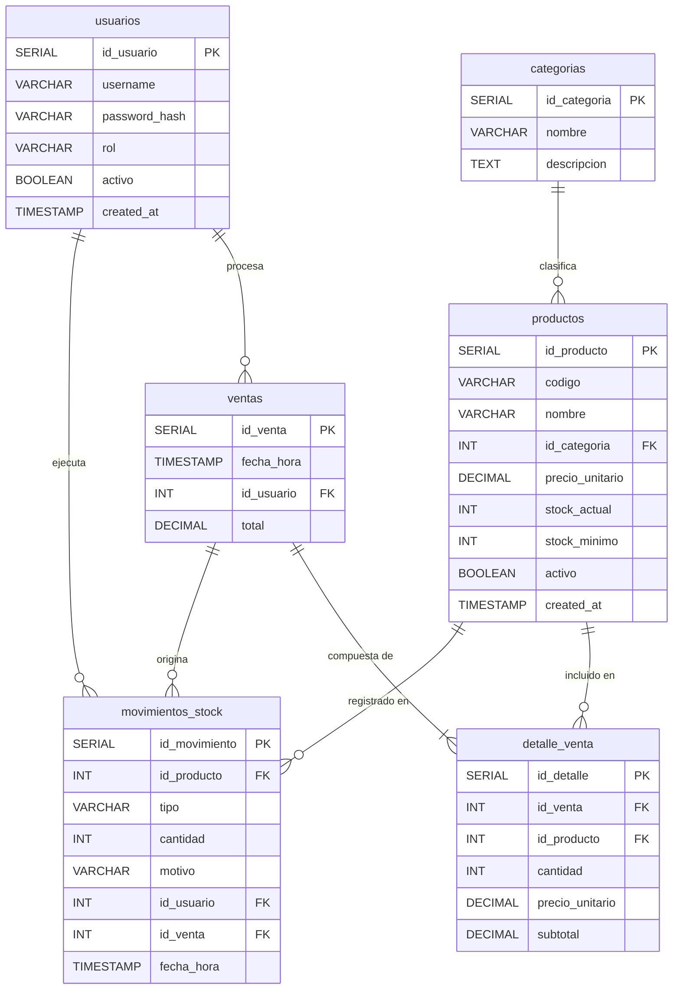

# Modelo de Datos — Sistema de Gestión de Inventarios

---

| | |
|---|---|
| **Proyecto** | Sistema de Gestión de Inventarios |
| **Documento** | Modelo de Datos |
| **Versión** | 1.0 |
| **Autor** | Daniel Wilston Chura Monroy |
| **Rol** | Arquitecto / Diseñador de Sistemas |
| **Fecha** | 14/10/2026 |
| **Stack** | Python (Flask) + PostgreSQL |
| **Estado** | Aprobado |

---

## Tabla de Contenidos

1. [Propósito](#1-propósito)
2. [Diagrama Entidad-Relación](#2-diagrama-entidad-relación)
3. [Diccionario de Datos](#3-diccionario-de-datos)
4. [Relaciones entre Entidades](#4-relaciones-entre-entidades)
5. [Reglas de Integridad Referencial](#5-reglas-de-integridad-referencial)
6. [Script DDL PostgreSQL](#6-script-ddl-postgresql)
7. [Trazabilidad Modelo ↔ Requisitos Funcionales](#7-trazabilidad-modelo--requisitos-funcionales)

---

## 1. Propósito

Este documento define el **Modelo de Datos** del Sistema de Gestión de Inventarios, especificando la estructura lógica y física de la base de datos relacional que sustenta todas las operaciones del sistema.

El modelo cubre los siguientes dominios funcionales:

- **Autenticación y control de acceso** — gestión de usuarios y roles (RF-01, RF-02).
- **Catálogo de productos** — organización por categorías y atributos de stock (RF-03).
- **Gestión de movimientos de stock** — entradas, ajustes positivos/negativos y salidas por venta (RF-05, RF-08).
- **Registro de ventas** — cabecera y detalle de cada transacción comercial (RF-09).
- **Auditoría e historial** — trazabilidad de cada operación con usuario y marca temporal (RF-10, RF-11).
- **Base para reportes** — estructura que habilita la generación de informes de stock y ventas (RF-11, RF-12, RF-13).

### Actores del sistema

| Actor | Descripción |
|---|---|
| **Administrador** | Gestiona usuarios, categorías, productos y configuración general |
| **Almacenero** | Registra entradas de mercancía y ajustes de stock |
| **Vendedor** | Procesa ventas y consulta disponibilidad de productos |
| **Dueño** | Accede a reportes gerenciales y visión global del negocio |

---

## 2. Diagrama Entidad-Relación



---

## 3. Diccionario de Datos

### 3.1 Entidad: `usuarios`

> [!NOTE]
> Almacena las credenciales y el rol de cada usuario del sistema. La contraseña **nunca** se almacena en texto plano; se utiliza un hash bcrypt de mínimo 12 rondas (RF-01).

| Campo | Tipo | Nulable | PK / FK | Descripción | Restricciones |
|---|---|---|---|---|---|
| `id_usuario` | `SERIAL` | No | **PK** | Identificador único autoincremental del usuario | Generado automáticamente |
| `username` | `VARCHAR(50)` | No | — | Nombre de usuario para inicio de sesión | `UNIQUE`, `NOT NULL` |
| `password_hash` | `VARCHAR(255)` | No | — | Hash bcrypt de la contraseña | `NOT NULL`, mínimo 60 caracteres |
| `rol` | `VARCHAR(20)` | No | — | Rol asignado al usuario en el sistema | `CHECK (rol IN ('administrador','almacenero','vendedor','dueño'))`, `NOT NULL` |
| `activo` | `BOOLEAN` | No | — | Indica si la cuenta está habilitada | `DEFAULT TRUE`, `NOT NULL` |
| `created_at` | `TIMESTAMP` | No | — | Fecha y hora de creación del registro | `DEFAULT CURRENT_TIMESTAMP`, `NOT NULL` |

---

### 3.2 Entidad: `categorias`

> [!NOTE]
> Agrupa los productos en familias lógicas para facilitar la navegación del catálogo y la generación de reportes por categoría (RF-03, RF-12).

| Campo | Tipo | Nulable | PK / FK | Descripción | Restricciones |
|---|---|---|---|---|---|
| `id_categoria` | `SERIAL` | No | **PK** | Identificador único autoincremental de la categoría | Generado automáticamente |
| `nombre` | `VARCHAR(100)` | No | — | Nombre descriptivo de la categoría | `UNIQUE`, `NOT NULL` |
| `descripcion` | `TEXT` | Sí | — | Descripción ampliada del tipo de productos que agrupa | Sin restricción adicional |

---

### 3.3 Entidad: `productos`

> [!NOTE]
> Núcleo del catálogo. Cada producto posee un código único de referencia, precio unitario vigente, niveles de stock actual y mínimo (umbral de alerta) (RF-03, RF-05).

| Campo | Tipo | Nulable | PK / FK | Descripción | Restricciones |
|---|---|---|---|---|---|
| `id_producto` | `SERIAL` | No | **PK** | Identificador único autoincremental del producto | Generado automáticamente |
| `codigo` | `VARCHAR(50)` | No | — | Código interno o SKU del producto | `UNIQUE`, `NOT NULL` |
| `nombre` | `VARCHAR(200)` | No | — | Nombre comercial del producto | `NOT NULL` |
| `id_categoria` | `INTEGER` | No | **FK** → `categorias` | Categoría a la que pertenece el producto | `NOT NULL`, `ON DELETE RESTRICT` |
| `precio_unitario` | `DECIMAL(10,2)` | No | — | Precio de venta unitario vigente | `NOT NULL`, `CHECK (precio_unitario >= 0)` |
| `stock_actual` | `INTEGER` | No | — | Cantidad de unidades disponibles en almacén | `NOT NULL`, `DEFAULT 0`, `CHECK (stock_actual >= 0)` |
| `stock_minimo` | `INTEGER` | No | — | Umbral mínimo; al alcanzarlo se genera alerta de reposición | `NOT NULL`, `DEFAULT 0`, `CHECK (stock_minimo >= 0)` |
| `activo` | `BOOLEAN` | No | — | Permite deshabilitar productos sin eliminarlos | `DEFAULT TRUE`, `NOT NULL` |
| `created_at` | `TIMESTAMP` | No | — | Fecha y hora de registro del producto | `DEFAULT CURRENT_TIMESTAMP`, `NOT NULL` |

---

### 3.4 Entidad: `movimientos_stock`

> [!NOTE]
> Bitácora de todas las variaciones de stock. Cada registro es **inmutable** una vez creado para garantizar la auditoría completa del historial (RF-05, RF-08, RF-11).

| Campo | Tipo | Nulable | PK / FK | Descripción | Restricciones |
|---|---|---|---|---|---|
| `id_movimiento` | `SERIAL` | No | **PK** | Identificador único autoincremental del movimiento | Generado automáticamente |
| `id_producto` | `INTEGER` | No | **FK** → `productos` | Producto afectado por el movimiento | `NOT NULL`, `ON DELETE RESTRICT` |
| `tipo` | `VARCHAR(20)` | No | — | Clasificación del movimiento de stock | `CHECK (tipo IN ('entrada','ajuste_positivo','ajuste_negativo','salida_venta'))`, `NOT NULL` |
| `cantidad` | `INTEGER` | No | — | Número de unidades involucradas en el movimiento | `NOT NULL`, `CHECK (cantidad > 0)` |
| `motivo` | `VARCHAR(255)` | Sí | — | Justificación o descripción del movimiento | Sin restricción adicional |
| `id_usuario` | `INTEGER` | No | **FK** → `usuarios` | Usuario que ejecutó el movimiento | `NOT NULL`, `ON DELETE RESTRICT` |
| `id_venta` | `INTEGER` | Sí | **FK** → `ventas` | Venta que originó el movimiento (solo `salida_venta`) | `NULL`, `ON DELETE SET NULL` |
| `fecha_hora` | `TIMESTAMP` | No | — | Fecha y hora exacta del movimiento | `DEFAULT CURRENT_TIMESTAMP`, `NOT NULL` |

---

### 3.5 Entidad: `ventas`

> [!NOTE]
> Cabecera de cada transacción de venta. Vincula la venta con el vendedor que la procesó y consolida el total del comprobante (RF-09).

| Campo | Tipo | Nulable | PK / FK | Descripción | Restricciones |
|---|---|---|---|---|---|
| `id_venta` | `SERIAL` | No | **PK** | Identificador único autoincremental de la venta | Generado automáticamente |
| `fecha_hora` | `TIMESTAMP` | No | — | Fecha y hora de realización de la venta | `DEFAULT CURRENT_TIMESTAMP`, `NOT NULL` |
| `id_usuario` | `INTEGER` | No | **FK** → `usuarios` | Vendedor que registró la venta | `NOT NULL`, `ON DELETE RESTRICT` |
| `total` | `DECIMAL(12,2)` | No | — | Suma total de todos los ítems de la venta | `NOT NULL`, `CHECK (total >= 0)` |

---

### 3.6 Entidad: `detalle_venta`

> [!NOTE]
> Línea de detalle de cada venta. El `precio_unitario` se persiste en el momento de la venta para conservar el historial de precios aunque el producto cambie su precio futuro (RF-09, RF-10, RF-12).

| Campo | Tipo | Nulable | PK / FK | Descripción | Restricciones |
|---|---|---|---|---|---|
| `id_detalle` | `SERIAL` | No | **PK** | Identificador único autoincremental del ítem | Generado automáticamente |
| `id_venta` | `INTEGER` | No | **FK** → `ventas` | Venta a la que pertenece este ítem | `NOT NULL`, `ON DELETE CASCADE` |
| `id_producto` | `INTEGER` | No | **FK** → `productos` | Producto vendido | `NOT NULL`, `ON DELETE RESTRICT` |
| `cantidad` | `INTEGER` | No | — | Cantidad de unidades del producto vendido | `NOT NULL`, `CHECK (cantidad > 0)` |
| `precio_unitario` | `DECIMAL(10,2)` | No | — | Precio vigente al momento de la venta (snapshot) | `NOT NULL`, `CHECK (precio_unitario >= 0)` |
| `subtotal` | `DECIMAL(12,2)` | No | — | Resultado de `cantidad × precio_unitario` | `NOT NULL`, `CHECK (subtotal >= 0)` |

---

## 4. Relaciones entre Entidades

| # | Entidad Origen | Entidad Destino | Cardinalidad | Descripción |
|---|---|---|---|---|
| R-01 | `categorias` | `productos` | Uno a Muchos (1:N) | Una categoría agrupa cero o más productos; cada producto pertenece a exactamente una categoría |
| R-02 | `usuarios` | `movimientos_stock` | Uno a Muchos (1:N) | Un usuario ejecuta cero o más movimientos de stock; cada movimiento es ejecutado por exactamente un usuario |
| R-03 | `usuarios` | `ventas` | Uno a Muchos (1:N) | Un usuario procesa cero o más ventas; cada venta es procesada por exactamente un usuario |
| R-04 | `productos` | `movimientos_stock` | Uno a Muchos (1:N) | Un producto aparece en cero o más movimientos; cada movimiento afecta a exactamente un producto |
| R-05 | `ventas` | `detalle_venta` | Uno a Muchos (1:N) — obligatorio | Una venta se compone de uno o más ítems de detalle; cada ítem pertenece a exactamente una venta |
| R-06 | `productos` | `detalle_venta` | Uno a Muchos (1:N) | Un producto puede aparecer en cero o más ítems de detalle; cada ítem referencia a exactamente un producto |

---

## 5. Reglas de Integridad Referencial

Las siguientes reglas de integridad referencial (RI) complementan las reglas de negocio del SRS (RN-01 a RN-04) y garantizan la consistencia interna de la base de datos:

### RI-01 — Integridad de usuarios

> [!IMPORTANT]
> No se puede eliminar un usuario que posea movimientos de stock o ventas registradas. Se debe **desactivar** la cuenta (`activo = FALSE`) en su lugar.

| Regla | Detalle |
|---|---|
| **RI-01.1** | `ON DELETE RESTRICT` en `movimientos_stock.id_usuario` → `usuarios.id_usuario` |
| **RI-01.2** | `ON DELETE RESTRICT` en `ventas.id_usuario` → `usuarios.id_usuario` |
| **RI-01.3** | Un usuario con `activo = FALSE` no puede iniciar sesión ni ejecutar operaciones |

---

### RI-02 — Integridad de productos y categorías

> [!IMPORTANT]
> No se puede eliminar una categoría si tiene productos asociados, ni un producto si tiene movimientos o detalles de venta registrados. Se debe **desactivar** (`activo = FALSE`).

| Regla | Detalle |
|---|---|
| **RI-02.1** | `ON DELETE RESTRICT` en `productos.id_categoria` → `categorias.id_categoria` |
| **RI-02.2** | `ON DELETE RESTRICT` en `movimientos_stock.id_producto` → `productos.id_producto` |
| **RI-02.3** | `ON DELETE RESTRICT` en `detalle_venta.id_producto` → `productos.id_producto` |
| **RI-02.4** | El campo `stock_actual` no puede ser negativo en ningún momento (`CHECK stock_actual >= 0`) |

---

### RI-03 — Integridad de ventas y detalle

> [!IMPORTANT]
> Un detalle de venta es inseparable de su venta cabecera. Si la venta se elimina (operación administrativa excepcional), sus detalles se eliminan en cascada.

| Regla | Detalle |
|---|---|
| **RI-03.1** | `ON DELETE CASCADE` en `detalle_venta.id_venta` → `ventas.id_venta` |
| **RI-03.2** | Toda venta debe tener al menos un registro en `detalle_venta` (validado en capa de aplicación) |
| **RI-03.3** | El `total` de `ventas` debe ser igual a la suma de `subtotal` de sus `detalle_venta` (validado en capa de aplicación mediante transacción) |

---

### RI-04 — Integridad de movimientos de stock

> [!IMPORTANT]
> Los movimientos son **registros de auditoría inmutables**. No se permite `UPDATE` ni `DELETE` sobre `movimientos_stock` desde la aplicación. El stock se corrige únicamente registrando nuevos movimientos de ajuste.

| Regla | Detalle |
|---|---|
| **RI-04.1** | Ningún `UPDATE` ni `DELETE` está permitido sobre `movimientos_stock` (forzado por permisos de rol de base de datos) |
| **RI-04.2** | Toda salida de venta (`tipo = 'salida_venta'`) debe estar vinculada a un `id_venta` válido (validado en capa de aplicación) |
| **RI-04.3** | El campo `cantidad` siempre es positivo; el signo del efecto sobre el stock lo determina el campo `tipo` |

---

## 6. Script DDL PostgreSQL

> [!TIP]
> Ejecutar como usuario con privilegios `CREATE` en la base de datos objetivo. Se recomienda ejecutar dentro de una transacción (`BEGIN` / `COMMIT`) para poder revertir ante errores.

```sql
-- ============================================================
-- SISTEMA DE GESTIÓN DE INVENTARIOS
-- Script DDL — Creación de tablas y objetos de base de datos
-- Base de datos: PostgreSQL 16
-- Autor: Daniel Wilston Chura Monroy
-- Fecha: 14/10/2026
-- Versión: 1.0
-- ============================================================

BEGIN;

-- ------------------------------------------------------------
-- TIPOS ENUMERADOS
-- ------------------------------------------------------------

-- Roles de usuario
DO $$
BEGIN
    IF NOT EXISTS (SELECT 1 FROM pg_type WHERE typname = 'tipo_rol') THEN
        CREATE TYPE tipo_rol AS ENUM (
            'administrador',
            'almacenero',
            'vendedor',
            'dueño'
        );
    END IF;
END$$;

-- Tipos de movimiento de stock
DO $$
BEGIN
    IF NOT EXISTS (SELECT 1 FROM pg_type WHERE typname = 'tipo_movimiento') THEN
        CREATE TYPE tipo_movimiento AS ENUM (
            'entrada',
            'ajuste_positivo',
            'ajuste_negativo',
            'salida_venta'
        );
    END IF;
END$$;

-- ------------------------------------------------------------
-- TABLA: usuarios
-- RF-01 Autenticación, RF-02 Control de roles
-- ------------------------------------------------------------

CREATE TABLE IF NOT EXISTS usuarios (
    id_usuario      SERIAL          PRIMARY KEY,
    username        VARCHAR(50)     NOT NULL UNIQUE,
    password_hash   VARCHAR(255)    NOT NULL,
    rol             tipo_rol        NOT NULL,
    activo          BOOLEAN         NOT NULL DEFAULT TRUE,
    created_at      TIMESTAMP       NOT NULL DEFAULT CURRENT_TIMESTAMP
);

COMMENT ON TABLE  usuarios              IS 'Usuarios del sistema con sus credenciales y rol asignado.';
COMMENT ON COLUMN usuarios.id_usuario   IS 'Identificador único autoincremental del usuario.';
COMMENT ON COLUMN usuarios.username     IS 'Nombre de usuario único para inicio de sesión.';
COMMENT ON COLUMN usuarios.password_hash IS 'Hash bcrypt (≥12 rondas) de la contraseña.';
COMMENT ON COLUMN usuarios.rol          IS 'Rol del usuario: administrador, almacenero, vendedor, dueño.';
COMMENT ON COLUMN usuarios.activo       IS 'TRUE = cuenta habilitada; FALSE = cuenta suspendida.';
COMMENT ON COLUMN usuarios.created_at   IS 'Fecha y hora de creación del registro.';

-- Índice para búsqueda rápida por nombre de usuario (login)
CREATE INDEX IF NOT EXISTS idx_usuarios_username ON usuarios (username);

-- ------------------------------------------------------------
-- TABLA: categorias
-- RF-03 Catálogo de productos
-- ------------------------------------------------------------

CREATE TABLE IF NOT EXISTS categorias (
    id_categoria    SERIAL          PRIMARY KEY,
    nombre          VARCHAR(100)    NOT NULL UNIQUE,
    descripcion     TEXT
);

COMMENT ON TABLE  categorias                IS 'Categorías que agrupan los productos del catálogo.';
COMMENT ON COLUMN categorias.id_categoria   IS 'Identificador único autoincremental de la categoría.';
COMMENT ON COLUMN categorias.nombre         IS 'Nombre único de la categoría.';
COMMENT ON COLUMN categorias.descripcion    IS 'Descripción ampliada del tipo de productos que agrupa.';

-- Índice para búsqueda por nombre de categoría
CREATE INDEX IF NOT EXISTS idx_categorias_nombre ON categorias (nombre);

-- ------------------------------------------------------------
-- TABLA: productos
-- RF-03 Catálogo, RF-05 Entradas stock
-- ------------------------------------------------------------

CREATE TABLE IF NOT EXISTS productos (
    id_producto     SERIAL          PRIMARY KEY,
    codigo          VARCHAR(50)     NOT NULL UNIQUE,
    nombre          VARCHAR(200)    NOT NULL,
    id_categoria    INTEGER         NOT NULL
                        REFERENCES categorias (id_categoria)
                        ON UPDATE CASCADE
                        ON DELETE RESTRICT,
    precio_unitario DECIMAL(10,2)   NOT NULL
                        CONSTRAINT chk_precio_positivo CHECK (precio_unitario >= 0),
    stock_actual    INTEGER         NOT NULL DEFAULT 0
                        CONSTRAINT chk_stock_actual_positivo CHECK (stock_actual >= 0),
    stock_minimo    INTEGER         NOT NULL DEFAULT 0
                        CONSTRAINT chk_stock_minimo_positivo CHECK (stock_minimo >= 0),
    activo          BOOLEAN         NOT NULL DEFAULT TRUE,
    created_at      TIMESTAMP       NOT NULL DEFAULT CURRENT_TIMESTAMP
);

COMMENT ON TABLE  productos                 IS 'Catálogo maestro de productos gestionados en inventario.';
COMMENT ON COLUMN productos.id_producto     IS 'Identificador único autoincremental del producto.';
COMMENT ON COLUMN productos.codigo          IS 'Código interno (SKU) único del producto.';
COMMENT ON COLUMN productos.nombre          IS 'Nombre comercial del producto.';
COMMENT ON COLUMN productos.id_categoria    IS 'FK hacia categorias. Categoría a la que pertenece el producto.';
COMMENT ON COLUMN productos.precio_unitario IS 'Precio de venta unitario vigente. Mínimo: 0.';
COMMENT ON COLUMN productos.stock_actual    IS 'Unidades disponibles en almacén. Se actualiza por triggers o procedimiento.';
COMMENT ON COLUMN productos.stock_minimo    IS 'Umbral mínimo de stock; genera alerta de reposición al alcanzarlo.';
COMMENT ON COLUMN productos.activo          IS 'TRUE = producto vigente; FALSE = producto dado de baja lógica.';
COMMENT ON COLUMN productos.created_at      IS 'Fecha y hora de registro del producto en el sistema.';

-- Índice por código de producto (búsquedas frecuentes en ventas y movimientos)
CREATE INDEX IF NOT EXISTS idx_productos_codigo       ON productos (codigo);
-- Índice por categoría para filtros y reportes
CREATE INDEX IF NOT EXISTS idx_productos_id_categoria ON productos (id_categoria);
-- Índice parcial: productos activos con stock por debajo del mínimo (reportes de alerta)
CREATE INDEX IF NOT EXISTS idx_productos_stock_bajo
    ON productos (id_producto)
    WHERE activo = TRUE AND stock_actual < stock_minimo;

-- ------------------------------------------------------------
-- TABLA: movimientos_stock
-- RF-05 Entradas, RF-08 Ajustes, RF-11 Reportes
-- ------------------------------------------------------------

CREATE TABLE IF NOT EXISTS movimientos_stock (
    id_movimiento   SERIAL              PRIMARY KEY,
    id_producto     INTEGER             NOT NULL
                        REFERENCES productos (id_producto)
                        ON UPDATE CASCADE
                        ON DELETE RESTRICT,
    tipo            tipo_movimiento     NOT NULL,
    cantidad        INTEGER             NOT NULL
                        CONSTRAINT chk_mov_cantidad_positiva CHECK (cantidad > 0),
    motivo          VARCHAR(255),
    id_usuario      INTEGER             NOT NULL
                        REFERENCES usuarios (id_usuario)
                        ON UPDATE CASCADE
                        ON DELETE RESTRICT,
    id_venta        INTEGER,
    fecha_hora      TIMESTAMP           NOT NULL DEFAULT CURRENT_TIMESTAMP
);

COMMENT ON TABLE  movimientos_stock                 IS 'Bitácora inmutable de todos los movimientos de stock.';
COMMENT ON COLUMN movimientos_stock.id_movimiento   IS 'Identificador único autoincremental del movimiento.';
COMMENT ON COLUMN movimientos_stock.id_producto     IS 'FK hacia productos. Producto afectado.';
COMMENT ON COLUMN movimientos_stock.tipo            IS 'Tipo: entrada | ajuste_positivo | ajuste_negativo | salida_venta.';
COMMENT ON COLUMN movimientos_stock.cantidad        IS 'Unidades involucradas. Siempre positivo (el tipo determina el efecto).';
COMMENT ON COLUMN movimientos_stock.motivo          IS 'Justificación o descripción del movimiento. Opcional.';
COMMENT ON COLUMN movimientos_stock.id_usuario      IS 'FK hacia usuarios. Usuario que registró el movimiento.';
COMMENT ON COLUMN movimientos_stock.id_venta        IS 'FK hacia ventas (nullable). Venta que originó la salida de stock.';
COMMENT ON COLUMN movimientos_stock.fecha_hora      IS 'Marca temporal del movimiento. Inmutable tras inserción.';

-- Índice por producto (consulta de historial de un producto específico)
CREATE INDEX IF NOT EXISTS idx_mov_id_producto  ON movimientos_stock (id_producto);
-- Índice por fecha (reportes de movimientos por rango de fecha)
CREATE INDEX IF NOT EXISTS idx_mov_fecha_hora   ON movimientos_stock (fecha_hora DESC);
-- Índice por usuario (auditoría de acciones por usuario)
CREATE INDEX IF NOT EXISTS idx_mov_id_usuario   ON movimientos_stock (id_usuario);
-- Índice por tipo (filtrado en reportes de entradas o ajustes)
CREATE INDEX IF NOT EXISTS idx_mov_tipo         ON movimientos_stock (tipo);

-- ------------------------------------------------------------
-- TABLA: ventas
-- RF-09 Ventas, RF-12 Reporte de ventas
-- ------------------------------------------------------------

CREATE TABLE IF NOT EXISTS ventas (
    id_venta    SERIAL          PRIMARY KEY,
    fecha_hora  TIMESTAMP       NOT NULL DEFAULT CURRENT_TIMESTAMP,
    id_usuario  INTEGER         NOT NULL
                    REFERENCES usuarios (id_usuario)
                    ON UPDATE CASCADE
                    ON DELETE RESTRICT,
    total       DECIMAL(12,2)   NOT NULL
                    CONSTRAINT chk_venta_total_positivo CHECK (total >= 0)
);

COMMENT ON TABLE  ventas            IS 'Cabecera de cada transacción de venta registrada en el sistema.';
COMMENT ON COLUMN ventas.id_venta   IS 'Identificador único autoincremental de la venta.';
COMMENT ON COLUMN ventas.fecha_hora IS 'Fecha y hora de realización de la venta.';
COMMENT ON COLUMN ventas.id_usuario IS 'FK hacia usuarios. Vendedor que procesó la venta.';
COMMENT ON COLUMN ventas.total      IS 'Total acumulado de la venta (suma de subtotales del detalle).';

-- Índice por fecha de venta (reportes y filtros por período — RF-12)
CREATE INDEX IF NOT EXISTS idx_ventas_fecha_hora ON ventas (fecha_hora DESC);
-- Índice por usuario (reporte de ventas por vendedor)
CREATE INDEX IF NOT EXISTS idx_ventas_id_usuario  ON ventas (id_usuario);

-- FK diferida movimientos_stock.id_venta → ventas (se agrega tras crear ventas por orden de dependencias)
ALTER TABLE movimientos_stock
    ADD CONSTRAINT fk_mov_id_venta
    FOREIGN KEY (id_venta)
    REFERENCES ventas (id_venta)
    ON UPDATE CASCADE
    ON DELETE SET NULL;

-- Índice por venta (recuperar movimientos originados por una venta)
CREATE INDEX IF NOT EXISTS idx_mov_id_venta ON movimientos_stock (id_venta);

-- ------------------------------------------------------------
-- TABLA: detalle_venta
-- RF-09 Ventas, RF-10 Historial, RF-12 Reporte de ventas
-- ------------------------------------------------------------

CREATE TABLE IF NOT EXISTS detalle_venta (
    id_detalle      SERIAL          PRIMARY KEY,
    id_venta        INTEGER         NOT NULL
                        REFERENCES ventas (id_venta)
                        ON UPDATE CASCADE
                        ON DELETE CASCADE,
    id_producto     INTEGER         NOT NULL
                        REFERENCES productos (id_producto)
                        ON UPDATE CASCADE
                        ON DELETE RESTRICT,
    cantidad        INTEGER         NOT NULL
                        CONSTRAINT chk_det_cantidad_positiva CHECK (cantidad > 0),
    precio_unitario DECIMAL(10,2)   NOT NULL
                        CONSTRAINT chk_det_precio_positivo CHECK (precio_unitario >= 0),
    subtotal        DECIMAL(12,2)   NOT NULL
                        CONSTRAINT chk_det_subtotal_positivo CHECK (subtotal >= 0)
);

COMMENT ON TABLE  detalle_venta                     IS 'Líneas de detalle de cada venta. Precio congelado al momento de la venta.';
COMMENT ON COLUMN detalle_venta.id_detalle          IS 'Identificador único autoincremental del ítem de detalle.';
COMMENT ON COLUMN detalle_venta.id_venta            IS 'FK hacia ventas. Venta a la que pertenece este ítem.';
COMMENT ON COLUMN detalle_venta.id_producto         IS 'FK hacia productos. Producto vendido.';
COMMENT ON COLUMN detalle_venta.cantidad            IS 'Unidades del producto vendido en esta línea.';
COMMENT ON COLUMN detalle_venta.precio_unitario     IS 'Snapshot del precio unitario vigente al momento de la venta.';
COMMENT ON COLUMN detalle_venta.subtotal            IS 'Resultado de cantidad × precio_unitario, calculado en la capa de aplicación.';

-- Índice por venta (recuperar todas las líneas de una venta)
CREATE INDEX IF NOT EXISTS idx_det_id_venta     ON detalle_venta (id_venta);
-- Índice por producto (reporte de productos más vendidos — RF-12)
CREATE INDEX IF NOT EXISTS idx_det_id_producto  ON detalle_venta (id_producto);

COMMIT;

-- ============================================================
-- FIN DEL SCRIPT DDL
-- ============================================================
```

---

## 7. Trazabilidad Modelo ↔ Requisitos Funcionales

La siguiente tabla vincula cada entidad y sus campos principales con el requisito funcional del SRS que los origina.

| RF | Descripción RF | Entidades Involucradas | Campos Clave |
|---|---|---|---|
| **RF-01** | Autenticación de usuarios | `usuarios` | `username`, `password_hash`, `activo` |
| **RF-02** | Control de acceso por roles | `usuarios` | `rol` |
| **RF-03** | Gestión del catálogo de productos | `productos`, `categorias` | `codigo`, `nombre`, `id_categoria`, `precio_unitario`, `stock_minimo`, `activo` |
| **RF-04** | Búsqueda de productos | `productos` | `codigo`, `nombre`, índices de búsqueda |
| **RF-05** | Registro de entradas de stock | `movimientos_stock`, `productos` | `tipo = 'entrada'`, `cantidad`, `stock_actual` |
| **RF-06** | Niveles de stock en tiempo real | `productos` | `stock_actual`, `stock_minimo` |
| **RF-07** | Alertas de stock bajo | `productos` | `stock_actual`, `stock_minimo`, índice parcial stock bajo |
| **RF-08** | Ajustes de inventario | `movimientos_stock`, `productos` | `tipo = 'ajuste_positivo' / 'ajuste_negativo'`, `motivo`, `cantidad` |
| **RF-09** | Registro de ventas con descuento directo | `ventas`, `detalle_venta`, `movimientos_stock` | `id_venta`, `total`, `precio_unitario` (snapshot), `tipo = 'salida_venta'` |
| **RF-10** | Historial de transacciones de venta | `ventas`, `detalle_venta` | `fecha_hora`, `id_usuario`, `total`, `cantidad` |
| **RF-11** | Reporte de movimientos de inventario | `movimientos_stock`, `productos` | `fecha_hora`, `tipo`, `id_usuario`, `id_producto` |
| **RF-12** | Reporte de ventas por período | `ventas`, `detalle_venta`, `productos` | `fecha_hora`, `total`, `subtotal`, índices por fecha |
| **RF-13** | Panel de control con KPIs | `productos`, `movimientos_stock`, `ventas` | `stock_actual`, `stock_minimo`, `total`, `fecha_hora` |

### Cobertura por entidad

| Entidad | RF Cubiertos |
|---|---|
| `usuarios` | RF-01, RF-02 |
| `categorias` | RF-03 |
| `productos` | RF-03, RF-04, RF-05, RF-06, RF-07, RF-08, RF-09, RF-12, RF-13 |
| `movimientos_stock` | RF-05, RF-08, RF-09, RF-11, RF-13 |
| `ventas` | RF-09, RF-10, RF-12, RF-13 |
| `detalle_venta` | RF-09, RF-10, RF-12 |

---

*Documento generado el 14/10/2026. Versión controlada bajo el repositorio del proyecto.*
