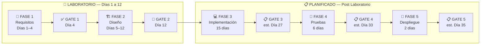
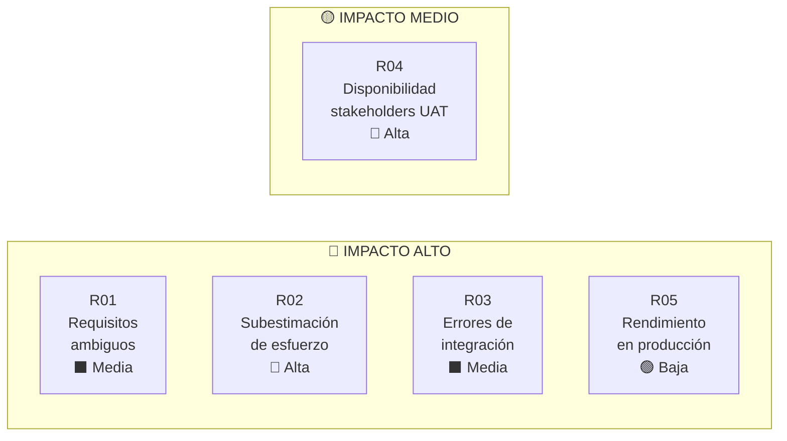

# Plan Completo del Proyecto
# Sistema de Gestión de Inventarios

---

| Campo              | Detalle                                         |
|--------------------|-------------------------------------------------|
| **Documento**      | Plan Completo del Proyecto                      |
| **Proyecto**       | Sistema de Gestión de Inventarios               |
| **Equipo**         | Cascada                                         |
| **Autor**          | Angelo Jair Vega Figueroa (Jefe de Proyecto)   |
| **Revisor**        | Daniel Wilston Chura Monroy (Arquitecto)        |
| **Fecha**          | 14/10/2026                                      |
| **Versión**        | 1.0                                             |
| **Metodología**    | Cascada estricta (sin solapamiento de fases)    |
| **Estado**         | 🔄 En curso — Fase 2: Diseño                   |

---

## Tabla de Contenidos

1. [Propósito del Documento](#1-propósito-del-documento)
2. [Resumen Ejecutivo](#2-resumen-ejecutivo)
3. [Estructura de Desglose de Trabajo (EDT/WBS)](#3-estructura-de-desglose-de-trabajo-edtwbs)
4. [Cronograma Completo de Fases](#4-cronograma-completo-de-fases)
5. [Hitos y Gates de Control](#5-hitos-y-gates-de-control)
6. [Roles y Responsabilidades (RACI)](#6-roles-y-responsabilidades-raci)
7. [Gestión de Riesgos](#7-gestión-de-riesgos)
8. [Restricciones del Proyecto](#8-restricciones-del-proyecto)
9. [Criterios de Cierre del Laboratorio](#9-criterios-de-cierre-del-laboratorio)

---

## 1. Propósito del Documento

Este documento constituye el **Plan Completo del Proyecto** para el desarrollo del Sistema de Gestión de Inventarios (SGI), elaborado bajo la metodología de ciclo de vida **Cascada Estricta**. Su propósito es:

- Definir el alcance, fases, entregables y cronograma del proyecto.
- Establecer los mecanismos de control de calidad mediante gates formales entre fases.
- Identificar riesgos potenciales y sus planes de mitigación.
- Delimitar con claridad las actividades ejecutadas en el laboratorio (Fases 1–2, Días 1–12) de las actividades planificadas para ejecución posterior (Fases 3–5).
- Servir como línea base de referencia para el seguimiento y control del proyecto.

> [!IMPORTANT]
> En la metodología Cascada Estricta adoptada por este equipo, **ninguna fase puede iniciarse antes de que la fase anterior haya sido formalmente aprobada** mediante su gate de control. Los retrocesos entre fases no están contemplados en el plan base.

---

## 2. Resumen Ejecutivo

### 2.1 Descripción del Sistema

El **Sistema de Gestión de Inventarios (SGI)** es una aplicación web empresarial diseñada para digitalizar y centralizar el control de existencias, movimientos de stock, alertas de reabastecimiento y generación de reportes de inventario en tiempo real. El sistema reemplazará los procesos manuales actualmente basados en hojas de cálculo, eliminando inconsistencias de datos y reduciendo el tiempo de auditoría de inventario.

### 2.2 Objetivo General

Desarrollar e implementar un sistema de información que permita gestionar de forma eficiente el ciclo de vida completo del inventario de la organización, garantizando trazabilidad, disponibilidad de datos en tiempo real y cumplimiento de los criterios de calidad definidos en el SRS.

### 2.3 Alcance

**Incluido en el alcance:**
- Autenticación y control de acceso por roles (RBAC).
- Módulo de registro y categorización de productos (catálogo).
- Módulo de movimientos de inventario (entradas y ajustes).
- Módulo de registro de ventas con descuento directo de stock.
- Módulo de alertas automáticas por stock mínimo.
- Módulo de reportes y dashboard gerencial de KPIs.

**Excluido del alcance:**
- Exposición de API REST / integración con sistemas externos.
- Integración con sistemas ERP de terceros (versión futura).
- Gestión de logística y despacho.
- Módulo de facturación y cuentas por pagar.

### 2.4 Equipo del Proyecto

| Rol                    | Nombre                          | Responsabilidad Principal                        |
|------------------------|---------------------------------|--------------------------------------------------|
| Jefe de Proyecto       | Angelo Jair Vega Figueroa       | Planificación, control, comunicación, entregables|
| Arquitecto de Software | Daniel Wilston Chura Monroy     | Diseño técnico, revisión de arquitectura         |
| Analista de Requisitos | *(Miembro del equipo)*          | Levantamiento y documentación de requisitos      |
| Desarrollador Senior   | *(Miembro del equipo)*          | Implementación de módulos core                   |
| Desarrollador Junior   | *(Miembro del equipo)*          | Implementación de módulos auxiliares             |
| QA / Tester            | *(Miembro del equipo)*          | Diseño y ejecución de pruebas                    |

---

## 3. Estructura de Desglose de Trabajo (EDT/WBS)

```mermaid
flowchart TD
    SGI["🗂️ SGI — Sistema de Gestión\nde Inventarios"]

    SGI --> F1["📄 FASE 1\nRequisitos\nDías 1–4"]
    SGI --> F2["🏗️ FASE 2\nDiseño\nDías 5–12"]
    SGI --> F3["💻 FASE 3\nImplementación\n15 días est."]
    SGI --> F4["🧪 FASE 4\nPruebas\n6 días est."]
    SGI --> F5["🚀 FASE 5\nDespliegue y\nMantenimiento\n2 días + continuo"]

    F1 --> F1A["1.1 Reuniones de\nlevantamiento"]
    F1 --> F1B["1.2 Análisis de\nrequisitos funcionales"]
    F1 --> F1C["1.3 Análisis de\nrequisitos no funcionales"]
    F1 --> F1D["1.4 Redacción SRS\ny revisión"]
    F1 --> F1E["1.5 Aprobación Gate 1\n✅ Día 4"]

    F2 --> F2A["2.1 Diseño de\narquitectura del sistema"]
    F2 --> F2B["2.2 Diseño de\nbase de datos (ERD)"]
    F2 --> F2C["2.3 Diseño de\ninterfaces UI/UX"]
    F2 --> F2D["2.4 Especificación\ntécnica y plan\nde pruebas"]
    F2 --> F2E["2.5 Documento de\nDiseño y revisión"]
    F2 --> F2F["2.6 Aprobación Gate 2\nDía 12"]

    F3 --> F3A["3.1 Configuración\nde entorno"]
    F3 --> F3B["3.2 Implementación\nmódulos core"]
    F3 --> F3C["3.3 Implementación\nmódulo de ventas"]
    F3 --> F3D["3.4 Integración\nde módulos"]
    F3 --> F3E["3.5 Code review\ny correcciones"]
    F3 --> F3F["3.6 Aprobación Gate 3\nest. Día 27"]

    F4 --> F4A["4.1 Plan de pruebas"]
    F4 --> F4B["4.2 Pruebas unitarias"]
    F4 --> F4C["4.3 Pruebas de\nintegración"]
    F4 --> F4D["4.4 Pruebas de\naceptación UAT"]
    F4 --> F4E["4.5 Aprobación Gate 4\nest. Día 33"]

    F5 --> F5A["5.1 Preparación\nde entorno productivo"]
    F5 --> F5B["5.2 Despliegue\ny configuración"]
    F5 --> F5C["5.3 Capacitación\nde usuarios"]
    F5 --> F5D["5.4 Mantenimiento\ncorrectivo continuo"]
    F5 --> F5E["5.5 Aprobación Gate 5\nest. Día 35"]
```

---

## 4. Cronograma Completo de Fases

> [!NOTE]
> Las **Fases 1 y 2** se ejecutan dentro del período de laboratorio (Días 1–12). Las **Fases 3, 4 y 5** corresponden a estimaciones planificadas para ejecución posterior al cierre del laboratorio.

### 4.1 Fase 1 — Requisitos ✅ COMPLETADA

| #  | Actividad                                        | Día Inicio | Día Fin | Responsable          | Estado      |
|----|--------------------------------------------------|:-----------:|:-------:|----------------------|-------------|
| 1  | Reuniones de levantamiento con stakeholders      | 1           | 1       | Analista / JP        | ✅ Completado |
| 2  | Análisis y clasificación de requisitos           | 2           | 2       | Analista             | ✅ Completado |
| 3  | Redacción de requisitos funcionales (SRS §3)     | 2           | 3       | Analista             | ✅ Completado |
| 4  | Redacción de requisitos no funcionales (SRS §4)  | 3           | 3       | Analista / Arquitecto| ✅ Completado |
| 5  | Revisión interna y correcciones del SRS          | 3           | 4       | Daniel W. Chura      | ✅ Completado |
| 6  | **GATE 1: Aprobación formal del SRS**            | **4**       | **4**   | Jefe de Proyecto     | ✅ **APROBADO** |

**Duración total:** 4 días  
**Entregable principal:** Especificación de Requisitos del Software (SRS) — `especificacion-requisitos.md`

---

### 4.2 Fase 2 — Diseño 🔄 EN CURSO

| #  | Actividad                                        | Día Inicio | Día Fin | Responsable          | Estado       |
|----|--------------------------------------------------|:-----------:|:-------:|----------------------|--------------|
| 1  | Definición de arquitectura del sistema           | 5           | 6       | Arquitecto           | 🔄 En curso  |
| 2  | Diseño del modelo de base de datos (ERD)         | 7           | 8       | Arquitecto / DBA     | 🔄 En curso  |
| 3  | Diseño de interfaces de usuario (wireframes)     | 9           | 10      | UX / Desarrollador   | ⏳ Pendiente |
| 4  | Especificación técnica de módulos y plan de pruebas | 11       | 11      | Arquitecto           | ⏳ Pendiente |
| 5  | Integración del Documento de Diseño (índice maestro) | 11      | 12      | Arquitecto / JP      | ⏳ Pendiente |
| 6  | Revisión y correcciones del Documento de Diseño  | 11          | 12      | Daniel W. Chura      | ⏳ Pendiente |
| 7  | **GATE 2: Aprobación del Documento de Diseño**   | **12**      | **12**  | Jefe de Proyecto     | ⏳ **Pendiente** |

**Duración total:** 8 días (Días 5–12)  
**Entregable principal:** Documento de Diseño del Sistema — `documento-diseño.md` (índice maestro) y sus artefactos: `arquitectura.md`, `modelo-datos.md`, `wireframes.md`, `especificacion-tecnica.md`

---

### 4.3 Fase 3 — Implementación 📋 PLANIFICADA

| #  | Actividad                                        | Día Inicio | Día Fin | Responsable          |
|----|--------------------------------------------------|:-----------:|:-------:|----------------------|
| 1  | Configuración del entorno de desarrollo          | 13          | 13      | Dev Senior           |
| 2  | Implementación módulo de productos               | 13          | 16      | Dev Senior           |
| 3  | Implementación módulo de movimientos             | 15          | 18      | Dev Senior / Junior  |
| 4  | Implementación módulo de alertas                 | 17          | 19      | Dev Junior           |
| 5  | Implementación módulo de reportes y dashboards   | 18          | 21      | Dev Senior           |
| 6  | Implementación módulo de usuarios y roles        | 19          | 21      | Dev Junior           |
| 7  | Implementación de reglas de negocio (RN-01 a RN-04) | 20       | 24      | Dev Senior           |
| 8  | Integración de todos los módulos                 | 23          | 25      | Dev Senior / Arquitecto |
| 9  | Code review y correcciones                       | 25          | 27      | Arquitecto           |
| 10 | **GATE 3: Fin de implementación**                | **27**      | **27**  | Jefe de Proyecto     |

**Duración estimada:** 15 días (Días 13–27)  
**Entregable principal:** Código fuente completo integrado en repositorio

> [!TIP]
> Se recomienda usar ramas (`feature branches`) por módulo y realizar integraciones continuas al finalizar cada módulo, para detectar conflictos de integración tempranamente.

---

### 4.4 Fase 4 — Pruebas 📋 PLANIFICADA

| #  | Actividad                                        | Día Inicio | Día Fin | Responsable          |
|----|--------------------------------------------------|:-----------:|:-------:|----------------------|
| 1  | Elaboración del plan de pruebas                  | 28          | 28      | QA                   |
| 2  | Diseño de casos de prueba                        | 28          | 29      | QA                   |
| 3  | Ejecución de pruebas unitarias                   | 29          | 30      | QA / Desarrolladores |
| 4  | Ejecución de pruebas de integración              | 30          | 31      | QA                   |
| 5  | Ejecución de pruebas de aceptación UAT           | 31          | 33      | QA / Stakeholders    |
| 6  | Corrección de defectos críticos                  | 30          | 33      | Dev Senior / Junior  |
| 7  | **GATE 4: Aceptación formal del sistema**        | **33**      | **33**  | Jefe de Proyecto     |

**Duración estimada:** 6 días (Días 28–33)  
**Entregable principal:** Informe de pruebas, registro de defectos y acta de aceptación

---

### 4.5 Fase 5 — Despliegue y Mantenimiento 📋 PLANIFICADA

| #  | Actividad                                        | Día Inicio | Día Fin    | Responsable          |
|----|--------------------------------------------------|:-----------:|:----------:|----------------------|
| 1  | Preparación del entorno de producción            | 34          | 34         | Dev Senior / Ops     |
| 2  | Despliegue del sistema en producción             | 34          | 35         | Dev Senior           |
| 3  | Configuración de backups y monitoreo             | 34          | 35         | Dev Senior / Ops     |
| 4  | Capacitación de usuarios finales                 | 35          | 35         | JP / QA              |
| 5  | **GATE 5: Despliegue productivo aprobado**       | **35**      | **35**     | Jefe de Proyecto     |
| 6  | Mantenimiento correctivo (soporte post-entrega)  | 36          | Continuo   | Dev Senior           |

**Duración estimada:** 2 días de despliegue (Días 34–35) + mantenimiento continuo  
**Entregable principal:** Sistema en producción, manual de usuario, acta de cierre del proyecto

---

### 4.6 Resumen Visual del Cronograma

---

## 5. Hitos y Gates de Control

> [!IMPORTANT]
> Cada gate es un **punto de control formal obligatorio**. La fase siguiente **no puede iniciarse** hasta que el gate correspondiente sea aprobado y firmado por el Jefe de Proyecto.

| Gate   | Nombre del Hito                              | Día Estimado | Entregable Requerido              | Estado         |
|--------|----------------------------------------------|:------------:|-----------------------------------|----------------|
| GATE 1 | Aprobación del SRS                           | Día 4        | `especificacion-requisitos.md` firmado | ✅ Completado  |
| GATE 2 | Aprobación del Documento de Diseño           | Día 12       | `documento-diseño.md` firmado     | ⏳ Pendiente   |
| GATE 3 | Fin de implementación y code review          | Día 27 (est.)| Código integrado en repositorio   | 📋 Planificado |
| GATE 4 | Aceptación formal tras pruebas UAT           | Día 33 (est.)| Informe de pruebas + acta UAT     | 📋 Planificado |
| GATE 5 | Despliegue productivo y cierre del proyecto  | Día 35 (est.)| Sistema en prod. + acta de cierre | 📋 Planificado |

**Criterio de aprobación de cada gate:** Todos los entregables de la fase deben estar completos, revisados por el Arquitecto y aprobados formalmente por el Jefe de Proyecto. Cualquier defecto bloqueante debe estar resuelto antes de la aprobación.

---

## 6. Roles y Responsabilidades (RACI)

**Leyenda:** R = Responsable de ejecución | A = Aprueba (Accountable) | C = Consultado | I = Informado

| Actividad / Entregable                  | Jefe de Proyecto | Arquitecto | Analista | Dev Senior | Dev Junior | QA     |
|-----------------------------------------|:----------------:|:----------:|:--------:|:----------:|:----------:|:------:|
| **FASE 1 — Requisitos**                 |                  |            |          |            |            |        |
| Levantamiento de requisitos             | A                | C          | R        | I          | I          | C      |
| Redacción del SRS                       | A                | C          | R        | I          | I          | C      |
| Revisión y aprobación del SRS (Gate 1)  | A                | R          | C        | I          | I          | I      |
| **FASE 2 — Diseño**                     |                  |            |          |            |            |        |
| Diseño de arquitectura                  | A                | R          | C        | C          | I          | I      |
| Diseño de base de datos                 | A                | R          | I        | C          | I          | I      |
| Diseño de interfaces UI/UX              | A                | C          | I        | R          | C          | C      |
| Especificación técnica de módulos       | A                | R          | I        | C          | I          | I      |
| Revisión y aprobación del Diseño (Gate 2)| A               | R          | I        | I          | I          | I      |
| **FASE 3 — Implementación**             |                  |            |          |            |            |        |
| Configuración de entorno                | A                | C          | I        | R          | C          | I      |
| Desarrollo de módulos                   | A                | C          | I        | R          | R          | I      |
| Code review (Gate 3)                    | A                | R          | I        | C          | C          | I      |
| **FASE 4 — Pruebas**                    |                  |            |          |            |            |        |
| Plan y casos de prueba                  | A                | C          | I        | C          | I          | R      |
| Ejecución de pruebas                    | A                | I          | I        | C          | C          | R      |
| Corrección de defectos                  | A                | C          | I        | R          | R          | C      |
| Aprobación UAT (Gate 4)                 | A                | C          | I        | I          | I          | R      |
| **FASE 5 — Despliegue**                 |                  |            |          |            |            |        |
| Despliegue en producción                | A                | C          | I        | R          | C          | I      |
| Capacitación de usuarios                | R                | I          | I        | C          | I          | C      |
| Cierre del proyecto (Gate 5)            | R                | C          | I        | I          | I          | I      |

---

## 7. Gestión de Riesgos

### 7.1 Tabla de Riesgos Identificados

| ID  | Riesgo                                                              | Prob.  | Impacto | Fase Afectada   | Plan de Mitigación                                                                                       |
|-----|---------------------------------------------------------------------|:------:|:-------:|-----------------|----------------------------------------------------------------------------------------------------------|
| R01 | Requisitos ambiguos o incompletos detectados en fases tardías       | Media  | Alto    | 3, 4            | Revisión exhaustiva del SRS en Gate 1; checklist de validación de requisitos antes de cerrar la fase 1.  |
| R02 | Subestimación del esfuerzo de implementación                        | Alta   | Alto    | 3               | Usar estimaciones con buffer del 20%; priorizar módulos core en las primeras iteraciones de la fase.      |
| R03 | Integración de módulos con errores en la fase final de desarrollo   | Media  | Alto    | 3               | Integración incremental al finalizar cada módulo; uso de repositorio con CI para detectar conflictos.     |
| R04 | Disponibilidad limitada de stakeholders para pruebas UAT            | Alta   | Medio   | 4               | Acordar fechas de UAT desde el inicio; designar un representante de negocio dedicado a las pruebas.      |
| R05 | Problemas de rendimiento del sistema en entorno de producción       | Baja   | Alto    | 5               | Ejecutar pruebas de carga en Fase 4; definir requisitos de infraestructura mínima en el SRS.             |

### 7.2 Matriz de Probabilidad e Impacto

> [!WARNING]
> Los riesgos **R02** y **R04** tienen probabilidad Alta y deben tratarse con prioridad inmediata. Se deben activar sus planes de mitigación antes del inicio de las fases 3 y 4 respectivamente.

---

## 8. Restricciones del Proyecto

### 8.1 Restricciones de Tiempo

| Restricción                                  | Detalle                                                                 |
|----------------------------------------------|-------------------------------------------------------------------------|
| **Duración del laboratorio**                 | Las Fases 1 y 2 deben completarse en exactamente 12 días hábiles.      |
| **Gates obligatorios**                       | Ninguna fase puede iniciarse sin la aprobación formal del gate previo.  |
| **Sin solapamiento de fases**                | La metodología Cascada Estricta prohíbe el inicio paralelo de fases.   |
| **Estimación post-laboratorio**              | Las Fases 3–5 son estimaciones; los plazos reales dependen del Gate 2. |

### 8.2 Restricciones de Alcance

| Restricción                                  | Detalle                                                                 |
|----------------------------------------------|-------------------------------------------------------------------------|
| **Alcance congelado tras Gate 1**            | No se aceptarán nuevos requisitos funcionales tras la aprobación del SRS. |
| **Módulos fuera de alcance**                 | ERP, facturación y logística quedan excluidos de esta versión.          |
| **Sin integración externa**                  | El sistema es una aplicación web monolítica; no se expone API REST ni se integra con otros sistemas en esta versión. |

### 8.3 Restricciones Tecnológicas

| Restricción                                  | Detalle                                                                 |
|----------------------------------------------|-------------------------------------------------------------------------|
| **Stack tecnológico definido en diseño**     | El stack se formaliza en la Fase 2 y no puede cambiarse en la Fase 3.  |
| **Entorno de producción**                    | El sistema debe ser compatible con entornos Linux y contenedores Docker.|
| **Estándar de documentación**               | Toda la documentación del proyecto se redacta en Markdown (`.md`).     |
| **Control de versiones**                     | Código fuente obligatoriamente gestionado en Git con repositorio compartido. |

---

## 9. Criterios de Cierre del Laboratorio

El laboratorio (Días 1–12) se considera **formalmente cerrado** cuando se cumplen **todos** los siguientes criterios:

### 9.1 Entregables Obligatorios al Día 12

| # | Entregable                                   | Archivo / Ubicación                 | Responsable           | Estado       |
|---|----------------------------------------------|-------------------------------------|-----------------------|--------------|
| 1 | Especificación de Requisitos del Software    | `LAB03/Cascada/especificacion-requisitos.md` | Analista / Arquitecto | ✅ Completado |
| 2 | Documento de Diseño del Sistema              | `LAB03/Cascada/documento-diseño.md` (+ artefactos) | Arquitecto    | ⏳ Pendiente  |
| 3 | Plan Completo del Proyecto (este documento)  | `LAB03/Cascada/plan-proyecto-completo.md` | Jefe de Proyecto | 🔄 En curso  |
| 4 | Gate 1 aprobado (SRS firmado)                | Registro en control de cambios      | Jefe de Proyecto      | ✅ Completado |
| 5 | Gate 2 aprobado (Diseño firmado)             | Registro en control de cambios      | Jefe de Proyecto      | ⏳ Pendiente  |

### 9.2 Criterios de Calidad Mínimos

- [ ] El SRS cubre **100%** de los módulos definidos en el alcance.
- [ ] El Documento de Diseño incluye: diagrama de arquitectura, ERD completo, wireframes de pantallas principales y especificación técnica de módulos.
- [ ] El Plan de Proyecto refleja cronograma completo de las 5 fases con estimaciones justificadas.
- [ ] Ambos gates (1 y 2) están formalmente aprobados y registrados por el Jefe de Proyecto.
- [ ] Todos los documentos han sido revisados por el Arquitecto Daniel Wilston Chura Monroy.

> [!CAUTION]
> Si al finalizar el Día 12 el Gate 2 no ha sido aprobado, el cierre del laboratorio se declara **INCOMPLETO** y el equipo debe escalar la situación inmediatamente al docente responsable. No se puede avanzar a la Fase 3 sin la aprobación formal del diseño.

### 9.3 Lo que NO se entrega en el laboratorio

Las siguientes actividades están **fuera del alcance del cierre del laboratorio** y corresponden a las fases planificadas:

- Código fuente del sistema (Fase 3).
- Casos de prueba y resultados (Fase 4).
- Sistema desplegado en producción (Fase 5).
- Manual de usuario final.

---

*Documento elaborado por **Angelo Jair Vega Figueroa** — Jefe de Proyecto, Equipo Cascada.*  
*Revisado por **Daniel Wilston Chura Monroy** — Arquitecto de Software.*  
*Fecha de emisión: 14/10/2026 — Versión 1.0*
