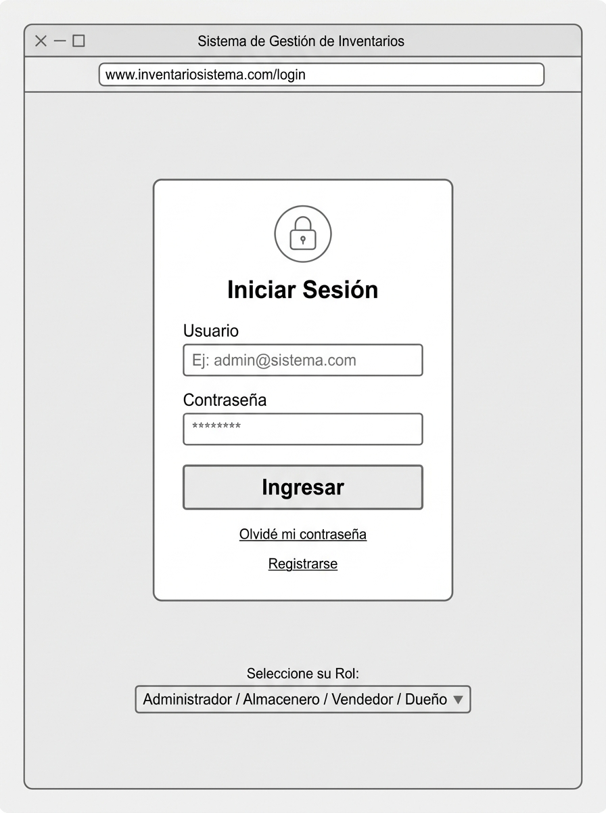
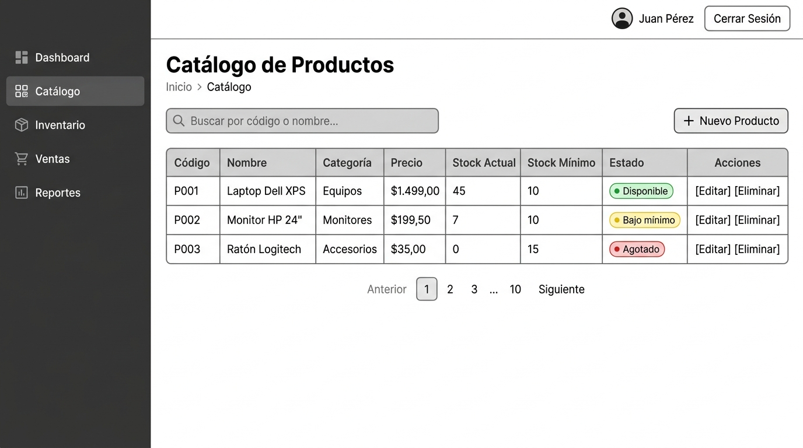
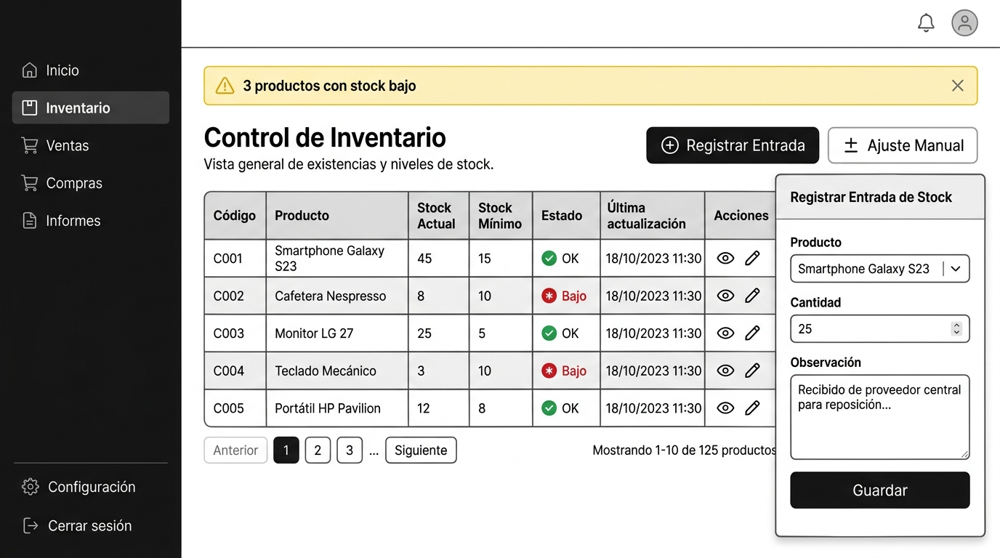
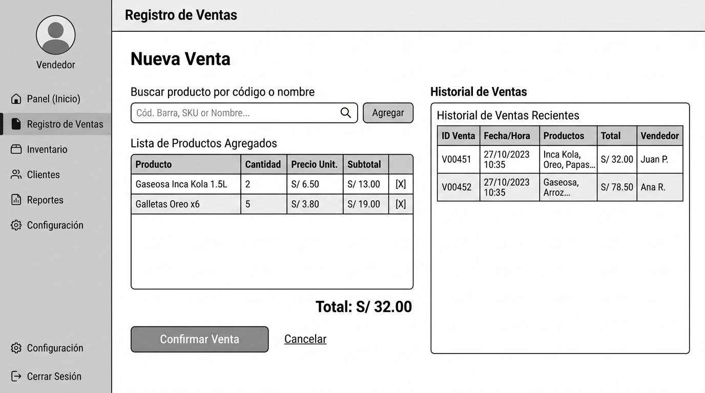
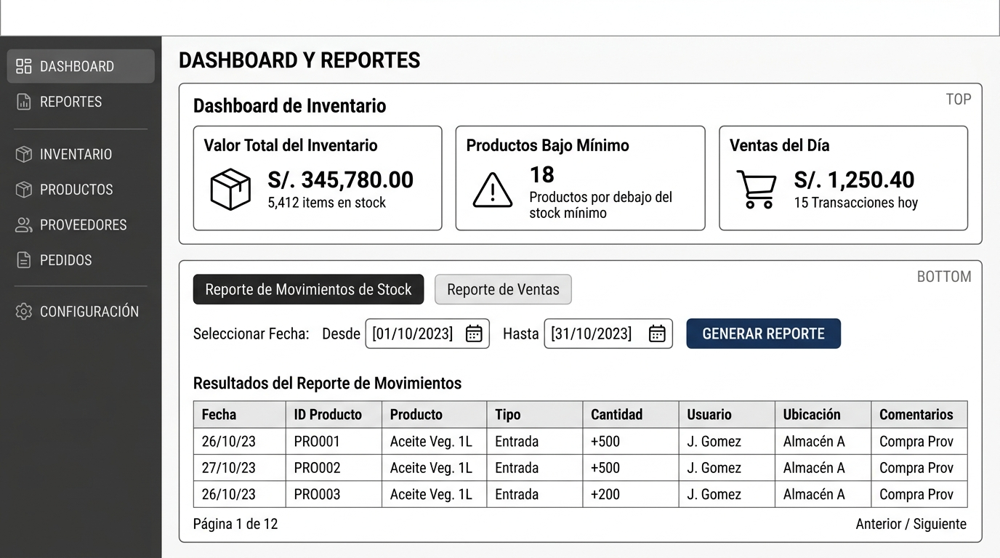

# Diseño de Interfaces — Wireframes
## Sistema de Gestión de Inventarios para Tienda Minorista

**Proyecto:** Sistema de Gestión de Inventarios  
**Metodología:** Cascada — Fase 2: Diseño  
**Autor / Arquitecto de Sistemas:** Daniel Wilston Chura Monroy  
**Revisor / Jefe de Proyecto:** Angelo Jair Vega Figueroa  
**Fecha:** 14/10/2026  
**Versión:** 1.0  
**Estado:** Finalizado (Días 9–10)

---

## 1. Propósito

Este documento presenta los wireframes (maquetas de baja fidelidad) de las cinco pantallas principales del sistema. Los wireframes definen la estructura visual y de navegación de la interfaz sin especificar colores ni estilos finales. Sirven como contrato entre el diseño y la implementación (Fase 3).

> **Herramienta:** Wireframes generados como mockups de referencia visual.  
> **Tecnología de implementación prevista:** HTML + Bootstrap 5 + Jinja2 (Flask templates).

---

## 2. Principios de diseño (RNF-04 — Usabilidad)

- Navegación lateral persistente con acceso a todos los módulos.
- Un usuario nuevo debe operar el sistema tras menos de 10 minutos de inducción.
- Indicadores de estado visual: **Disponible** (verde) / **Bajo mínimo** (amarillo) / **Agotado** (rojo).
- Alertas de stock bajo visibles en todo el sistema (banner superior).
- Acciones destructivas (cancelar venta, eliminar producto) requieren confirmación.

---

## 3. Mapa de navegación

```
/auth/login              → Pantalla de inicio de sesión (todos los roles)
/reportes/dashboard      → Dashboard KPIs + Reportes (Dueño)
/catalogo/               → Catálogo de productos (Administrador)
/catalogo/nuevo          → Formulario nuevo producto
/catalogo/<id>/editar    → Formulario edición producto
/catalogo/buscar         → Búsqueda AJAX de productos (JSON)
/inventario/             → Control de stock (Almacenero)
/inventario/entrada/nueva → Registro de entrada de mercancía
/inventario/ajuste/nuevo  → Registro de ajuste manual
/ventas/                 → Registro de ventas e historial (Vendedor)
/ventas/nueva            → Registrar nueva venta
/reportes/movimientos    → Reporte de movimientos de stock
/reportes/ventas         → Reporte de ventas por período
```

---

## 4. Wireframes de pantallas

### WF-01 — Inicio de Sesión (`/auth/login`)

**Actores:** Todos los roles  
**RF asociados:** RF-01 (Autenticación), RF-02 (Control de acceso por roles)



**Elementos de la pantalla:**
| Elemento | Descripción |
|---|---|
| Logo / Título | "Sistema de Gestión de Inventarios" |
| Campo Usuario | Input text — nombre de usuario registrado |
| Campo Contraseña | Input password — oculto con asteriscos |
| Botón Ingresar | Envía credenciales al servidor (POST /auth/login) |
| Selector de Rol | Informativo; el rol lo determina el sistema automáticamente |
| Mensaje de error | Aparece debajo del formulario si las credenciales son inválidas |

**Flujo:** Tras autenticación exitosa → redirige según rol (Administrador→/catalogo/, Almacenero→/inventario/, Vendedor→/ventas/, Dueño→/reportes/dashboard).

---

### WF-02 — Catálogo de Productos (`/catalogo`)

**Actores:** Administrador  
**RF asociados:** RF-03 (Gestión catálogo), RF-04 (Búsqueda de productos)



**Elementos de la pantalla:**
| Elemento | Descripción |
|---|---|
| Barra de búsqueda | Búsqueda en tiempo real por código o nombre (RF-04) |
| Botón "+ Nuevo Producto" | Abre formulario de registro (→/catalogo/nuevo) |
| Tabla de productos | Columnas: Código, Nombre, Categoría, Precio, Stock Actual, Stock Mínimo, Estado, Acciones |
| Indicadores de estado | Badge: Disponible (verde) / Bajo mínimo (amarillo) / Agotado (rojo) |
| Acciones por fila | [Editar] → formulario edición / [Eliminar] → confirmación modal |
| Paginación | Controles de navegación por páginas |

---

### WF-03 — Control de Inventario (`/inventario`)

**Actores:** Almacenero  
**RF asociados:** RF-05 (Entradas stock), RF-06 (Niveles tiempo real), RF-07 (Alertas), RF-08 (Ajuste manual)



**Elementos de la pantalla:**
| Elemento | Descripción |
|---|---|
| Banner de alerta | Amarillo: "⚠ N productos con stock bajo" — visible siempre que haya alertas (RF-07) |
| Botón "Registrar Entrada" | Abre panel lateral para registrar ingreso de mercadería (RF-05) |
| Botón "Ajuste Manual" | Abre panel con selector de motivo obligatorio (RF-08, RN-03) |
| Tabla de stock | Columnas: Código, Producto, Stock Actual, Stock Mínimo, Estado, Última actualización, Acciones |
| Panel lateral — Entrada | Campos: Producto (dropdown), Cantidad, Observación, Guardar |
| Panel lateral — Ajuste | Campos: Producto, Tipo ajuste, Cantidad, Motivo (obligatorio: merma/rotura/conteo) |

---

### WF-04 — Registro de Ventas (`/ventas`)

**Actores:** Vendedor  
**RF asociados:** RF-04 (Búsqueda), RF-06 (Verificar stock), RF-09 (Registrar venta), RF-10 (Historial)



**Elementos de la pantalla:**
| Elemento | Descripción |
|---|---|
| Buscador de productos | Busca por código o nombre, muestra precio y stock disponible (RF-04, RF-06) |
| Lista de productos agregados | Tabla editable: Producto, Cantidad, Precio Unit., Subtotal, [X eliminar] |
| Total acumulado | Calculado automáticamente en tiempo real |
| Botón "Confirmar Venta" | Procesa la transacción y descuenta stock (RF-09, RN-01, RN-02) |
| Cancelar | Limpia el formulario sin afectar el inventario |
| Historial reciente | Panel derecho: ID Venta, Fecha/Hora, Productos, Total, Vendedor (RF-10) |

**Validaciones:** Si la cantidad supera el stock disponible → bloquea y muestra advertencia (RN-02).

---

### WF-05 — Dashboard y Reportes (`/reportes/dashboard`)

**Actores:** Dueño de la tienda  
**RF asociados:** RF-11 (Movimientos), RF-12 (Ventas por período), RF-13 (KPIs)



**Elementos de la pantalla:**
| Elemento | Descripción |
|---|---|
| KPI Card 1 | Valor Total del Inventario: Σ(stock_actual × precio_unitario) de todos los productos activos |
| KPI Card 2 | Productos Bajo Mínimo: conteo de productos con stock_actual ≤ stock_mínimo |
| KPI Card 3 | Ventas del Día: suma total de ventas con fecha = hoy |
| Pestaña "Reporte de Movimientos" | Tabla: Fecha, Producto, Tipo, Cantidad, Usuario — con filtro por rango de fechas (RF-11) |
| Pestaña "Reporte de Ventas" | Tabla: Fecha, ID Venta, Productos, Total, Vendedor — filtro por día/semana/producto (RF-12) |
| Botón "Generar Reporte" | Aplica los filtros y refresca la tabla |
| Paginación | Navegación por páginas en reportes extensos |

---

## 5. Navegación y control de acceso por pantalla

| Pantalla | URL | Rol(es) con acceso | RF de autorización |
|---|---|---|---|
| Login | `/auth/login` | Todos (público) | RF-01 |
| Catálogo | `/catalogo/` | Administrador | RF-02 |
| Inventario | `/inventario/` | Almacenero, Administrador | RF-02 |
| Ventas | `/ventas/` | Vendedor, Administrador | RF-02 |
| Dashboard / Reportes | `/reportes/dashboard` | Dueño, Administrador | RF-02 |

> Un usuario que intente acceder a una pantalla sin permiso recibirá un mensaje de error 403 y será redirigido a su pantalla principal correspondiente.

---

## 6. Trazabilidad wireframes ↔ RF del SRS

| Wireframe | RF implementados | Casos de uso |
|---|---|---|
| WF-01 Login | RF-01, RF-02 | CU-01…CU-04 (precondición) |
| WF-02 Catálogo | RF-03, RF-04 | CU-03 |
| WF-03 Inventario | RF-05, RF-06, RF-07, RF-08 | CU-02 |
| WF-04 Ventas | RF-04, RF-06, RF-09, RF-10 | CU-01 |
| WF-05 Dashboard | RF-11, RF-12, RF-13 | CU-04 |
