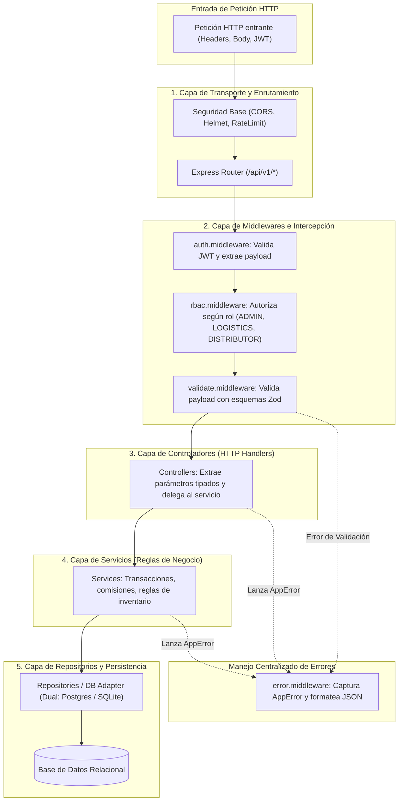
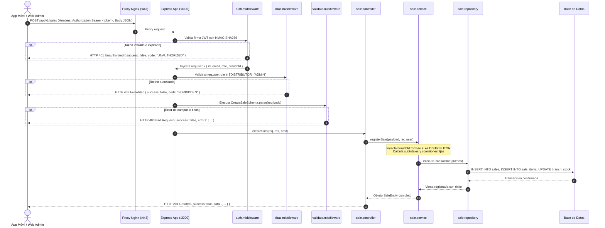

# Especificación de Arquitectura de Código: Backend (Express + TypeScript)

* **Módulo:** Arquitectura de Software / Backend
* **Fecha:** 2026-10-14
* **Autor:** Yourdyy (Scrum Master / Arquitecto de Software)
* **Stack:** Node.js 26 (Alpine), Express.js, TypeScript 5.x, Zod, PostgreSQL 16 / SQLite 3
* **Tareas Relacionadas:** [`TASK-01-01`](file:///home/tooboe/Documentos/AcademicProjects/Lab_GPS/SCRUM/sprint-backlog/tasks/TASK-01-01.md), [`TASK-01-03`](file:///home/tooboe/Documentos/AcademicProjects/Lab_GPS/SCRUM/sprint-backlog/tasks/TASK-01-03.md), [`TASK-01-04`](file:///home/tooboe/Documentos/AcademicProjects/Lab_GPS/SCRUM/sprint-backlog/tasks/TASK-01-04.md)

---

## 1. Patrón Arquitectónico: Clean Layered Architecture

El backend se estructura bajo una **Arquitectura en Capas Limpias desacopladas**, donde las dependencias fluyen estrictamente desde la capa externa (transporte HTTP) hacia el núcleo interno (lógica de negocio y persistencia).



---

## 2. Estructura de Directorios del Backend (`backend/`)

```
backend/
├── Dockerfile                  # Imagen multi-stage en node:26-alpine
├── docker-compose.yml          # Orquestación de backend + PostgreSQL
├── package.json                # Dependencias de producción y scripts de ejecución
├── tsconfig.json               # Configuración estricta de TypeScript (ES2022)
├── .env.example                # Plantilla de variables de entorno tipadas
└── src/
    ├── server.ts               # Punto de entrada: arranque del servidor HTTP
    ├── app.ts                  # Configuración de Express, middlewares globales y rutas
    │
    ├── config/                 # Parámetros y entorno
    │   ├── env.ts              # Validación en tiempo de arranque con Zod
    │   └── database.ts         # Pool de conexiones (Postgres) o SQLite instance
    │
    ├── types/                  # Tipos TypeScript transversales
    │   ├── express.d.ts        # Extensión de Request con user: AuthPayload
    │   ├── domain.ts           # Interfaces de Rol, Usuario, Sede, Producto, Venta
    │   └── responses.ts        # Formato de respuesta JSON estandarizado
    │
    ├── schemas/                # Validaciones de entrada en tiempo de ejecución (Zod)
    │   ├── auth.schema.ts      # LoginSchema, RefreshTokenSchema
    │   ├── branch.schema.ts    # CreateBranchSchema, UpdateBranchSchema
    │   ├── product.schema.ts   # CreateProductSchema, UpdatePriceSchema
    │   ├── sale.schema.ts      # CreateSaleSchema, BatchSyncSalesSchema
    │   └── settlement.schema.ts# DailySettlementSchema
    │
    ├── middlewares/            # Interceptores y filtros de seguridad
    │   ├── auth.middleware.ts  # Verificación criptográfica de token Bearer JWT
    │   ├── rbac.middleware.ts  # Guardia de autorización por roles
    │   ├── validate.middleware.ts # Validador reutilizable para Zod
    │   └── error.middleware.ts # Manejador global de excepciones (AppError)
    │
    ├── controllers/            # Controladores HTTP desacoplados
    │   ├── auth.controller.ts
    │   ├── branch.controller.ts
    │   ├── product.controller.ts
    │   ├── sale.controller.ts
    │   └── settlement.controller.ts
    │
    ├── services/               # Lógica de negocio y reglas transaccionales
    │   ├── auth.service.ts     # Hasheo bcrypt, emisión de JWT
    │   ├── branch.service.ts   # Creación de sedes con validación de código único
    │   ├── product.service.ts  # Alta de títulos, inmutabilidad de comisiones
    │   ├── sale.service.ts     # Registro de ventas, idempotencia offline
    │   └── settlement.service.ts # Cuadre diario automatizado
    │
    └── repositories/           # Consultas SQL preparadas parametrizadas
        ├── dbAdapter.ts        # Interfaz de abstracción para queries
        ├── user.repository.ts
        ├── branch.repository.ts
        ├── product.repository.ts
        └── sale.repository.ts
```

---

## 3. Flujo Detallado de una Petición HTTP



---

## 4. Estandarización de Respuestas y Manejo de Errores

### 4.1. Formato de Respuesta Exitosa (`successResponse`)
Todas las respuestas satisfactorias de la API mantienen una estructura homogénea:

```json
{
  "success": true,
  "data": {
    "id": "sale-uuid-1234",
    "totalAmount": 50.00,
    "totalCommission": 8.00,
    "status": "CONFIRMED"
  },
  "timestamp": "2026-10-14T21:50:00.000Z"
}
```

### 4.2. Formato de Respuesta de Error (`errorResponse`)
Los errores capturados por el `error.middleware.ts` devuelven códigos legibles:

```json
{
  "success": false,
  "error": {
    "code": "INSUFFICIENT_STOCK",
    "message": "No hay stock disponible suficiente en esta sede para el título solicitado.",
    "details": {
      "productId": "prod-01",
      "available": 0,
      "requested": 1
    }
  },
  "timestamp": "2026-10-14T21:50:00.000Z"
}
```

### 4.3. Clase de Excepción de Dominio: `AppError`
```typescript
export class AppError extends Error {
  constructor(
    public readonly statusCode: number,
    public readonly code: string,
    message: string,
    public readonly details?: unknown
  ) {
    super(message);
    Object.setPrototypeOf(this, new.target.prototype);
  }

  static badRequest(message: string, code = "BAD_REQUEST", details?: unknown) {
    return new AppError(400, code, message, details);
  }

  static unauthorized(message = "No autorizado", code = "UNAUTHORIZED") {
    return new AppError(401, code, message);
  }

  static forbidden(message = "Acceso denegado para su perfil", code = "FORBIDDEN") {
    return new AppError(403, code, message);
  }

  static notFound(message: string, code = "NOT_FOUND") {
    return new AppError(404, code, message);
  }

  static conflict(message: string, code = "CONFLICT") {
    return new AppError(409, code, message);
  }
}
```

---

## 5. Control de Aislamiento de Sedes en la Capa de Servicios

Para garantizar el cumplimiento de la regla de negocio **RN-05 (Aislamiento Multi-Sede)**, el servicio implementa una guarda estricta:

```typescript
export class SaleService {
  async listSales(filter: SalesFilter, currentUser: AuthUser) {
    // Si el usuario es distribuidor, sobreescribir branchId forzosamente con el de su token
    if (currentUser.role === 'DISTRIBUTOR') {
      filter.branchId = currentUser.branchId!;
    }
    // Si es Administrador, puede filtrar por cualquier sede o ver el consolidado global
    return this.saleRepo.findByFilter(filter);
  }
}
```
Esto asegura que un vendedor nunca pueda visualizar las ventas, el stock ni los cuadres de otra distribuidora aliada.
