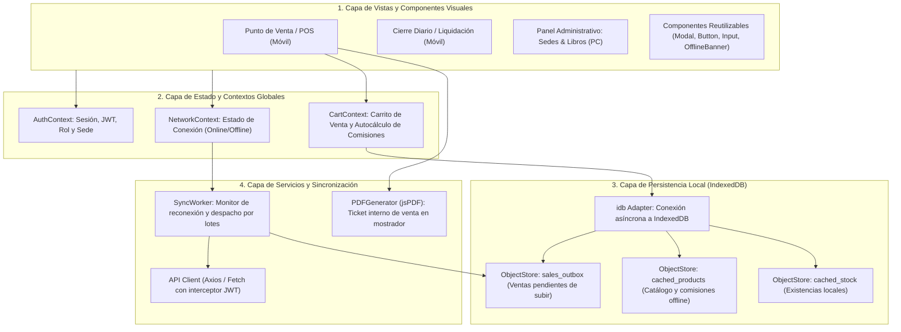
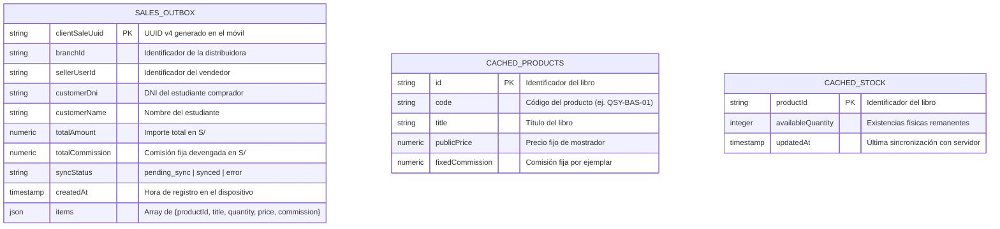
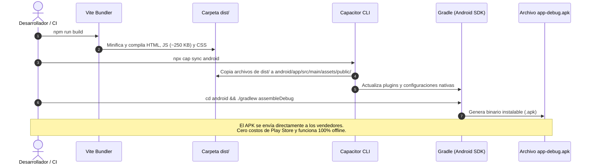

# Especificación de Arquitectura de Código: Frontend (React + Vite + Capacitor)

* **Módulo:** Arquitectura de Software / Frontend
* **Fecha:** 2026-10-14
* **Autor:** Yourdyy (Scrum Master / Arquitecto de Software)
* **Stack:** React, Vite, TypeScript, Tailwind CSS, Capacitor (Android APK), IndexedDB (`idb`), jsPDF
* **Tareas Relacionadas:** [`TASK-01-01`](file:///home/tooboe/Documentos/AcademicProjects/Lab_GPS/SCRUM/sprint-backlog/tasks/TASK-01-01.md), [`TASK-01-05`](file:///home/tooboe/Documentos/AcademicProjects/Lab_GPS/SCRUM/sprint-backlog/tasks/TASK-01-05.md)

---

## 1. Patrón Arquitectónico del Frontend

El frontend se diseña bajo un patrón de **Componentes Modulares Desacoplados y Manejo de Estado por Contextos**, con un enfoque estrictamente **Mobile-First** para los distribuidores en mostrador y responsivo para el panel administrativo de escritorio:



---

## 2. Estructura de Directorios del Frontend (`frontend/`)

```
frontend/
├── capacitor.config.ts         # Configuración del paquete móvil (App ID: com.editorialqsy.ventas)
├── android/                    # Proyecto nativo generado por Capacitor (para compilar el APK)
├── index.html                  # Punto de montaje con viewport para móviles (user-scalable=no)
├── package.json                # Dependencias (React, Tailwind, Capacitor, idb, jsPDF)
├── tsconfig.json               # Configuración estricta de TypeScript
├── vite.config.ts              # Bundler ultrarrápido con salida a 'dist/'
└── src/
    ├── main.tsx                # Entrada de la aplicación y renderizado en DOM
    ├── App.tsx                 # Enrutador principal (React Router) y proveedores de contexto
    │
    ├── assets/                 # Logotipo institucional QSY e iconos SVG optimizados
    │
    ├── components/             # Componentes visuales atómicos reutilizables
    │   ├── common/
    │   │   ├── Button.tsx      # Botón táctil grande optimizado para dedos (mín. 48px de alto)
    │   │   ├── Input.tsx       # Campo de texto con validación y teclado numérico para DNI
    │   │   ├── Modal.tsx       # Ventana modal accesible para confirmación de ventas
    │   │   ├── Badge.tsx       # Etiquetas de estado (Pendiente, Sincronizado, Anulado)
    │   │   └── OfflineBanner.tsx # Indicador visual fijo: "Modo Offline (Sin señal)"
    │   └── layout/
    │       ├── MobileLayout.tsx# Layout sin scroll horizontal para celulares (360px-420px)
    │       └── DesktopLayout.tsx # Layout con barra lateral para administradores en PC
    │
    ├── views/                  # Vistas o Pantallas de la aplicación
    │   ├── auth/
    │   │   └── LoginView.tsx   # Inicio de sesión táctil con selección de sede
    │   ├── pos/
    │   │   ├── PosSalesView.tsx # Terminal de venta rápida (< 2 min) con selector de libros
    │   │   └── TicketModal.tsx # Previsualización y descarga del ticket en PDF
    │   ├── settlements/
    │   │   └── DailySettlementView.tsx # Cuadre de caja diario y balance en efectivo
    │   ├── admin/
    │   │   ├── BranchesView.tsx   # Gestión de distribuidoras aliadas (HU-02)
    │   │   ├── ProductsView.tsx   # Catálogo y fijación de comisiones fijas (HU-03)
    │   │   └── UsersView.tsx      # Asignación de colaboradores y roles (HU-01)
    │   └── logistics/
    │       └── ConsignmentsView.tsx # Despachos de imprenta y remisiones
    │
    ├── context/                # Estado reactivo global
    │   ├── AuthContext.tsx     # Almacena token JWT, datos del usuario y rol activo
    │   ├── NetworkContext.tsx  # Escucha eventos 'online' y 'offline' de la API de red
    │   └── CartContext.tsx     # Carrito de venta, cálculo automático de total y comisiones
    │
    ├── offline/                # Motor de persistencia local y sincronización
    │   ├── db.ts               # Conexión a IndexedDB (esquemas de tiendas de objetos)
    │   ├── outboxQueue.ts      # Encolado de ventas offline con UUID idempotente
    │   ├── syncWorker.ts       # Despacho en segundo plano al recuperar señal
    │   └── ticketPdf.ts        # Renderizado cliente del comprobante interno en PDF
    │
    ├── services/               # Comunicación HTTP con el backend de Node 26
    │   ├── apiClient.ts        # Instancia centralizada con interceptor de cabecera Bearer
    │   ├── authService.ts      # Login y renovación de sesión
    │   ├── salesService.ts     # Envío de ventas individuales y lotes de sincronización
    │   └── catalogService.ts   # Descarga del catálogo para cachear en IndexedDB
    │
    ├── hooks/                  # Custom hooks para desacoplar lógica de la vista
    │   ├── useNetwork.ts       # Hook de estado de conectividad en tiempo real
    │   ├── useOfflineSales.ts  # Hook para registrar ventas directamente en IndexedDB
    │   └── useCart.ts          # Hook de manipulación del carrito
    │
    └── types/                  # Modelos de datos del cliente
        ├── domain.ts           # Product, Sale, Branch, User, Settlement
        └── offline.ts          # OutboxSale, SyncStatus, OfflinePayload
```

---

## 3. Esquema de Persistencia Local en `IndexedDB`

La base de datos local del dispositivo móvil se denomina `qsy_pos_db` (versión 1) y contiene tres tiendas de objetos (*object stores*):



---

## 4. Flujo de Empaquetado a Android APK con Capacitor

El flujo para compilar el archivo instalable `.apk` a partir de la web de React se ejecuta mediante scripts automatizados en `package.json`:



---

## 5. Scripts de Compilación y Ejecución en `package.json`

```json
{
  "name": "qsy-frontend",
  "version": "1.0.0",
  "scripts": {
    "dev": "vite",
    "build": "tsc -b && vite build",
    "preview": "vite preview",
    "cap:sync": "npm run build && npx cap sync android",
    "cap:open": "npx cap open android",
    "cap:build-apk": "npm run build && npx cap sync android && cd android && ./gradlew assembleDebug"
  }
}
```
Con el comando `npm run cap:build-apk`, en un solo paso se compila la versión web de producción, se sincroniza con el proyecto Android y se emite el archivo `app-debug.apk` listo para su distribución en mostrador.
