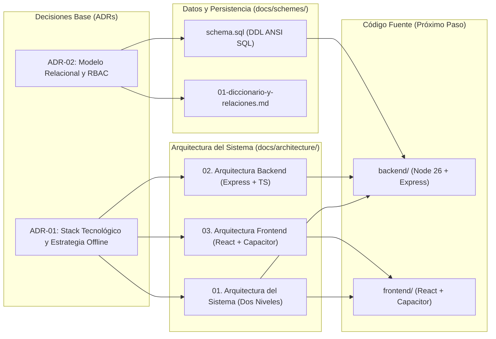

# Índice y Mapa de Arquitectura del Software (Editorial QSY)

* **Proyecto:** Sistema de Gestión Comercial y Control de Existencias — Editorial QSY
* **Módulo:** Documentación Arquitectónica Formal
* **Autor:** Yourdyy (Scrum Master / Arquitecto de Software)
* **Fecha:** 2026-10-14

---

## 1. Estructura de la Documentación de Arquitectura

La arquitectura de la solución se encuentra completamente desglosada y diagramada en tres documentos complementarios dentro de este directorio:

| Documento | Enfoque | Tecnologías Clave | Diagramas Incluidos |
|---|---|---|---|
| [`01-arquitectura-del-sistema.md`](file:///home/tooboe/Documentos/AcademicProjects/Lab_GPS/SCRUM/docs/architecture/01-arquitectura-del-sistema.md) | **Arquitectura en Dos Niveles e Infraestructura** | Docker Compose, Nginx, Node 26, PostgreSQL 16, Capacitor APK, VPS Hostinger | • Diagrama Físico de Dos Niveles • Secuencia de Sincronización Offline (Outbox) |
| [`02-arquitectura-de-codigo-backend.md`](file:///home/tooboe/Documentos/AcademicProjects/Lab_GPS/SCRUM/docs/architecture/02-arquitectura-de-codigo-backend.md) | **Arquitectura de Código del Backend** | Node.js 26 (Alpine), Express.js, TypeScript 5, Zod, bcrypt, JWT, Clean Layered Architecture | • Flujo por Capas Limpias • Secuencia de Petición HTTP e Interceptores RBAC |
| [`03-arquitectura-de-codigo-frontend.md`](file:///home/tooboe/Documentos/AcademicProjects/Lab_GPS/SCRUM/docs/architecture/03-arquitectura-de-codigo-frontend.md) | **Arquitectura de Código del Frontend y App Móvil** | React, Vite, TypeScript, Tailwind CSS, Capacitor (Android APK), IndexedDB (`idb`), jsPDF | • Arquitectura de Componentes y Estado • ERD de IndexedDB Local • Flujo de Compilación a APK |

---

## 2. Mapa de Conexión con otros Entregables Técnicos

---

## 3. Matriz de Decisiones Técnicas

1. **Aislamiento Multi-Sede (RN-05):**
   * *Backend:* Middleware [`auth.middleware.ts`](file:///home/tooboe/Documentos/AcademicProjects/Lab_GPS/SCRUM/docs/architecture/02-arquitectura-de-codigo-backend.md#L48-L60) y [`rbac.middleware.ts`](file:///home/tooboe/Documentos/AcademicProjects/Lab_GPS/SCRUM/docs/architecture/02-arquitectura-de-codigo-backend.md#L48-L60) inyectan forzosamente el predicado `WHERE branch_id = $jwt.branchId` para vendedores con rol `DISTRIBUTOR`.
   * *Base de Datos:* Clave foránea e índices B-Tree en [`branches`](file:///home/tooboe/Documentos/AcademicProjects/Lab_GPS/SCRUM/docs/schemes/schema.sql#L21-L32) y [`sales`](file:///home/tooboe/Documentos/AcademicProjects/Lab_GPS/SCRUM/docs/schemes/schema.sql#L118-L137).

2. **Tolerancia Total a Desconexión en Puntos de Venta:**
   * *Cliente Móvil:* App Android instalada vía APK ([`Capacitor`](file:///home/tooboe/Documentos/AcademicProjects/Lab_GPS/SCRUM/docs/architecture/03-arquitectura-de-codigo-frontend.md#L115-L135)) para evitar recargas accidentales del navegador.
   * *Persistencia:* [`IndexedDB`](file:///home/tooboe/Documentos/AcademicProjects/Lab_GPS/SCRUM/docs/architecture/03-arquitectura-de-codigo-frontend.md#L80-L110) almacena catálogo de libros y encola ventas en la tienda de objetos `sales_outbox`.
   * *Comprobante Inmediato:* Generación local de boleta en PDF mediante `jsPDF` sin requerir llamada de red.

3. **Cero Hardcoding de Entidades:**
   * Las tablas `branches`, `products` y `users` (vendedores) nacen vacías en [`schema.sql`](file:///home/tooboe/Documentos/AcademicProjects/Lab_GPS/SCRUM/docs/schemes/schema.sql#L190-L215).
   * El Administrador General las parametriza dinámicamente desde la interfaz web, permitiendo que la red comercial crezca libremente.
   * Todas las entidades cuentan con el campo libre `observations TEXT` para contingencias operativas.
