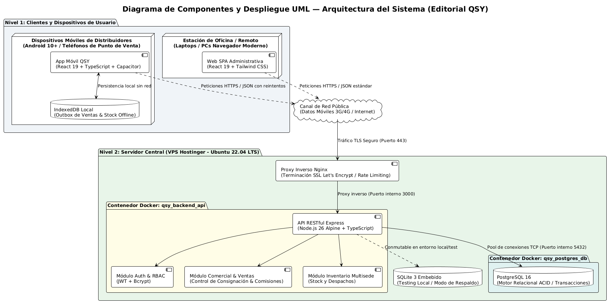
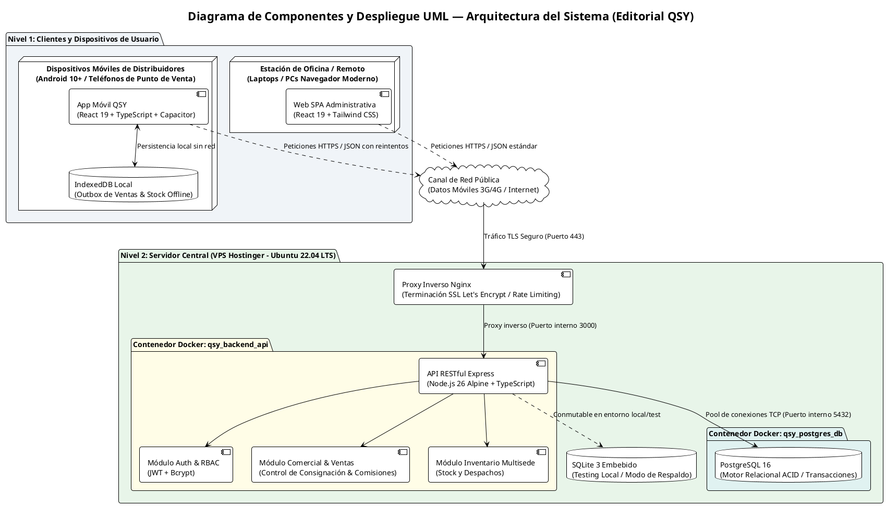
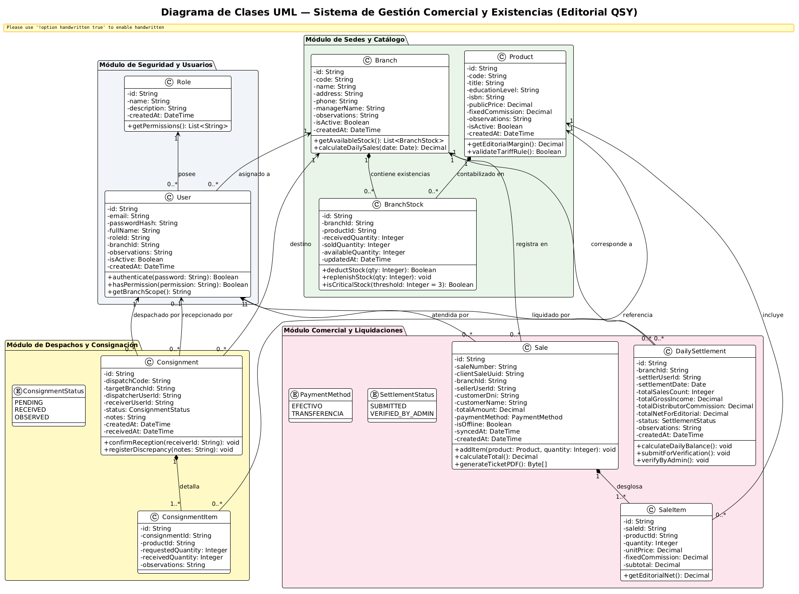
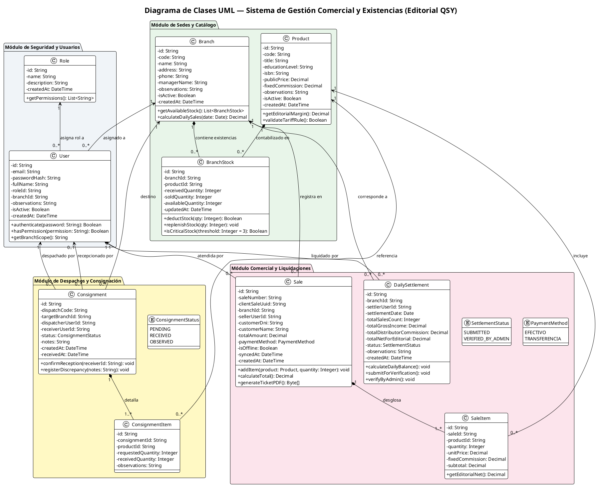
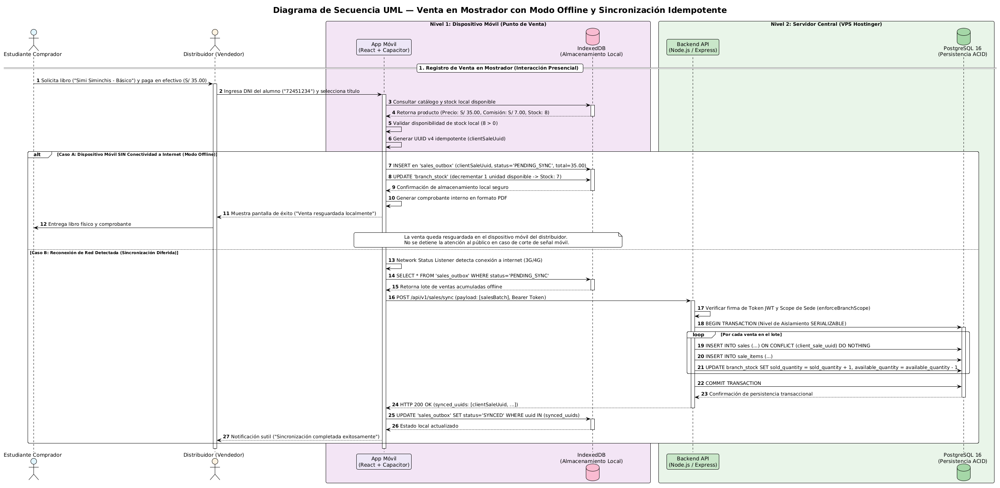
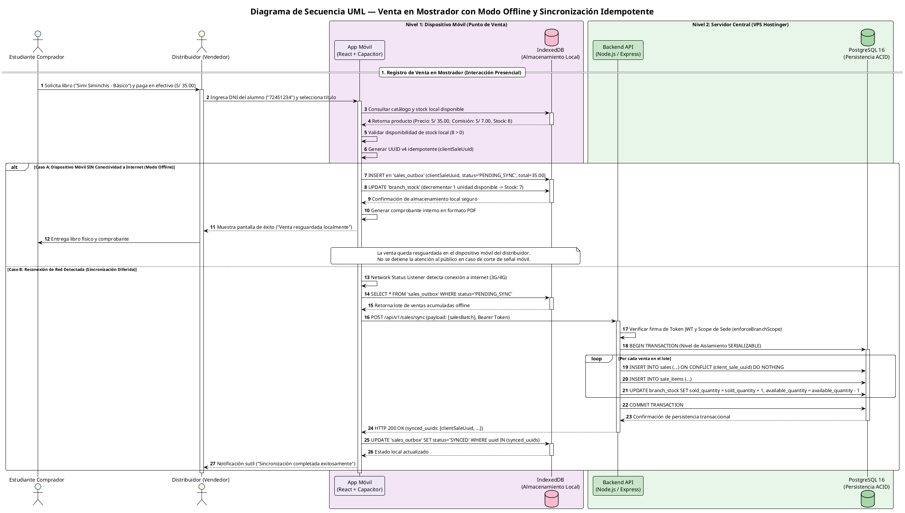

# Informe de Laboratorio: Requisitos y Diseño de Software

**Proyecto:** Sistema de Gestión Comercial y Control de Existencias  
**Organización Beneficiaria:** Editorial QSY (Arequipa)  
**Repositorio GitHub:** [https://github.com/yhuayhuahi/LAB_GSTI](https://github.com/yhuayhuahi/LAB_GSTI)  
**Índice de Documentación:** [https://github.com/yhuayhuahi/LAB_GSTI/blob/main/LAB04/README.md](https://github.com/yhuayhuahi/LAB_GSTI/blob/main/LAB04/README.md)  

---

> ### Enunciado Oficial de la Actividad:
> **Parte 2: Requisitos y Diseño de Software**  
> **2.1. Requisitos de software**  
> • Los estudiantes deberán realizar una reunión con el "cliente" (profesor o compañero) para recolectar los requisitos del sistema.  
> • Elaborar un documento de especificación de requisitos que incluya:  
> • Requisitos funcionales y no funcionales.  
> • Restricciones del sistema.  
>  
> **2.2. Diseño de software**  
> • Los estudiantes deben diseñar la arquitectura del sistema utilizando diagramas UML.  
> • Crear un diagrama de clases para la estructura del sistema.  
> • Definir la interacción de los componentes clave con un diagrama de secuencia.  

---

# Sección 1: Contenido para el ítem 2.1 (Requisitos de Software)

### 2.1.1. Registro de la Reunión con el Cliente y Levantamiento de Información
Para levantar las necesidades y reglas reales del negocio, se ejecutó una entrevista estructurada con la gerencia y responsables operativos de **Editorial QSY**, MYPE arequipeña dedicada a la producción y comercialización de publicaciones educativas en lengua quechua.

* **Evidencia Audiovisual de la Entrevista:**  
  👉 Enlace al video de la reunión con el cliente: `[ENLACE_AL_VIDEO_AQUÍ]` *(Colocar enlace de YouTube / Drive / Teams)*.
* **Documentación Detallada de la Entrevista en el Repositorio:**  
  - 📄 Entrevista Principal: [https://github.com/yhuayhuahi/LAB_GSTI/blob/main/LAB04/entrevista/Entrevista.md](https://github.com/yhuayhuahi/LAB_GSTI/blob/main/LAB04/entrevista/Entrevista.md) (Diagnóstico operativo, ventas y puntos de dolor).
  - 📄 Entrevista de Validación: [https://github.com/yhuayhuahi/LAB_GSTI/blob/main/LAB04/entrevista/Entrevista2.md](https://github.com/yhuayhuahi/LAB_GSTI/blob/main/LAB04/entrevista/Entrevista2.md) (Reglas tarifarias, comisiones fijas y descarte de SUNAT).

**Síntesis de Hallazgos y Diagnóstico del Negocio:**
1. **Modelo de Consignación:** QSY no vende a las librerías al contado; entrega lotes de libros en custodia a 3 distribuidoras aliadas en el Centro Histórico de Arequipa (*Trilce*, *Siglo XX* y *Jerusalén*). Los libros continúan siendo propiedad de QSY hasta su venta efectiva al alumno.
2. **Deficiencias Críticas de Conectividad:** 2 de las 3 distribuidoras carecen de internet fijo por cable, operando exclusivamente mediante planes de datos móviles desde los teléfonos celulares de los vendedores en casonas y sótanos.
3. **Pérdida de Tiempo en Arqueos:** Cada libro tiene una comisión fija monetaria en soles (*RN-03*). Las liquidaciones se hacían sumando boletas de papel en cuadernos, demorando **más de 1 hora por sede**.
4. **Comprobantes Físicos Vulnerables:** El llenado de boletas físicas demoraba hasta 2 minutos y los alumnos extraviaban los talonarios, complicando la atención de reclamos y garantías por fallas de imprenta.

---

### 2.1.2. Requisitos Funcionales (RF)
Se especificaron **18 Requisitos Funcionales** organizados en 5 módulos del ciclo de valor de la editorial. A continuación se presenta la matriz resumen. La especificación técnica completa con casos de uso detallados se encuentra en:  
👉 [https://github.com/yhuayhuahi/LAB_GSTI/blob/main/LAB04/requisitos/01-especificacion-requisitos.md](https://github.com/yhuayhuahi/LAB_GSTI/blob/main/LAB04/requisitos/01-especificacion-requisitos.md)

| ID | Módulo | Nombre del Requisito | Descripción Funcional en Modo Resumen | Prioridad |
| :---: | :--- | :--- | :--- | :---: |
| **RF-01** | Seguridad | Autenticación y RBAC | Control de acceso seguro por roles (`ADMIN`, `LOGISTICS`, `DISTRIBUTOR`) con JWT. | Alta (Must) |
| **RF-02** | Sedes | Padrón de Distribuidoras | Registro y administración de las 3 sedes físicas aliadas y asignación de personal. | Alta (Must) |
| **RF-03** | Catálogo | Catálogo de Libros y Tarifas | Gestión de libros con precio oficial de venta y comisión fija en soles inmutable (*RN-03*). | Alta (Must) |
| **RF-04** | Logística | Despacho en Consignación | Emisión y control de lotes de libros desde el almacén central hacia las distribuidoras. | Alta (Must) |
| **RF-05** | Logística | Confirmación de Recepción | Confirmación digital en sede de existencias recibidas o registro de discrepancias. | Alta (Must) |
| **RF-06** | Inventario | Consulta de Stock Multisede | Visibilidad en tiempo real del stock en almacén central y saldos en consignación por sede. | Alta (Must) |
| **RF-07** | Inventario | Salidas Especiales / Mermas | Registro justificado de libros para muestras docentes, donaciones o fallas de imprenta. | Alta (Must) |
| **RF-08** | Inventario | Alertas de Stock Crítico | Avisos visuales preventivos automáticos al quedar 3 o menos ejemplares de un título. | Media (Should) |
| **RF-09** | Ventas | Venta Rápida en Celular | Registro de venta táctil en mostrador (< 2 min) capturando DNI, nombre y medio de pago. | Alta (Must) |
| **RF-10** | Ventas | Modo Offline y Sincronización | Registro de ventas locales sin internet (`IndexedDB`) y sincronización automática por lotes. | Alta (Must) |
| **RF-11** | Ventas | Comprobante / Ticket PDF | Generación digital instantánea de ticket PDF para entrega por WhatsApp o impresión. | Alta (Must) |
| **RF-12** | Ventas | Historial y Anulación | Consulta de transacciones del turno y anulación auditada con motivo obligatorio. | Alta (Must) |
| **RF-13** | Reposición | Solicitud de Reabastecimiento | Envío digital de pedidos de stock desde el punto de venta hacia logística. | Media (Should) |
| **RF-14** | Reposición | Reposición Asistida | Cálculo automatizado de reposición exacta antes del viaje del despachador. | Alta (Must) |
| **RF-15** | Caja | Liquidación Automática | Cuadre diario instantáneo: Total Recaudado − Comisiones Retenidas = Saldo Editorial. | Alta (Must) |
| **RF-16** | Caja | Control de Deudas y Cobros | Monitoreo de balances pendientes y registro de transferencias bancarias de las sedes. | Alta (Must) |
| **RF-17** | Analítica | Dashboard Gerencial | Gráficos consolidados de ventas diarias, ingresos netos y ranking de títulos más vendidos. | Media (Should) |
| **RF-18** | Trazabilidad | Búsqueda Histórica por DNI | Consulta de transacciones por DNI del estudiante para validación de garantías y reclamos. | Alta (Must) |

---

### 2.1.3. Requisitos No Funcionales (RNF)
Los requisitos de calidad técnica y atributos de arquitectura del sistema se resumen a continuación (especificación ampliada en [https://github.com/yhuayhuahi/LAB_GSTI/blob/main/LAB04/requisitos/01-especificacion-requisitos.md#4-requisitos-no-funcionales-rnf](https://github.com/yhuayhuahi/LAB_GSTI/blob/main/LAB04/requisitos/01-especificacion-requisitos.md#4-requisitos-no-funcionales-rnf)):

* **RNF-01: Seguridad y Aislamiento por Sede (RBAC):**  
  Ninguna distribuidora puede consultar las ventas, ingresos o inventario de otra sede (*RN-05*). Las contraseñas se resguardan con hash `bcrypt` con 10 rondas de salt.
* **RNF-02: Usabilidad Mobile-First:**  
  La interfaz de ventas táctil está diseñada para pantallas de 360px a 420px, completando una venta en un flujo intuitivo de máximo 4 toques.
* **RNF-03: Rendimiento Transaccional:**  
  Tiempo de respuesta de la API inferior a **2 segundos** en operaciones estándar de venta y consulta de catálogo sobre redes móviles 3G/4G.
* **RNF-04: Tolerancia a Red Inestable y Modo Offline:**  
  El cliente web/móvil aplica el patrón *Outbox* con almacenamiento local en `IndexedDB`, garantizando atención en ventanilla aun en ausencia total de señal celular.
* **RNF-05: Inmutabilidad y Auditoría:**  
  Los precios y comisiones pactadas no son editables por distribuidores. Toda anulación o merma exige motivo obligatorio, usuario responsable y marca de tiempo inalterable.
* **RNF-06: Trazabilidad y Retención de Datos:**  
  El histórico de ventas y liquidaciones se conserva por un mínimo de 2 años en base de datos relacional para control tributario y garantías estudiantiles.
* **RNF-07: Modularidad y Portabilidad:**  
  Arquitectura en capas desacopladas (Frontend Web/Móvil, Backend REST API y Base de Datos Relacional) paquetizada en contenedores Docker lista para el VPS de la editorial.

---

### 2.1.4. Restricciones del Sistema
Las restricciones que condicionan el diseño de la solución se clasifican en tres ejes:

1. **Restricciones Técnicas:**
   - **Descarte de Facturación Electrónica SUNAT:** El sistema **no se conecta a OSE/PSE SUNAT**; emite tickets de control interno y comprobantes digitales en PDF con identificador único de operación (UUID) y opcionalmente número de talonario físico.
   - **Almacenamiento Local Estandarizado:** El modo offline opera sobre APIs web estándar (`IndexedDB`) integradas vía Capacitor, sin depender de bases de datos propietarias.
   - **Servidor VPS Preexistente:** La solución se despliega en el servidor VPS ya contratado por QSY (Ubuntu Server 22.04 LTS), optimizando recursos mediante Docker Compose.
2. **Restricciones Operativas:**
   - **Hardware Heterogéneo de Gama Media/Baja:** La app debe operar en los teléfonos personales de los encargados de librería sin exigir hardware especializado ni escáneres dedicados.
   - **Picos de Demanda y Cortes de Red:** El sistema debe resistir picos de atención al inicio de ciclo académico y cortes recurrentes de datos móviles.
3. **Restricciones de Negocio:**
   - **Regla RN-03 (Tarifas y Comisiones Inmutables):** Las comisiones no son porcentuales; son montos fijos en soles (ej. S/ 7.00 por libro). El sistema impide su alteración en ventanilla.
   - **Regla RN-05 (Aislamiento Territorial Estricto):** Al competir entre sí las 3 distribuidoras céntricas, está terminantemente prohibida la visualización cruzada de cifras entre sedes.

*(Para más detalle sobre el análisis de procesos AS-IS y TO-BE, consultar [https://github.com/yhuayhuahi/LAB_GSTI/blob/main/LAB04/requisitos/02-procesos-as-is-to-be.md](https://github.com/yhuayhuahi/LAB_GSTI/blob/main/LAB04/requisitos/02-procesos-as-is-to-be.md)).*

---
---

# Sección 2: Contenido para el ítem 2.2 (Diseño de Software)

### 2.2.1. Diseño de la Arquitectura del Sistema (Diagrama UML de Componentes y Despliegue)
La solución adopta una **Arquitectura en Dos Niveles Desacoplados (Cliente Híbrido Mobile-First / Servidor Centralizado en VPS)**:

* **Nivel 1 (Clientes):** Aplicación móvil Android compilada con Capacitor para distribuidores presenciales (con persistencia local en `IndexedDB` para ventas offline) y Single Page Application (SPA) en React para administración y logística.
* **Nivel 2 (Servidor Central en VPS):** Servidor HTTP Nginx como proxy inverso con terminación TLS/SSL, contenedor Docker con la API RESTful en Node.js 26 (Express + TypeScript) y contenedor con la base de datos relacional PostgreSQL 16.

La especificación profunda de cada capa se encuentra en:  
👉 [https://github.com/yhuayhuahi/LAB_GSTI/blob/main/LAB04/architecture/01-arquitectura-del-sistema.md](https://github.com/yhuayhuahi/LAB_GSTI/blob/main/LAB04/architecture/01-arquitectura-del-sistema.md)  
👉 [https://github.com/yhuayhuahi/LAB_GSTI/blob/main/LAB04/ADRs/ADR-01-stack-tecnologico.md](https://github.com/yhuayhuahi/LAB_GSTI/blob/main/LAB04/ADRs/ADR-01-stack-tecnologico.md)

#### Diagrama de Arquitectura de Componentes y Despliegue

* **Imagen en el repositorio:** [https://github.com/yhuayhuahi/LAB_GSTI/blob/main/LAB04/plantuml/arquitectura_componentes.png](https://github.com/yhuayhuahi/LAB_GSTI/blob/main/LAB04/plantuml/arquitectura_componentes.png)
* **Código fuente PlantUML (.puml):** [https://github.com/yhuayhuahi/LAB_GSTI/blob/main/LAB04/plantuml/arquitectura_componentes.puml](https://github.com/yhuayhuahi/LAB_GSTI/blob/main/LAB04/plantuml/arquitectura_componentes.puml)

▶ Desplegar código fuente PlantUML

---

### 2.2.2. Diagrama de Clases UML para la Estructura del Sistema
El diagrama de clases modela la estructura lógica del sistema y el comportamiento de las entidades del dominio, organizadas en los 4 módulos funcionales clave: **Seguridad**, **Sedes y Catálogo**, **Consignaciones** y **Comercial / Liquidaciones**.

Se incluye la tipificación rigurosa de atributos, operaciones de negocio y multiplicidades de asociación. El diccionario de datos detallado y script DDL correspondiente se encuentran en:  
👉 [https://github.com/yhuayhuahi/LAB_GSTI/blob/main/LAB04/schemes/01-diccionario-y-relaciones.md](https://github.com/yhuayhuahi/LAB_GSTI/blob/main/LAB04/schemes/01-diccionario-y-relaciones.md)  
👉 [https://github.com/yhuayhuahi/LAB_GSTI/blob/main/LAB04/schemes/schema.sql](https://github.com/yhuayhuahi/LAB_GSTI/blob/main/LAB04/schemes/schema.sql)

#### Diagrama de Clases UML del Dominio

* **Imagen en el repositorio:** [https://github.com/yhuayhuahi/LAB_GSTI/blob/main/LAB04/plantuml/clases.png](https://github.com/yhuayhuahi/LAB_GSTI/blob/main/LAB04/plantuml/clases.png)
* **Código fuente PlantUML (.puml):** [https://github.com/yhuayhuahi/LAB_GSTI/blob/main/LAB04/plantuml/clases.puml](https://github.com/yhuayhuahi/LAB_GSTI/blob/main/LAB04/plantuml/clases.puml)

▶ Desplegar código fuente PlantUML

---

### 2.2.3. Diagrama de Secuencia UML: Interacción de Componentes Clave
El flujo más crítico del sistema es el **registro de ventas en mostrador con soporte offline y sincronización diferida** mediante el patrón *Outbox*:

1. **Escenario Offline:** Ante la caída de datos móviles en las sedes céntricas, la venta se valida contra el stock local en `IndexedDB`, se asigna un UUID idempotente y se emite el ticket PDF sin bloquear la atención al estudiante.
2. **Reconexión y Sincronización:** Cuando el dispositivo detecta conexión a internet (3G/4G), envía el lote de ventas pendientes a la API central, la cual aplica una transacción relacional ACID con cláusula idempotente `ON CONFLICT (client_sale_uuid) DO NOTHING`.

La explicación extendida de este ciclo se encuentra en:  
👉 [https://github.com/yhuayhuahi/LAB_GSTI/blob/main/LAB04/architecture/01-arquitectura-del-sistema.md#4-ciclo-de-vida-de-sincronización-offline-patrón-outbox](https://github.com/yhuayhuahi/LAB_GSTI/blob/main/LAB04/architecture/01-arquitectura-del-sistema.md#4-ciclo-de-vida-de-sincronización-offline-patrón-outbox)

#### Diagrama de Secuencia UML (Venta Offline y Sincronización Diferida)

* **Imagen en el repositorio:** [https://github.com/yhuayhuahi/LAB_GSTI/blob/main/LAB04/plantuml/secuencia_venta_offline.png](https://github.com/yhuayhuahi/LAB_GSTI/blob/main/LAB04/plantuml/secuencia_venta_offline.png)
* **Código fuente PlantUML (.puml):** [https://github.com/yhuayhuahi/LAB_GSTI/blob/main/LAB04/plantuml/secuencia_venta_offline.puml](https://github.com/yhuayhuahi/LAB_GSTI/blob/main/LAB04/plantuml/secuencia_venta_offline.puml)

▶ Desplegar código fuente PlantUML

---

### 2.2.4. Respaldo de Decisiones Arquitectónicas (ADRs)
El diseño del software y la selección tecnológica se sustentan en registros de decisiones de arquitectura formalizados:
* **ADR-01 (Stack Tecnológico):** [https://github.com/yhuayhuahi/LAB_GSTI/blob/main/LAB04/ADRs/ADR-01-stack-tecnologico.md](https://github.com/yhuayhuahi/LAB_GSTI/blob/main/LAB04/ADRs/ADR-01-stack-tecnologico.md) (Justifica React 19 + TypeScript con Capacitor Mobile-First y Node.js en Docker).
* **ADR-02 (Modelo Relacional y RBAC):** [https://github.com/yhuayhuahi/LAB_GSTI/blob/main/LAB04/ADRs/ADR-02-modelo-relacional-rbac.md](https://github.com/yhuayhuahi/LAB_GSTI/blob/main/LAB04/ADRs/ADR-02-modelo-relacional-rbac.md) (Justifica el modelo relacional 3FN y las políticas de aislamiento de consultas multi-sede).
