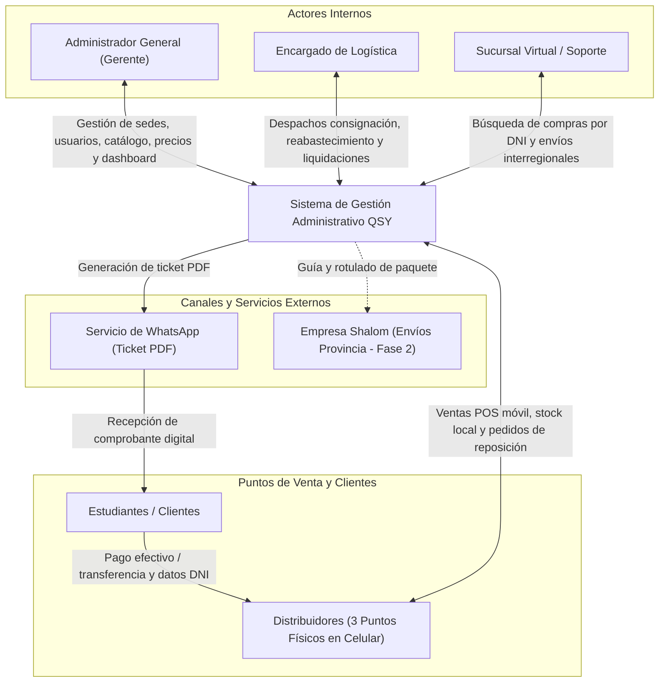

# Especificación de Requisitos del Sistema — Editorial QSY

## 1. Introducción y Diagnóstico del Negocio

### 1.1. Contexto Organizacional
La organización analizada es la editorial **QSY**, una MYPE de la ciudad de Arequipa dedicada a la publicación y venta de libros educativos y especializados en quechua (niveles Básico, Intermedio, Avanzado, Quechua Médico y Diccionarios), contando con un catálogo activo de aproximadamente 10 publicaciones.

La editorial distribuye sus libros en modalidad de **consignación** a través de 3 distribuidoras aliadas ubicadas en puntos céntricos de Arequipa, además de atender de forma complementaria pedidos interregionales mediante WhatsApp y despacho por agencias de transporte (Shalom).

### 1.2. Diagnóstico del Problema Operativo
A partir del levantamiento de información y entrevistas en profundidad con la gerencia, se determinaron los siguientes problemas críticos en la operación manual:
- **Descontrol en liquidaciones y recaudación:** Se negocia una comisión fija monetaria por cada ejemplar vendido, la cual varía según el producto. La conciliación de dinero y ventas se realiza quincenal o mensualmente y toma más de 1 hora por distribuidora, siendo el proceso que más tiempo hace perder.
- **Reabastecimiento lento y basado en recuentos físicos:** Logística calcula las ventas por diferencia (restando los libros restantes de los entregados inicialmente), lo que demanda entre 2 y 4 horas entre traslados y cuadres manuales en mostrador.
- **Emisión manual de comprobantes susceptible a errores y pérdidas:** A cada distribuidora se le entregan talonarios físicos de 100 boletas de papel. Por la alta concurrencia de estudiantes, el llenado manual demora hasta 2 minutos; muchas boletas se llenan mal, se omiten o los estudiantes las pierden, complicando severamente la atención de reclamos posteriores por fallas de imprenta.
- **Conectividad inestable en puntos de atención:** Dos de las tres distribuidoras carecen de internet fijo por cable; los vendedores operan exclusivamente desde teléfonos celulares personales, enfrentando interrupciones de datos móviles.
- **Salidas no comerciales no documentadas:** Libros otorgados a docentes, cortesías, promociones, sorteos o mermas por fallas de fábrica se retiran del inventario sin registrar motivo formal ni responsable.

### 1.3. Objetivo de la Solución
Desarrollar un **Sistema de Gestión Administrativo Modular y Responsivo (Mobile-First)** que automatice, centralice y otorgue trazabilidad a las operaciones de la editorial QSY, garantizando el registro de ventas con soporte offline, la emisión digital de tickets de venta en PDF para compartir por WhatsApp o imprimir, el cálculo automático de liquidaciones con comisiones fijas inmutables y la visibilidad en tiempo real del stock en consignación.

---

## 2. Actores del Sistema y Sistemas Externos

### 2.1. Actores Humanos
- **Administrador General (Gerente):** Posee control total sobre el sistema. Administra usuarios, locales distribuidores, catálogo de libros, precios de venta al público y comisiones fijas monetarias; visualiza dashboards consolidados de ventas y recaudación.
- **Encargado de Logística:** Responsable del almacén central, despacho de lotes en consignación a distribuidoras, ejecución de reabastecimientos asistidos, registro de salidas no comerciales (mermas/cortesías) y liquidación de dinero.
- **Distribuidor / Vendedor:** Operador en los puntos de venta físicos (1 o 2 por local). Registra ventas desde su teléfono móvil (con soporte offline), consulta su inventario asignado, emite tickets PDF y solicita reabastecimiento web.
- **Sucursal Virtual (Soporte):** Atiende consultas y reclamos de estudiantes buscando compras por DNI, y coordina pedidos de provincia en la segunda etapa.
- **Cliente / Estudiante:** Adquirente de los libros; suministra su DNI y nombres para la trazabilidad de la compra y recibe su comprobante digital.

### 2.2. Canales y Sistemas Externos
- **Servicio de Mensajería WhatsApp:** Canal directo para el envío del ticket/comprobante de venta en formato PDF y coordinación de pedidos interregionales.
- **Empresa de Transporte (Shalom):** Operador logístico externo utilizado para envíos a provincia (Fase 2).

> **Nota de Aclaración Arquitectónica sobre Comprobantes:**  
> Tras la validación directa con el cliente, **se descarta la integración con SUNAT (PSE/OSE)**. El sistema genera tickets de venta internos y comprobantes digitales en formato PDF con identificador único de operación, permitiendo además vincular opcionalmente el correlativo del talonario físico entregado por QSY.

---

## 3. Catálogo de Requisitos Funcionales (RF)

Los 18 Requisitos Funcionales del sistema mapean directamente las 18 Historias de Usuario del Producto Mínimo Viable (MVP):

| ID | Nombre del Requisito | Descripción Funcional | Prioridad |
|---|---|---|---|
| **RF-01** | Control de Acceso y RBAC | Autenticar usuarios y restringir permisos según rol (Administrador, Logística, Distribuidor). | Alta (Must) |
| **RF-02** | Gestión de Distribuidoras | Administrar el padrón de las 3 distribuidoras aliadas y asignación de personal responsable. | Alta (Must) |
| **RF-03** | Catálogo de Libros y Precios | Registrar títulos, niveles, precios fijos de venta y comisiones fijas monetarias inmutables. | Alta (Must) |
| **RF-04** | Despacho en Consignación | Registrar la entrega de lotes de libros desde el almacén central hacia las sedes distribuidoras. | Alta (Must) |
| **RF-05** | Confirmación de Recepción | Permitir al distribuidor confirmar digitalmente la recepción de libros o registrar observaciones. | Alta (Must) |
| **RF-06** | Consulta de Stock Multisede | Visualizar existencias disponibles en almacén central y saldos en consignación por sucursal. | Alta (Must) |
| **RF-07** | Salidas Especiales y Mermas | Registrar egresos sin venta (muestras docentes, cortesías, sorteos, mermas) con justificación obligatoria. | Alta (Must) |
| **RF-08** | Alertas de Stock Crítico | Emitir indicadores visuales de alerta cuando una distribuidora alcance 3 o menos unidades de un título. | Alta (Must) |
| **RF-09** | Venta Rápida en Celular | Registrar ventas en mostrador (< 2 min): validación de stock, captura de DNI/alumno y cobro. | Alta (Must) |
| **RF-10** | Modo Offline y Sincronización | Registrar ventas localmente sin internet y sincronizar por lotes al activar datos móviles. | Alta (Must) |
| **RF-11** | Comprobante / Ticket PDF | Generar comprobante digital en PDF para compartir directamente por WhatsApp o imprimir. | Alta (Must) |
| **RF-12** | Historial y Anulación Auditada | Consultar ventas del turno y anular operaciones erróneas con justificación obligatoria. | Alta (Must) |
| **RF-13** | Solicitud de Reabastecimiento | Permitir al distribuidor solicitar reposición de títulos y cantidades desde la web. | Alta (Must) |
| **RF-14** | Reabastecimiento Asistido | Proveer a Logística el consolidado de ventas antes del viaje para calcular la reposición exacta. | Alta (Must) |
| **RF-15** | Liquidación con Comisión Fija | Calcular automáticamente: Total Venta − Comisión Fija = Saldo a entregar a QSY. | Alta (Must) |
| **RF-16** | Control de Pagos y Deudas | Registrar cobros de liquidaciones y monitorear estados de cuenta pendientes por distribuidora. | Alta (Must) |
| **RF-17** | Dashboard Gerencial | Mostrar gráficos de ventas diarias/mensuales por sucursal y ranking de títulos más vendidos. | Alta (Must) |
| **RF-18** | Trazabilidad de Reclamos por DNI | Buscar transacciones históricas por DNI del estudiante para validar garantías por fallas de imprenta. | Alta (Must) |

---

## 4. Requisitos No Funcionales (RNF)

| ID | Nombre | Descripción Técnica y Criterio de Aceptación |
|---|---|---|
| **RNF-01** | **Seguridad y Aislamiento por Sede (RBAC)** | El sistema debe aislar estrictamente las consultas: ningún distribuidor puede ver ventas, stock ni reportes de otras sedes (RN-05). Contraseñas protegidas mediante hash bcrypt. |
| **RNF-02** | **Usabilidad Mobile-First** | La interfaz de venta debe estar 100% optimizada para pantallas táctiles de teléfonos inteligentes (360px a 420px), completando una venta en un máximo de 4 pasos/toques. |
| **RNF-03** | **Rendimiento Transaccional** | El tiempo de respuesta del sistema para registrar una venta o consultar existencias locales no debe exceder los 2 segundos bajo condiciones normales. |
| **RNF-04** | **Tolerancia a Red Inestable y Modo Offline** | En ausencia de conectividad, el módulo POS debe persistir transacciones en el almacenamiento local del navegador (IndexedDB) y sincronizarlas por lotes al detectar conexión móvil. |
| **RNF-05** | **Inmutabilidad y Auditoría** | Los precios y comisiones no pueden ser alterados por distribuidores. Toda anulación de venta o salida no comercial exige motivo obligatorio, usuario y marca de tiempo inalterable. |
| **RNF-06** | **Trazabilidad Histórica** | El historial cronológico de ventas, liquidaciones y despachos debe conservarse disponible durante un mínimo de 2 años para auditorías y atención de reclamos. |
| **RNF-07** | **Modularidad y Despliegue en VPS** | La arquitectura debe estructurarse en módulos desacoplados (Backend API, Frontend Mobile, Base de Datos relacional) configurados inicialmente en entorno local y listos para migrar al servidor VPS de QSY. |

---

## 5. Diagrama de Contexto del Sistema

---

## 6. Caso de Uso Principal (CU-01)

### Ficha Técnica: Registrar Venta en Mostrador y Emitir Comprobante PDF
* **Actor Principal:** Distribuidor (Vendedor en punto de venta).
* **Actores Secundarios:** Estudiante / Cliente, Servicio de WhatsApp.
* **Precondiciones:** El distribuidor tiene sesión activa en su sede; existen unidades en el stock local.
* **Flujo Normal:**
  1. El vendedor accede al módulo de venta rápida desde su teléfono celular.
  2. Ingresa el DNI y nombre del estudiante comprador.
  3. Selecciona el título del libro y nivel solicitado; el sistema carga automáticamente el precio fijo de catálogo.
  4. El sistema valida la disponibilidad física del libro en dicha sede.
  5. El vendedor confirma el medio de pago (Efectivo o Transferencia personal verificada) y pulsa "Confirmar Venta".
  6. El sistema descuenta inmediatamente la unidad del stock local y persiste la transacción.
  7. El sistema genera el comprobante digital en formato PDF con identificador único de operación.
  8. El vendedor comparte el comprobante al WhatsApp del alumno o lo envía a imprimir.
* **Flujo Alternativo (Modo Offline):**
  - Si el vendedor no tiene datos móviles activos, el sistema almacena la venta en IndexedDB localmente, descuenta el stock en pantalla y marca la venta como "Pendiente de sincronizar". Al reconectar los datos, el vendedor pulsa "Sincronizar" y las ventas suben al servidor central.
