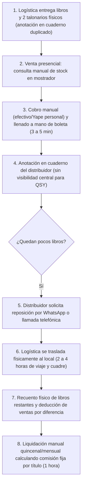
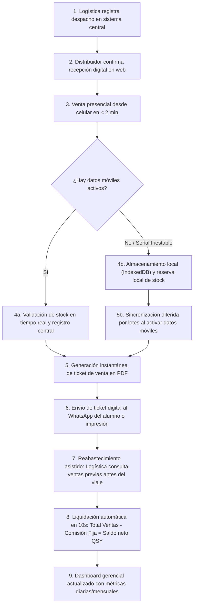

# Mapeo de Procesos de Negocio: AS-IS vs. TO-BE — Editorial QSY

## 1. Alcance Operativo

El mapeo de procesos modela el ciclo comercial central de la editorial **QSY**:
1. **Entrega de lotes en consignación:** Traslado de libros desde el almacén central a las 3 distribuidoras aliadas.
2. **Venta presencial en mostrador:** Atención rápida a estudiantes universitarios desde teléfonos celulares.
3. **Reabastecimiento de existencias:** Reposición asistida basada en el consumo real de cada punto de venta.
4. **Liquidación quincenal/mensual:** Conciliación de dinero recaudado y deducción de la comisión fija monetaria pactada por publicación.

---

## 2. Proceso Actual (AS-IS)

En la actualidad, las operaciones de QSY se gestionan mediante anotaciones manuales en cuadernos y talonarios de papel:

### Cuellos de Botella Críticos Identificados:
1. **Liquidación manual prolongada (El mayor desperdicio de tiempo):** Revisar cuadernos y calcular comisiones fijas por producto toma aproximadamente 1 hora por distribuidora.
2. **Reabastecimientos imprevistos y costosos:** La reposición empírica genera viajes no programados de hasta 4 horas (transporte y cuadre en mostrador).
3. **Deducción de ventas por diferencia física:** Al no registrar ventas en tiempo real, Logística cuenta los libros que sobran y deduce que los demás se vendieron; un error de conteo distorsiona la recaudación.
4. **Pérdida de boletas físicas:** Los estudiantes extravían los comprobantes de papel y los distribuidores a menudo omiten llenarlas por la prisa, impidiendo atender reclamos por libros defectuosos.
5. **Conectividad inestable:** Dos de las tres distribuidoras carecen de internet fijo, operando con datos móviles personales intermitentes.

---

## 3. Proceso Propuesto (TO-BE)

El proceso rediseñado sustituye los cuadernos por un repositorio centralizado accesible desde navegador web móvil con soporte para trabajo desconectado:

---

## 4. Tabla Comparativa de Tiempos y Eficiencia (AS-IS vs. TO-BE)

Los datos de la línea base corresponden a las mediciones reales reportadas por la gerencia en la entrevista:

| Actividad Operativa | Tiempo Actual (AS-IS) | Tiempo Esperado (TO-BE)* | Mejora y Eficiencia Obtenida |
|---|---|---|---|
| **Verificación de stock en sede** | 1 min | < 10 s | Consulta digital inmediata del stock local antes de confirmar la venta. |
| **Registro de venta en mostrador** | 3 a 5 min | ≈ 1.5 a 2 min | Interfaz móvil simplificada (4 toques) con captura de DNI y cálculo automático. |
| **Emisión de comprobante de venta** | 2 min | < 30 s | Generación automática de ticket PDF para compartir por WhatsApp o imprimir. |
| **Consulta de ventas por distribuidora**| 30 min | < 1 min | Datos consolidados al instante sin depender de recuentos manuales. |
| **Liquidación periódica por distribuidora**| **1 hora** | **≈ 10 segundos** | **Cálculo instantáneo:** Total Ventas − Comisiones Fijas = Saldo neto para QSY. |
| **Reabastecimiento de punto de venta** | 2 a 4 h | ≈ 1 a 2 h | Se planifica con datos reales antes de salir; solo se consume el tiempo de traslado físico. |

> \* *Nota metodológica: Las reducciones de tiempo aplican a las actividades administrativas de captura, consulta y cálculo aritmético. En actividades que involucran traslado físico entre sedes, el tiempo de transporte se mantiene.*
