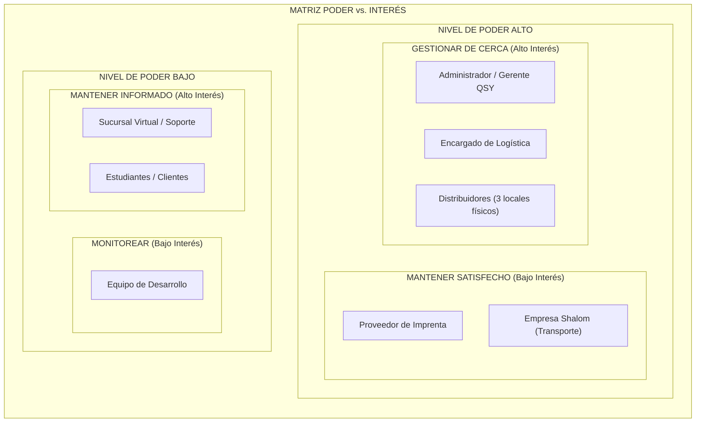

# Gestión de Interesados (Stakeholders) — Editorial QSY

## 1. Identificación y Padrón de Interesados

Se identificaron los 8 interesados reales que intervienen en el ecosistema operativo y tecnológico de la editorial QSY:

| N.° | Interesado (Stakeholder) | Tipo | Rol en el Proyecto | Interés Principal y Expectativas |
|---|---|---|---|---|
| **1** | **Administrador / Gerente QSY** | Interno | Patrocinador y Decisor Final | Acceso total, dashboard de ventas diarias/mensuales, catálogo de precios y comisiones inmutables, control de liquidaciones. |
| **2** | **Encargado de Logística** | Interno | Usuario Clave Operativo | Control del inventario central, despachos en consignación, reabastecimiento asistido y liquidación automática sin recuentos manuales. |
| **3** | **Distribuidores (3 locales)** | Externo / Aliado | Usuario Final Operativo | Venta rápida desde celular, operación sin internet (offline), consultar su propio stock asignado y pedir libros sin llamar. |
| **4** | **Sucursal Virtual (Soporte)** | Interno | Usuario Operativo | Búsqueda histórica de compras por DNI para resolver reclamos de libros defectuosos y gestión de envíos a provincia (Fase 2). |
| **5** | **Estudiantes / Clientes** | Externo | Beneficiario Final | Compra ágil en mostrador, recepción de ticket de venta PDF vía WhatsApp y atención de garantías con su DNI. |
| **6** | **Proveedor de Imprenta** | Externo | Proveedor de Producción | Recepción oportuna de pedidos de tiradas de reimpresión basadas en estadísticas de ventas. |
| **7** | **Empresa de Transporte (Shalom)** | Externo | Operador Logístico | Admisión de encomiendas interregionales correctamente rotuladas (Fase 2). |
| **8** | **Equipo de Desarrollo** | Interno | Ejecutor Técnico | Requisitos claros, alcance realista acotado a la entrevista y cumplimiento del cronograma ágil. |

---

## 2. Matriz Poder vs. Interés

### Justificación de Cuadrantes:
- **Gestionar de Cerca (Alto Poder / Alto Interés):**
  - *Administrador/Gerente:* Financia el proyecto y aprueba los entregables.
  - *Encargado de Logística:* Alimenta y concilia el inventario central y las liquidaciones.
  - *Distribuidores:* Poseen un **poder crítico de adopción**: si la aplicación móvil resulta compleja o no funciona sin internet, volverán a usar cuadernos y el software fracasará.
- **Mantener Satisfecho (Alto Poder / Bajo Interés):** La imprenta y Shalom condicionan la continuidad física de los libros; se respetan sus formatos de entrega sin involucrarlos en el diseño de software.
- **Mantener Informado (Bajo Poder / Alto Interés):** El personal de soporte y los estudiantes reciben los beneficios de la agilidad del sistema pero no deciden la arquitectura técnica.
- **Monitorear (Bajo Poder / Bajo Interés):** El equipo ejecutor opera bajo las pautas metodológicas y técnicas establecidas.

---

## 3. Estrategia de Participación y Comunicación

| Interesado | Clasificación | Expectativa Crítica | Estrategia de Mitigación y Comunicación |
|---|---|---|---|
| **Administrador** | Gestionar de Cerca | Control de recaudación, precios inmutables y dashboard en tiempo real. | Demostraciones quincenales al cierre de cada Sprint (Sprint Review) y validación de reportes. |
| **Logística** | Gestionar de Cerca | Liquidación automática en segundos y control de inventario en consignación. | Validación de prototipos del módulo de almacén y pruebas de cálculo de comisiones. |
| **Distribuidores** | Gestionar de Cerca | Venta móvil ágil (< 2 min) y soporte offline ante señal inestable. | Diseño mobile-first con botones grandes; pruebas de desconexión de red y sincronización diferida. |
| **Soporte** | Mantener Informado | Consulta rápida de ventas por DNI del estudiante para reclamos. | Capacitación en el buscador histórico y gestión de tickets de reclamo. |
| **Estudiantes** | Mantener Informado | Recepción de comprobante digital en WhatsApp y solución de garantías. | Señalética en los puntos de venta informando la entrega de ticket digital. |
