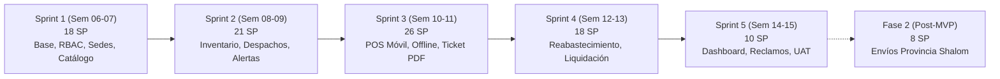

# Planificación Ágil y Estructura de Costos — Editorial QSY

## 1. Marco Metodológico y Capacidad del Equipo

El proyecto se planifica bajo el marco **Scrum**, estructurado en **5 Sprints de 2 semanas de duración** (10 semanas de desarrollo efectivo, abarcando de la **Semana 06 a la Semana 15** del semestre académico).

- **Composición del Equipo:**
  - 1 Analista de Requisitos / Scrum Master (20 horas/semana)
  - 2 Desarrolladores Full-Stack (40 horas/semana cada uno = 80 h/sem)
  - 1 QA Tester / Aseguramiento de Calidad (15 horas/semana)
- **Capacidad semanal total:** 115 horas-hombre / semana.
- **Total de horas-hombre del proyecto:** 115 h/sem × 10 semanas = **1,150 horas-hombre**.
- **Alcance planificado para el MVP:** **18 Historias de Usuario (93 Story Points)**, seleccionadas estrictamente del alcance prioritario (*Must Have*).
- **Velocidad promedio estimada:** **≈ 18 a 20 SP por Sprint**.

---

## 2. Distribución de Sprints (MVP - 93 SP)

| Sprint | Alcance Funcional / Módulos Cubiertos | Historias Asignadas | Story Points | Período |
|---|---|---|---|---|
| **Sprint 1** | **Arquitectura Base, RBAC, Sedes y Catálogo de Precios** | [[HU-01]] (8), [[HU-02]] (5), [[HU-03]] (5) | **18 SP** | Semanas 06 - 07 |
| **Sprint 2** | **Inventario Central, Despacho en Consignación y Alertas** | [[HU-04]] (5), [[HU-05]] (3), [[HU-06]] (5), [[HU-07]] (5), [[HU-08]] (3) | **21 SP** | Semanas 08 - 09 |
| **Sprint 3** | **Punto de Venta Móvil (POS), Modo Offline y Ticket PDF** | [[HU-09]] (8), [[HU-10]] (8), [[HU-11]] (5), [[HU-12]] (5) | **26 SP** | Semanas 10 - 11 |
| **Sprint 4** | **Reabastecimiento Asistido y Liquidación de Comisiones** | [[HU-13]] (3), [[HU-14]] (5), [[HU-15]] (5), [[HU-16]] (5) | **18 SP** | Semanas 12 - 13 |
| **Sprint 5** | **Dashboard Gerencial, Trazabilidad por DNI y Cierre** | [[HU-17]] (5), [[HU-18]] (5) + Pruebas UAT | **10 SP** | Semanas 14 - 15 |
| **TOTAL** | **Alcance Completo del MVP (Release 1)** | **18 Historias de Usuario** | **93 SP** | **10 semanas** |

> **Fase 2 (Post-MVP):** [[HU-19]] (8 SP) correspondiente a Envíos a Provincia vía Shalom queda planificada como evolución posterior al MVP semestral, respetando la decisión gerencial (Pregunta 84 de la entrevista).

---

## 3. Cronograma de Hitos y Entregables

| Hito | Entregable Clave | Criterio de Aceptación del Hito | Semana Límite |
|---|---|---|---|
| **Hito 1** | Plataforma base, modelo RBAC y catálogo inicial | Base de datos relacional local; autenticación JWT con roles; CRUD de distribuidoras y catálogo con precios y comisiones fijas. | **Semana 07** |
| **Hito 2** | Inventario central y transferencias en consignación | Despachos de lotes con confirmación digital de recepción; registro de mermas y alertas visuales de stock crítico. | **Semana 09** |
| **Hito 3** | Terminal POS móvil con offline y ticket PDF | Venta en celular (< 2 min); persistencia local en IndexedDB; sincronización al conectar datos; generación de ticket PDF. | **Semana 11** |
| **Hito 4** | Reabastecimiento asistido y liquidación automática | Solicitud web de reposición; cálculo instantáneo de liquidación deduciendo comisión fija monetaria por producto. | **Semana 13** |
| **Hito 5** | Dashboard gerencial, búsqueda por DNI y puesta a punto | Gráficos de ventas por día/mes; buscador histórico de compras para reclamos; pruebas de aceptación UAT con la gerencia. | **Semana 15** |

---

## 4. Presupuesto y Estructura de Costos

### 4.1. Costos Directos (Personal / Horas-Hombre)

| Rol Profesional | Dedicación Semanal | Horas Totales (10 sem) | Tarifa / Hora | Costo Total (S/) |
|---|---|---|---|---|
| **Analista de Requisitos / Scrum Master** | 20 h/sem | 200 h | S/ 35.00 | S/ 7,000.00 |
| **Desarrollador Full-Stack 1 (Backend/Datos)** | 40 h/sem | 400 h | S/ 25.00 | S/ 10,000.00 |
| **Desarrollador Full-Stack 2 (Frontend/Mobile)** | 40 h/sem | 400 h | S/ 25.00 | S/ 10,000.00 |
| **QA Tester / Aseguramiento de Calidad** | 15 h/sem | 150 h | S/ 20.00 | S/ 3,000.00 |
| **Subtotal Costos Directos (CD)** | **115 h/sem** | **1,150 h** | — | **S/ 30,000.00** |

### 4.2. Costos Indirectos e Infraestructura
* **Servidor Cloud (VPS):** Se utilizará uno de los 3 VPS existentes propiedad de la editorial QSY (S/ 0.00).
* **Dominio corporativo y SSL:** Dominio vigente del cliente y certificados gratuitos Let's Encrypt (S/ 0.00).
* **Herramientas de Colaboración:** GitHub y Docker bajo planes comunitarios (S/ 0.00).
* **Subtotal Costos Indirectos (CI):** **S/ 0.00** *(Ahorro total al descartar APIs externas de SUNAT/PSE)*.

### 4.3. Presupuesto Consolidado
- **Subtotal Operativo (CD + CI):** S/ 30,000.00
- **Reserva de Contingencia (5%):** S/ 1,500.00
- **LÍNEA BASE DE COSTOS TOTAL:** **S/ 31,500.00**
