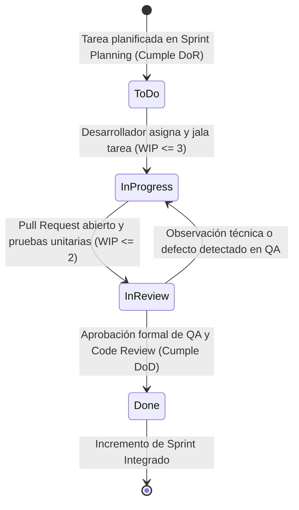
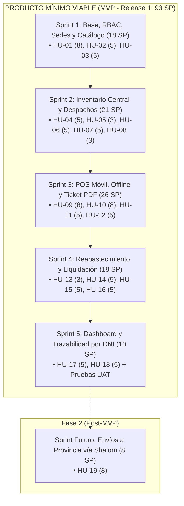

# Flujo de Trabajo Ágil y Producto Mínimo Viable (PMV) — Editorial QSY

---

## 1. Definición del Flujo de Trabajo (Workflow Kanban)

Para la ejecución operativa de las tareas técnicas dentro de cada Sprint, el equipo adopta un marco de trabajo visual basado en **Kanban**, el cual gestiona el ciclo de vida de cada tarea desde su selección hasta su entrega conforme.

### 1.1. Estados del Tablero y Columnas

El tablero se organiza en cuatro columnas secuenciales:

| Estado / Columna | Clave en YAML | Significado y Criterio de Entrada |
|---|---|---|
| **Por Hacer (To Do)** | `todo` | Tareas técnicas planificadas para el sprint que cumplen con la *Definition of Ready (DoR)*. Se encuentran ordenadas por prioridad técnica y dependencias. |
| **En Progreso (In Progress)** | `in-progress` | Tareas que un desarrollador se encuentra construyendo activamente en su rama local de trabajo. |
| **En Revisión / QA (In Review)** | `in-review` | Tareas cuya implementación terminó y cuentan con un *Pull Request (PR)* abierto. Se ejecutan pruebas de integración en entorno local y revisión de código por pares. |
| **Terminado (Done)** | `done` | Tareas finalizadas que satisfacen de forma rigurosa la *Definition of Done (DoD)* y han sido integradas a la rama principal del proyecto. |

---

### 1.2. Límites de Trabajo en Curso (WIP Limits)

Para evitar la multitarea ineficiente y prevenir cuellos de botella en la fase de revisión y pruebas, se establecen **Límites de Trabajo en Curso (*Work In Progress - WIP*)**:

* **Límite en `todo`:** Sin límite formal (contiene la totalidad de tareas comprometidas en el Sprint Backlog).
* **Límite en `in-progress` (WIP = 3):** Para un equipo de 2 desarrolladores Full-Stack, se permite un máximo de 3 tareas simultáneas en desarrollo. Esto promueve que los desarrolladores concluyan una tarea antes de abrir otra ("*Stop starting, start finishing*").
* **Límite en `in-review` (WIP = 2):** Para 1 QA Tester, se restringe a un máximo de 2 tareas en cola de revisión para asegurar que las validaciones y revisiones de código se atiendan de inmediato sin acumular deuda técnica.
* **Límite en `done`:** Sin límite acumulativo (mide el avance del sprint).

---

### 1.3. Diagrama de Transición del Flujo de Trabajo

---

### 1.4. Políticas Explícitas de Calidad

#### Definition of Ready (DoR) — Criterio para entrar a `todo`:
1. La tarea técnica está vinculada explícitamente a una Historia de Usuario padre (`historia_padre`).
2. Cuenta con estimación en horas-hombre (1 a 6 horas máximo; tareas mayores deben subdividirse).
3. Identifica claramente los archivos o componentes a intervenir (`Base de Datos`, `Backend`, `Frontend`, `QA`, `Arquitectura`).
4. Los criterios de aceptación técnicos están redactados sin ambigüedad.

#### Definition of Done (DoD) — Criterio para pasar a `done`:
1. El código compila y ejecuta sin errores ni advertencias en el entorno de desarrollo local.
2. Cumple con los criterios de aceptación técnicos y funcionales especificados.
3. Se realizaron pruebas de integración y no se introdujeron regresiones.
4. Revisión de código (Code Review) aprobada por al menos un compañero del equipo.
5. Documentación técnica y scripts de migración/seed actualizados.

---

## 2. Identificación del Producto Mínimo Viable (PMV)

### 2.1. Distinción Metodológica: Incremento de Sprint vs. PMV
* **El Incremento de Sprint:** Es el resultado técnico parcial que entrega cada sprint de forma independiente (ej. el Sprint 1 entrega la autenticación y el catálogo de libros).
* **El Producto Mínimo Viable (PMV):** Es la solución global que abarca el **Release 1 (los 5 Sprints)**. Es la versión más austera y temprana del software capaz de resolver el ciclo comercial completo de la editorial QSY y ponerse en producción en las distribuidoras.

---

### 2.2. Delimitación del Alcance del PMV (18 Historias / 93 SP)

El PMV de la editorial QSY se compone estrictamente de las siguientes **18 Historias de Usuario**:

#### Núcleo de Valor Entregado por el PMV:
1. **Seguridad y Aislamiento:** Login seguro con roles diferenciados que impide que una distribuidora vea cifras o existencias de otra sede.
2. **Control de Consignación:** Despachos centralizados de libros con confirmación digital de recepción (eliminando cuadernos duplicados).
3. **Punto de Venta Móvil Resistente:** Venta ágil (< 2 min) desde celulares personales en mostrador, operable sin internet (IndexedDB) con sincronización por lotes cuando el vendedor activa sus datos móviles.
4. **Comprobante Digital Inmediato:** Generación instantánea de tickets de venta en PDF con código único de operación para compartir por WhatsApp o imprimir.
5. **Liquidación Automática Instantánea:** Deducción matemática de la comisión fija monetaria por libro vendido, reduciendo el cuadre quincenal de 1 hora a pocos segundos.
6. **Dashboard y Garantías:** Vista gerencial en tiempo real de libros vendidos y búsqueda histórica de compras por DNI del estudiante para resolver reclamos de ejemplares defectuosos.

---

### 2.3. Exclusiones Estratégicas del PMV

Para asegurar un lanzamiento viable y no saturar el cronograma académico, se descartaron o postergaron deliberadamente las siguientes funciones:
* **Exclusión de integración con SUNAT (PSE/OSE):** Se validó en la entrevista que la empresa opera con talonarios físicos y tickets internos. Integrar facturación electrónica tributaria hubiera requerido certificados digitales, costos recurrentes de API y una conexión a internet obligatoria que colapsaría en los locales sin red fija.
* **Exclusión de serialización/barcodes por ejemplar:** El inventario se controla limpiamente por cantidad de títulos y niveles; los reclamos se validan con el DNI del comprador.
* **Exclusión de pasarelas de pago bancarias automatizadas:** Los pagos por Yape en mostrador son transferencias directas entre cliente y vendedor que se liquidan al final; el sistema registra el cobro en efectivo/transferencia sin intermediación de APIs bancarias externas.
* **Postergación de Envíos a Provincia (HU-19):** Con apenas 10 pedidos interregionales al mes, la gerencia solicitó enfocarse al 100% en las 3 distribuidoras físicas céntricas de Arequipa durante el primer lanzamiento.

---

## 3. Justificación de Viabilidad del PMV

El Producto Mínimo Viable propuesto es plenamente viable bajo cuatro dimensiones analíticas fundamentales:

### 3.1. Viabilidad Operativa
* **Eliminación del cuello de botella más grave:** Automatiza la liquidación quincenal, pasando de 1 hora de cálculos aritméticos manuales por distribuidora a una conciliación instantánea e inmutable.
* **Adaptación a las restricciones del personal:** Los vendedores atienden exclusivamente con sus propios teléfonos inteligentes; la interfaz *Mobile-First* con botones táctiles grandes permite concretar ventas en menos de 2 minutos sin fricción.
* **Resiliencia ante la falta de infraestructura:** Dos de las tres distribuidoras no pagan internet fijo; la arquitectura offline con sincronización diferida garantiza que el negocio nunca detenga sus ventas por falta de señal.

### 3.2. Viabilidad Técnica
* **Arquitectura Ligera y Modular:** Construida sobre estándares web modernos (Backend REST, Frontend SPA responsivo y Base de Datos Relacional).
* **Aprovechamiento de Recursos Existentes:** Se aprovecha uno de los **3 servidores VPS propiedad del cliente**, eliminando dependencias de servicios cloud de pago o plataformas propietarias complejas.
* **Cero dependencias de alta fricción:** Al no depender de la pasarela de SUNAT ni de APIs bancarias con tiempos de caída, la estabilidad operativa del sistema está bajo el control total del equipo.

### 3.3. Viabilidad Económica
* **Línea Base de Costos Optimizada:** Presupuesto total de **S/ 31,500.00** estructurado estrictamente en horas-hombre de desarrollo (1,150 h), con costo de infraestructura de **S/ 0.00** gracias al VPS propio de la editorial.
* **Retorno de Inversión (ROI) tangible:** El sistema elimina las mermas no justificadas, evita los viajes infructuosos de 4 horas para reabastecimientos a ciegas y erradica los conflictos contables en la recaudación de comisiones.

### 3.4. Viabilidad Temporal
* **Cronograma Ejecutable:** 10 semanas de desarrollo efectivo (5 Sprints de 2 semanas, Semanas 06 a 15) que se ajustan al calendario académico semestral.
* **Carga de Trabajo Calibrada:** La velocidad promedio de **≈ 18 a 20 SP por Sprint** (y 54 horas en el Sprint 1) coincide exactamente con la capacidad de dedicación semanal de 115 horas-hombre del equipo ejecutor.
