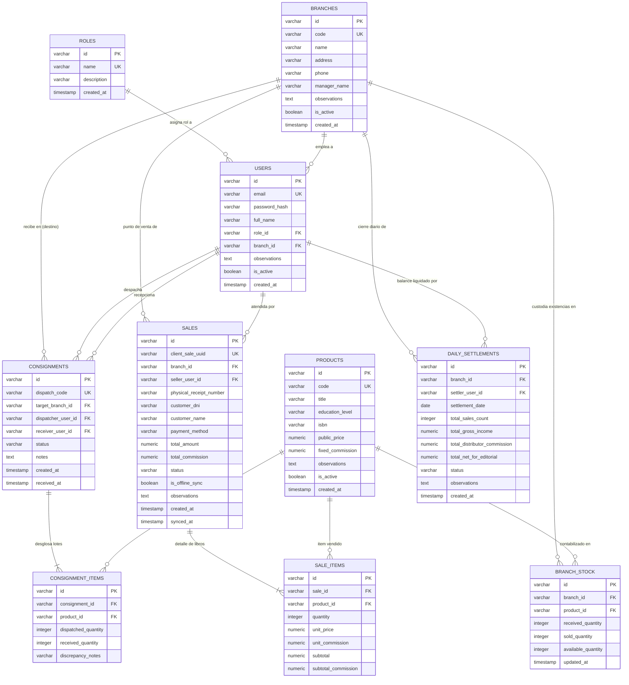

# Especificación del Modelo Relacional y Diccionario de Datos

* **Módulo:** Arquitectura de Datos / Persistencia Relacional
* **Fecha:** 2026-10-14 (Actualizado según retroalimentación de alcance)
* **Autor:** Yourdyy (Scrum Master / Arquitecto de Software)
* **Script SQL Ejecutable:** [`schema.sql`](file:///home/tooboe/Documentos/AcademicProjects/Lab_GPS/SCRUM/docs/schemes/schema.sql)
* **Compatibilidad:** PostgreSQL 14+ / SQLite 3 (ANSI SQL Estándar)

---

## 1. Diagrama Entidad-Relación (Mermaid ERD)

A continuación se presenta el modelo relacional del sistema de información para **Editorial QSY**, estructurado en Tercera Forma Normal (3FN), con sus 10 tablas, cardinalidades y claves foráneas:

---

## 2. Aclaraciones de Alcance y Lógica de Relaciones

### 2.1. Padrón Dinámico de Distribuidoras y Empleados (Cero Hardcoding)
* Históricamente la editorial ha operado con tres librerías aliadas en Arequipa (Trilce, Siglo XX y Jerusalén).
* Sin embargo, para garantizar la máxima escalabilidad y no amarrar el sistema a datos fijos que no poseemos formalmente (contratos, direcciones legales o personal de turno):
  * **La tabla `branches` inicia vacía:** El Administrador General crea y parametriza las distribuidoras desde la interfaz web (`HU-02`), pudiendo añadir nuevas sedes en cualquier momento.
  * **La tabla `users` (vendedores/personal) inicia vacía (excepto el Super-Admin inicial):** El Administrador o Logística dan de alta a los empleados, asignándoles credenciales y vinculándolos a su respectiva sede (`HU-01`).

### 2.2. Alta de Libros por el Administrador (Tabla `products` vacía por diseño)
* Los títulos de libros no vienen precreados ni estáticos en base de datos.
* La tabla `products` inicia **completamente vacía**, cumpliendo con la historia de usuario `HU-03` (*"Como Administrador, quiero dar de alta títulos de libros, fijar precios de venta y establecer la comisión fija..."*). Es el propio Administrador General quien registrará y gestionará los títulos mediante la interfaz web administrativa.

### 2.3. Naturaleza de las Comisiones y Logística Operativa de Consignación
* **¿Qué es la comisión?** Las distribuidoras son aliadas comerciales independientes (librerías terceras). La comisión es la ganancia fija en soles que la distribuidora retiene por prestar su vitrina y mostrador al vender cada ejemplar.
* **Autocálculo:** Al congelar la comisión en cada ítem de venta (`sale_items`), el balance de liquidación diario (`daily_settlements`) computa de forma automática en 10 segundos el ingreso bruto menos las comisiones retenidas.
* **Rol de Logística:** Es el encargado del almacén central que custodia los lotes provenientes de imprenta, despacha las remisiones físicas (`consignments`) y atiende las solicitudes de reposición de las sucursales.

### 2.4. Modalidad de Pago Única en Mostrador (Efectivo Regularizado)
* Las transferencias bancarias y pasarelas de pago externas están **completamente deshabilitadas** en el sistema.
* En mostrador, cuando un estudiante decide transferir por Yape/Plin, lo hace directamente al número de teléfono personal del vendedor aliado. Por ende, para la editorial, **el dinero siempre se rinde y regulariza en efectivo físico** al momento del cuadre.
* Por esta razón, el campo `payment_method` en la tabla `sales` queda fijado por defecto en `'EFECTIVO'`, y la tabla `daily_settlements` unifica la recaudación en un único flujo de caja en efectivo:
  $$\text{total\_net\_for\_editorial} = \text{total\_gross\_income} - \text{total\_distributor\_commission}$$

### 2.5. Extensibilidad y Manejo de Imprevistos (`observations`)
* Para evitar bloqueos operativos ante situaciones atípicas (descuentos especiales, ejemplares con falla de imprenta, turnos especiales de personal, horarios restringidos), las entidades maestras y transaccionales incorporan el campo de texto libre `observations` / `notes`.

---

## 3. Diccionario de Datos Exhaustivo Campo por Campo

### 3.1. Tabla: `roles`
Catálogo de perfiles para el control de acceso RBAC.

| Campo | Tipo SQL | Nulo | Restricción | Descripción y Propósito de Negocio |
|---|---|---|---|---|
| `id` | `VARCHAR(36)` | NO | PK | Identificador único del rol (ej. `'role-01'`). |
| `name` | `VARCHAR(50)` | NO | UNIQUE | Nombre del rol: `'ADMIN'`, `'LOGISTICS'`, `'DISTRIBUTOR'`. |
| `description` | `VARCHAR(255)` | NO | — | Explicación del ámbito de permisos. |
| `created_at` | `TIMESTAMP` | NO | DEFAULT NOW | Fecha y hora de creación. |

---

### 3.2. Tabla: `branches`
Padrón maestro de distribuidoras aliadas físicas (poblado dinámicamente por el Admin).

| Campo | Tipo SQL | Nulo | Restricción | Descripción y Propósito de Negocio |
|---|---|---|---|---|
| `id` | `VARCHAR(36)` | NO | PK | Identificador único de la sede (ej. `'branch-01'`). |
| `code` | `VARCHAR(20)` | NO | UNIQUE | Código de sede asignado por el admin (ej. `'SEDE-TRILCE'`, `'SEDE-SIGLOXX'`). |
| `name` | `VARCHAR(100)` | NO | — | Nombre comercial de la distribuidora aliada. |
| `address` | `VARCHAR(200)` | NO | — | Dirección física del local comercial en Arequipa. |
| `phone` | `VARCHAR(30)` | SÍ | — | Teléfono o celular de contacto de la tienda. |
| `manager_name` | `VARCHAR(100)` | SÍ | — | Nombre del distribuidor aliado titular. |
| `observations` | `TEXT` | SÍ | — | Notas u observaciones sobre el local (horarios especiales, acuerdos, etc.). |
| `is_active` | `BOOLEAN` | NO | DEFAULT TRUE | Estado operativo (permite suspender locales sin borrar historial). |
| `created_at` | `TIMESTAMP` | NO | DEFAULT NOW | Fecha de alta en el sistema. |

---

### 3.3. Tabla: `users`
Cuentas de acceso con aislamiento obligatorio por sede para vendedores.

| Campo | Tipo SQL | Nulo | Restricción | Descripción y Propósito de Negocio |
|---|---|---|---|---|
| `id` | `VARCHAR(36)` | NO | PK | Identificador único del usuario. |
| `email` | `VARCHAR(120)` | NO | UNIQUE | Correo electrónico de inicio de sesión. |
| `password_hash`| `VARCHAR(255)` | NO | — | Hash bcrypt de la contraseña. |
| `full_name` | `VARCHAR(120)` | NO | — | Nombres y apellidos completos del operador. |
| `role_id` | `VARCHAR(36)` | NO | FK $\rightarrow$ `roles.id` | Rol asignado (permisos RBAC). |
| `branch_id` | `VARCHAR(36)` | SÍ | FK $\rightarrow$ `branches.id`| Sede a la que pertenece. **Obligatoria para Distribuidores; nula para Administrador y Logística**. |
| `observations` | `TEXT` | SÍ | — | Comentarios u observaciones del colaborador. |
| `is_active` | `BOOLEAN` | NO | DEFAULT TRUE | Estado de habilitación de acceso. |
| `created_at` | `TIMESTAMP` | NO | DEFAULT NOW | Fecha de creación. |

---

### 3.4. Tabla: `products`
Catálogo de publicaciones y tarifas parametrizadas por el Administrador.

| Campo              | Tipo SQL        | Nulo | Restricción     | Descripción y Propósito de Negocio                                      |
| ------------------ | --------------- | ---- | --------------- | ----------------------------------------------------------------------- |
| `id`               | `VARCHAR(36)`   | NO   | PK              | Identificador único del libro.                                          |
| `code`             | `VARCHAR(30)`   | NO   | UNIQUE          | Código editorial asignado por el admin (ej. `'QSY-BAS-01'`).            |
| `title`            | `VARCHAR(150)`  | NO   | —               | Título del libro creado por el administrador.                           |
| `education_level`  | `VARCHAR(50)`   | NO   | —               | Nivel pedagógico (`'Básico'`, `'Intermedio'`, `'Avanzado'`).            |
| `isbn`             | `VARCHAR(30)`   | SÍ   | —               | Código ISBN (opcional).                                                 |
| `public_price`     | `NUMERIC(10,2)` | NO   | CHECK ($> 0$)   | **Precio oficial de venta al público en S/** (fijado por el admin).     |
| `fixed_commission` | `NUMERIC(10,2)` | NO   | CHECK ($\ge 0$) | **Comisión fija unitaria en S/** para el distribuidor.                  |
| `observations`     | `TEXT`          | SÍ   | —               | Comentarios editoriales (fe de erratas, material complementario, etc.). |
| `is_active`        | `BOOLEAN`       | NO   | DEFAULT TRUE    | Habilitado para despacho y venta.                                       |
| `created_at`       | `TIMESTAMP`     | NO   | DEFAULT NOW     | Fecha de registro.                                                      |

---

### 3.5. Tabla: `branch_stock`
Balance de inventario físico en tiempo real por distribuidora y título.

| Campo                | Tipo SQL      | Nulo | Restricción                    | Descripción y Propósito de Negocio                                     |
| -------------------- | ------------- | ---- | ------------------------------ | ---------------------------------------------------------------------- |
| `id`                 | `VARCHAR(36)` | NO   | PK                             | Identificador único del registro de saldo.                             |
| `branch_id`          | `VARCHAR(36)` | NO   | FK $\rightarrow$ `branches.id` | Distribuidora física aliada.                                           |
| `product_id`         | `VARCHAR(36)` | NO   | FK $\rightarrow$ `products.id` | Libro en consignación.                                                 |
| `received_quantity`  | `INTEGER`     | NO   | CHECK ($\ge 0$)                | Unidades totales recibidas desde almacén.                              |
| `sold_quantity`      | `INTEGER`     | NO   | CHECK ($\ge 0$)                | Unidades totales vendidas en mostrador.                                |
| `available_quantity` | `INTEGER`     | NO   | CHECK ($\ge 0$)                | **Saldo disponible en mostrador** ($= \text{received} - \text{sold}$). |
| `updated_at`         | `TIMESTAMP`   | NO   | DEFAULT NOW                    | Última actualización por venta o despacho.                             |

*Restricción de unicidad:* `UNIQUE (branch_id, product_id)`.

---

### 3.6. Tabla: `consignments`
Cabecera de remisión de lotes de libros en consignación hacia las sucursales.

| Campo | Tipo SQL | Nulo | Restricción | Descripción y Propósito de Negocio |
|---|---|---|---|---|
| `id` | `VARCHAR(36)` | NO | PK | Identificador del despacho. |
| `dispatch_code`| `VARCHAR(30)` | NO | UNIQUE | Código de remisión (ej. `'DESP-2026-0001'`). |
| `target_branch_id`| `VARCHAR(36)`| NO | FK $\rightarrow$ `branches.id`| Distribuidora aliada de destino. |
| `dispatcher_user_id`| `VARCHAR(36)`| NO | FK $\rightarrow$ `users.id` | Encargado de Logística que emite el lote. |
| `receiver_user_id`| `VARCHAR(36)`| SÍ | FK $\rightarrow$ `users.id` | Distribuidor que confirma la recepción física. |
| `status` | `VARCHAR(30)` | NO | DEFAULT `'PENDING'`| Estado: `'PENDING'`, `'RECEIVED'`, `'OBSERVED'`. |
| `notes` | `TEXT` | SÍ | — | Notas de empaque o traslado. |
| `created_at` | `TIMESTAMP` | NO | DEFAULT NOW | Fecha de envío. |
| `received_at` | `TIMESTAMP` | SÍ | — | Fecha de conformidad en tienda. |

---

### 3.7. Tabla: `consignment_items`
Partidas de libros comprendidas en cada despacho.

| Campo | Tipo SQL | Nulo | Restricción | Descripción y Propósito de Negocio |
|---|---|---|---|---|
| `id` | `VARCHAR(36)` | NO | PK | Identificador de la partida. |
| `consignment_id`| `VARCHAR(36)`| NO | FK $\rightarrow$ `consignments.id`| Despacho asociado. |
| `product_id` | `VARCHAR(36)` | NO | FK $\rightarrow$ `products.id`| Título de libro despachado. |
| `dispatched_quantity`| `INTEGER` | NO | CHECK ($> 0$) | Cantidad enviada por Logística. |
| `received_quantity`| `INTEGER` | SÍ | CHECK ($\ge 0$) | Cantidad contada y recibida por el distribuidor. |
| `discrepancy_notes`| `VARCHAR(255)`| SÍ | — | Detalle de faltantes o discrepancias. |

---

### 3.8. Tabla: `sales`
Registro de ventas presenciales en ventanilla (efectivo regularizado).

| Campo | Tipo SQL | Nulo | Restricción | Descripción y Propósito de Negocio |
|---|---|---|---|---|
| `id` | `VARCHAR(36)` | NO | PK | Identificador de la venta. |
| `client_sale_uuid`| `VARCHAR(36)`| NO | UNIQUE | **UUID generado en el navegador cliente** (idempotencia en sincronización offline). |
| `branch_id` | `VARCHAR(36)` | NO | FK $\rightarrow$ `branches.id`| Local donde se realizó la venta. |
| `seller_user_id`| `VARCHAR(36)` | NO | FK $\rightarrow$ `users.id` | Distribuidor que atendió la transacción. |
| `physical_receipt_number`| `VARCHAR(50)`| SÍ | — | N° de boleta física manual (si la pide el alumno). |
| `customer_dni` | `VARCHAR(15)` | NO | — | **DNI del alumno** (clave para validar garantías y recursos virtuales). |
| `customer_name`| `VARCHAR(120)`| NO | — | Nombre del estudiante comprador. |
| `payment_method`| `VARCHAR(30)` | NO | DEFAULT `'EFECTIVO'`| Modalidad de cobro regularizada en mostrador. |
| `total_amount` | `NUMERIC(10,2)`| NO | CHECK ($> 0$) | Total cobrado al alumno en S/. |
| `total_commission`| `NUMERIC(10,2)`| NO | CHECK ($\ge 0$)| Comisión monetaria fija devengada para el distribuidor. |
| `status` | `VARCHAR(30)` | NO | DEFAULT `'CONFIRMED'`| Estado (`'CONFIRMED'`, `'ANNULLED'`). |
| `is_offline_sync`| `BOOLEAN` | NO | DEFAULT FALSE | Marca de origen offline (IndexedDB). |
| `observations` | `TEXT` | SÍ | — | Notas u observaciones sobre la venta o reclamos de mostrador. |
| `created_at` | `TIMESTAMP` | NO | DEFAULT NOW | Fecha y hora en el dispositivo vendedor. |
| `synced_at` | `TIMESTAMP` | SÍ | — | Fecha y hora de impacto en el servidor central. |

---

### 3.9. Tabla: `sale_items`
Líneas de venta con precio y comisión unitaria congelados en la transacción.

| Campo | Tipo SQL | Nulo | Restricción | Descripción y Propósito de Negocio |
|---|---|---|---|---|
| `id` | `VARCHAR(36)` | NO | PK | Identificador de partida. |
| `sale_id` | `VARCHAR(36)` | NO | FK $\rightarrow$ `sales.id` | Venta asociada. |
| `product_id` | `VARCHAR(36)` | NO | FK $\rightarrow$ `products.id`| Título vendido. |
| `quantity` | `INTEGER` | NO | CHECK ($> 0$) | Ejemplares vendidos. |
| `unit_price` | `NUMERIC(10,2)`| NO | CHECK ($> 0$) | Precio unitario congelado. |
| `unit_commission`| `NUMERIC(10,2)`| NO | CHECK ($\ge 0$)| Comisión unitaria congelada. |
| `subtotal` | `NUMERIC(10,2)`| NO | CHECK ($> 0$) | Total bruto ($= \text{quantity} \times \text{unit\_price}$). |
| `subtotal_commission`| `NUMERIC(10,2)`| NO | CHECK ($\ge 0$)| Comisión total ($= \text{quantity} \times \text{unit\_commission}$). |

---

### 3.10. Tabla: `daily_settlements`
Balances diarios automáticos de rendición de cuentas por distribuidora.

| Campo | Tipo SQL | Nulo | Restricción | Descripción y Propósito de Negocio |
|---|---|---|---|---|
| `id` | `VARCHAR(36)` | NO | PK | Identificador del arqueo. |
| `branch_id` | `VARCHAR(36)` | NO | FK $\rightarrow$ `branches.id`| Distribuidora que liquida. |
| `settler_user_id`| `VARCHAR(36)`| NO | FK $\rightarrow$ `users.id` | Distribuidor responsable. |
| `settlement_date`| `DATE` | NO | — | Fecha contable del cierre. |
| `total_sales_count`| `INTEGER` | NO | DEFAULT 0 | Cantidad de ventas realizadas en el día. |
| `total_gross_income`| `NUMERIC(10,2)`| NO | DEFAULT 0 | Ingreso bruto total en ventanilla (S/). |
| `total_distributor_commission`| `NUMERIC(10,2)`| NO | DEFAULT 0 | Comisión fija total que retiene el distribuidor. |
| `total_net_for_editorial`| `NUMERIC(10,2)`| NO | DEFAULT 0 | **Efectivo neto a rendir a QSY** ($= \text{gross} - \text{commission}$). |
| `status` | `VARCHAR(30)` | NO | DEFAULT `'SUBMITTED'`| Estado: `'SUBMITTED'`, `'VERIFIED_BY_ADMIN'`. |
| `observations` | `TEXT` | SÍ | — | Notas explicativas de la jornada. |
| `created_at` | `TIMESTAMP` | NO | DEFAULT NOW | Fecha y hora de generación del balance. |

*Restricción de unicidad:* `UNIQUE (branch_id, settlement_date)`.
